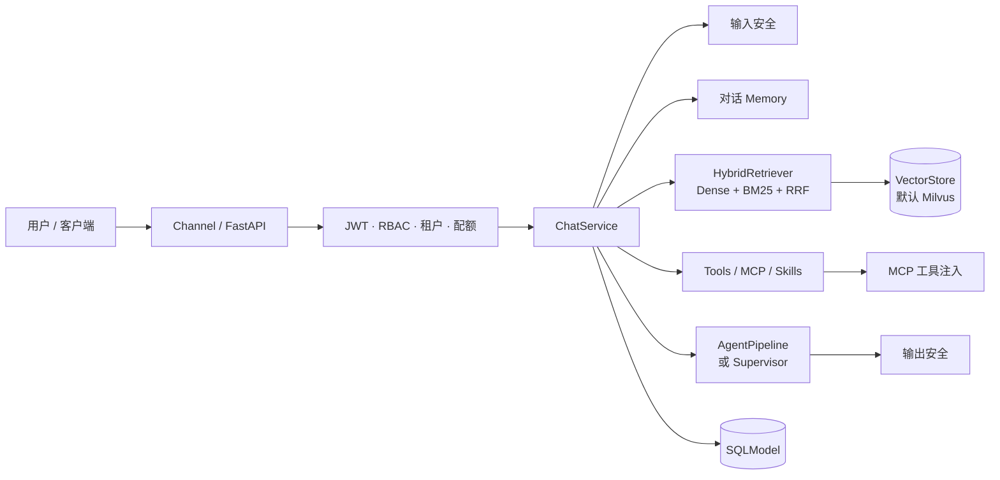

# ai-assistant

[](LICENSE)
[](CONTRIBUTING.md)
[](.github/workflows/ci.yml)
[](https://www.python.org)
[](docker-compose.yml)

> **ai-assistant** 是面向企业的自托管 AI 助手平台：RAG 检索增强生成 + 五阶段 Agent 编排 + MCP 连接私有知识库与受控企业能力。
>
> 本页的首要读者是**评估这个仓库的人**，因此每条能力都带状态标签与证据入口，未验证的部分直接写未验证，不用「功能齐全」代替事实。

目录：[30 秒概览](#30-秒概览) · [能力边界](#能力边界as-is--target) · [三个带代价的设计决策](#三个带代价的设计决策) · [一条消息的旅程](#一条消息的旅程) · [快速开始](#快速开始) · [架构](#架构) · [API](#api-端点) · [配置](#配置速览) · [已知失败](#已知失败与评测基线) · [文档地图](#文档地图)

## 30 秒概览

后端 FastAPI + SQLModel + Pydantic v2，前端 React + TypeScript + Vite 控制台；数据面 SQLite（开发）/ PostgreSQL 16（生产），向量面 Milvus（默认）或显式 `local`（离线评测与隔离测试）。版本号以 [`pyproject.toml`](pyproject.toml) 与 [`frontend/package.json`](frontend/package.json) 为准，本页不维护快照。

工程规模（以下每条命令都能在仓库根目录复现）：

| 指标 | 数值 | 复现命令 |
|---|---|---|
| 后端 Python 行数 | 47,085 | `find app -name '*.py' -print0 \| xargs -0 cat \| wc -l` |
| 测试文件 / 测试函数 | 262 / 2,444 | `find tests -name 'test_*.py' \| wc -l`、`grep -rh 'def test_' tests \| wc -l` |
| 前端 TS/TSX 行数 | 14,659 | `find frontend/src \( -name '*.ts' -o -name '*.tsx' \) \| xargs cat \| wc -l` |
| 业务 API 路径 | 100（`develop` 导出快照，随功能增长） | `python -c "import json;print(len(json.load(open('docs/swagger.json',encoding='utf-8'))['paths']))"` |
| 架构决策记录 | 26 份 ADR | `ls docs/adr/*.md \| wc -l` |

平台当前能做的事，一句话一条，状态见[能力边界](#能力边界as-is--target)：

- 上传文档 → 结构保护切分 → 带索引身份的向量检索（Dense + BM25 + RRF）→ 附来源文本的回答；
- 五阶段推理管线（理解 → 规划 → 行动 → 反思 → 响应），行动阶段用原生函数调用提议工具、客户端校验后归一为内部执行信封；
- SSE 流式输出与断线回放、同一次执行续跑、显式取消；
- MCP 工具动态注入 Agent 工具箱，Agent 不直连业务数据库；
- JWT 双令牌 + RBAC + 多租户隔离、租户配额与限流、审计与运行历史、版本化评测平台。

## 能力边界（As-Is / TARGET）

状态术语：`Implemented` 有实现+测试+运行证据；`Partial` 链路存在但闭环未验收；`Planned` 已批准未实现；`Deferred` 明确后置。**Mock 与合成样本只能证明链路，不能证明真实检索或生成质量。** 全表见 [`docs/product/as-is-capability-matrix.md`](docs/product/as-is-capability-matrix.md)。

| 能力 | 当前 | 已实现到 | 目标边界 | 证据 |
|---|---|---|---|---|
| Agent 编排 | `Partial` | `ChatService` + 自研 `AgentPipeline`，已接独立 Tool Executor 与 State Manager | 独立 Harness / Context / 预算 / 恢复 | [`app/agents/pipeline.py`](app/agents/pipeline.py)、ADR-0010 |
| RAG 检索 | `Implemented` | 多格式摄取、结构保护切分、Dense + BM25 + RRF | 资源级 ACL `Planned`；结构化 Citation `Partial` | [`app/rag/retriever.py`](app/rag/retriever.py)、`tests/test_rag.py` |
| 向量库 | `Partial` | 默认 `milvus`（2026-10-21 起），显式 `local` 仅离线评测 | 真实服务闭环与生产验收未做 | `app/core/config.py`、ADR-0002、ADR-0019 |
| 多租户与权限 | `Partial` | JWT 双令牌、五级角色、租户切换与邀请码、配额与限流 | 整份权限矩阵、资源级 ACL | ADR-0001、`tests/test_quota.py` |
| 工具与 MCP | `Partial` | 工具与 MCP 可注入，经执行器与风险分级 | 完整 Tool Contract、跨进程治理 | [`app/agents/tools/`](app/agents/tools/) |
| 评测 | `Partial` | rag-v0.1 检索基线冻结、Agent 官方基线门禁 | 生成层真实质量、离线 Skill/Safety 评测 | `docs/evaluations/`、ADR-0023 |
| HITL 审批 | `Deferred` | — | MCP 完整执行闭环前引入 | 治理规范 §3 |

## 三个带代价的设计决策

这一节是我认为最值得追问的地方：每条都写清「为什么不用更简单的做法」和「我为此付了什么」。

### 1. 向量索引绑定身份，宁可检索不到也不混用

向量按 `provider / deployment / model / dim / index_version / normalization / metric` 七元组判定是否同一套索引。**同维度不同模型的向量不可比**，所以升级到该版本后，身份未知的历史分块默认不参与检索，检索会明确返回 `unavailable`，而不是返回空结果冒充「知识库里没有」。

代价是真实的：升级后必须先登记或重建才能恢复老知识库。登记（`adopt`）要求举证原模型与目标索引一致并抽样校验维度，任一条不符整体拒绝；举证不能才走 `rebuild`，重建期间旧索引继续服务，回退时校验当前模型配置与目标索引完全一致。工具：`python scripts/rebuild_embedding_index.py status|adopt|rebuild|activate|rollback`，设计见 [`docs/rag/索引身份与切换.md`](docs/rag/索引身份与切换.md) 与 ADR-0008。

### 2. 检索用总 deadline，而不是逐次 timeout

一次检索由「嵌入 + 向量检索」两个外部调用串成。改造前各拿一个 60 秒超时，最坏能拖 120 秒且 429/5xx 不重试。现在两个子调用装进**同一个总时限**：子调用按剩余预算夹自己的超时，预算用完就拒绝发起下一个；只有连接错误 / 读超时 / 429 / 5xx 才重试，退避 `base * 2**(n-1)` 夹到上限再叠 ±20% 抖动，**退避前先检查剩余预算**，不够就直接放弃——否则「耗时有界」名存实亡。

三条边界必须说清：总时限的粒度是「一次检索」而不是「一次用户请求」（一请求 N 次检索按 `N × deadline` 累加，需调用方显式包一层）；写入/导入路径不复用检索预算，每批各拿 `RAG_EMBED_BATCH_DEADLINE_SECONDS`；`asyncio.CancelledError` 原样上抛不写成「检索不可用」。pymilvus 是同步客户端，超时只能让**协程放弃等待**，中断不了线程里的底层调用——所以「有界」指调用方不再等，不是服务端被取消，运维上仍需 Milvus 侧超时兜底。配置项 `RAG_RETRIEVAL_*`，设计见 `docs/plans/implementation_rag_038_retrieval_deadline.md`，失败语义见 [`docs/rag/检索状态与拒答契约.md`](docs/rag/检索状态与拒答契约.md)。

### 3. 模型能力未登记就拒绝发送，不替运营者猜窗口

每次真实调用前核对一条不等式：`实际 payload + 输出预留 + 余量 ≤ 已登记的上下文窗口`。payload 用**本次真正要发的 messages** 现算，所以工具返回、自纠错轮次、历史和系统提示天然计入。

内置表只登记核对过厂商公开依据的条目（2026-10-07 实取）：

| 部署 | 模型 | 上下文窗口 | 最大输出 |
|---|---|---|---|
| `api.openai.com` | `gpt-4o-mini` | 128000 | 16384 |
| `api.deepseek.com` | `deepseek-flash` | 1000000 | 384000 |
| `api.deepseek.com` | `deepseek-v4-pro` | 1000000 | 384000 |

部署参与身份判定：同一个模型名跑在自建网关上，不等于厂商官方接口，窗口不能跟着名字被借走。**仓库默认模型名 `deepseek-chat` 刻意没有登记**——各来源给的窗口数字互相矛盾，与其猜一个上限，不如要求运营者用 `LLM_CAPABILITY_DECLARED` + `LLM_CAPABILITY_DECLARED_SOURCE` 成对声明，缺一即视为未批准。护栏默认开启，未声明时所有真实调用被拒绝。

计数方法也不伪装精度：只在 OpenAI 官方域名下认 `tiktoken`，其余退回经校准的保守估算（UTF-8 字节 + 每条消息框架开销，一个汉字 3 字节 ≥ 1 token，因此偏保守）；计不出来就拒绝发送而不是按 0 计。已知残余低估：远程 `image_url` 只计 URL 本身。云 OCR 送 base64 图片是全系统最大的单次 payload，走同一条不等式。设计见 ADR-0005。

## 一条消息的旅程



流式连接的事件序列：`run.started` → `node.started/finished` → `intent.classified` → `plan.generated` → `tool.call/result` → `token` → `citations` → `run.finished`，无输出 15 秒时发 `heartbeat`。所有事件顶层带 `run_id`，帧号是 `<run_id>:<序号>`。

值得追问的三个语义：**HTTP 断开只结束订阅，运行继续**，重连只对 `/runs/{run_id}/events` 带 `Last-Event-ID` 回放，不重发用户消息；主动停止必须调 cancel 并等服务端确认；`resume_message_id` 续跑只支持当前用户本人的自研管线活动执行，复用原消息、不重复扣配额，工具副作用与快照提交之间的断电窗口不提供 exactly-once。回放限于单进程（每运行至多 1000 事件 / 8 MiB，终态保留 15 分钟），这不代表跨实例或持久化队列。契约见 ADR-0010、ADR-0012。

## 快速开始

第一次使用按五步走。开发模式控制台在 `http://localhost:5173`，后端 `http://127.0.0.1:8000`（前端开发服务默认把 `/api` 代理到 8000，见 `frontend/vite.config.ts`）。

```bash
git clone https://github.com/lwmjava/ai-assistant.git
cd ai-assistant
python -m venv .venv
source .venv/bin/activate        # Windows: .venv\Scripts\activate
pip install -r requirements.txt
python -m app.cli init           # 生成随机 JWT_SECRET_KEY，不打印密钥、不建库、不覆盖已有 .env
```

填 `LLM_API_KEY` 才会调用真实模型；主密钥与兜底密钥都为空时，开发环境降为 Mock，**这只说明对话链路通了，不说明检索或生成质量**。要让历史知识库可检索，还须配置真实 `EMBEDDING_*`。可选：同时填 `INITIAL_ADMIN_USERNAME` 与 `INITIAL_ADMIN_PASSWORD` 可在启动时引导首个系统管理员与 `default` 租户；任一项为空则改由 `/setup` 页面创建。口令只走环境变量或秘密管理，不进命令参数、日志或仓库。

```bash
uvicorn app.main:app --reload    # 后端
cd frontend && npm install && npm run dev   # 另开终端，控制台
```

想单进程托管：先在 `frontend/` 执行 `npm run build`，再把 `SERVE_FRONTEND=true` 写进 `.env`，只启动 `uvicorn`，`http://127.0.0.1:8000` 即为控制台。

建立管理员后到 `/register` 注册（成为 `default` 租户的 member）或 `/login` 登录，初始化创建的账号首次登录会先进入 `/change-password`，完成改密前服务端拒绝业务请求。然后在 `/chat` 发一句话，能看到助手回复就说明整条旅程走通。

排查入口：`http://127.0.0.1:8000/api/v1/health` 应返回 `status: ok`；打不开 5173 先确认命令是在 `frontend/` 里执行的；接口 404 或跨域失败先确认代理目标端口。非 development 环境若 `JWT_SECRET_KEY` 为空白或仍是默认值，应用会在建表和账号引导前拒绝启动。

### Docker 一键部署

复制 `.env.example` 为 `.env`，填入随机 `POSTGRES_PASSWORD`、随机 `JWT_SECRET_KEY`、一个 `LLM_API_KEY` 和实际的 `CORS_ORIGINS`——这四项缺失时 `docker compose config` 拒绝展开，编排不回退固定数据库口令或通配来源。

```bash
docker compose up -d --build     # 服务默认监听 http://localhost:8000
```

编排含 PostgreSQL 与开发用 Milvus（宿主机端口 19530 / 9091，可用 `MILVUS_PORT`、`MILVUS_HEALTH_PORT` 覆盖，这两个变量不属于应用配置）。

生产部署改用 `docker-compose.prod.yml`，四条命令都必须显式指定项目名与环境文件：`ai-assistant start|status|logs|stop --project-name <名字> --env-file <配置>`。`start` 等待容器运行或健康、重复执行复用同一项目；`stop` 只停容器并保留数据卷，给容器 30 秒退出；超时返回 124、中断返回 130 且容器侧操作可能继续，须用同样的项目与配置执行 `status` 复查，不能假定已回滚。失败时不回显底层输出以防插值后的凭据泄露；状态与日志会遮蔽已知敏感值及含凭据标记的整行，但这不能替代应用端日志脱敏。语义见 `docs/plans/implementation_cli_003_20261017.md` 与 [`docs/workflows/production-compose.md`](docs/workflows/production-compose.md)。

## 架构

文档必须同时保留 **As-Is（当前实现）** 与 **TARGET（最终形态）**：目标图不能替代当前事实。权威文字稿见 [`docs/product/项目产品需求方案.md`](docs/product/项目产品需求方案.md) §3.1，可视化见 [`docs/architecture/target-agent-harness-architecture.html`](docs/architecture/target-agent-harness-architecture.html)。

上面「一条消息的旅程」的图是 As-Is。默认配置事实：`AGENT_ORCHESTRATION=self`、`RAG_BACKEND=native`、`RAG_VECTOR_STORE=milvus`、`RAG_ENABLED=true`、`SECURITY_BLOCK_ON_INJECTION=false`（检测到注入默认仅告警）。Checkpoint 持久化与同消息续跑是 `Partial`（单实例、SQLite 隔离证据，未完成生产验收），Trace 以内存环形缓冲为主。

LangGraph Supervisor 不在默认安装里：`pip install -e ".[langgraph]"` 后把 `AGENT_ORCHESTRATION` 设为 `langgraph`，只有明确要求多轮调研的问题才进入 Supervisor；没装该包时多轮请求回退五阶段管线。

TARGET 的依赖方向是 `Channel/API → Harness → Runtime → Skill → Tool Executor → Service/Adapter → Repository → 数据与外部系统`：Harness 只负责编排（Context、Runtime、State、预算、Guard、HITL），Code Sandbox 在能力层由 Tool Guard 调用、代码动作不得在宿主进程执行，Evaluation 是消费 Trace 的离线横切能力、不阻塞在线请求。目标架构图与时序图见上面的 HTML 与 [`docs/governance/agent-harness-engineering.md`](docs/governance/agent-harness-engineering.md)。

**向量库有三个不同的概念，别混**：`RAG_VECTOR_STORE=local` 是 SQLite + numpy 的实现，只用于显式离线评测和隔离测试；`milvus` 是默认值，连接失败不会自动退回 `local`；Milvus Lite 是**开发环境下、仅当本机地址的 Standalone 启动时不可达**才启用的运行时文件兜底（`MILVUS_LITE_FALLBACK=true`，生产与远程地址一律不兜底，选定后不自动切回）。Lite 选择失败时普通 API 仍启动，健康检查返回 503 并标记 `runtime=unavailable`，检索与摄取明确失败。判定条件见 `app/rag/vectorstore/runtime.py`，决策记录见 ADR-0019。

## API 端点

业务接口统一使用 `/api/v1`，旧 `/api` 不提供别名或重定向；`/docs` 与 `/redoc` 是接口文档入口。完整清单见 [`docs/swagger.json`](docs/swagger.json)（`develop` 当前导出 100 个业务路径），或启动后访问 `http://127.0.0.1:8000/docs`。下表只列主链，不是全集。

| 模块 | 方法 | 路径 | 说明 |
|---|---|---|---|
| 系统 | `GET` | `/api/v1/health` | 数据库与向量库连通性，以及 Embedding 配置身份 |
| 认证 | `POST` | `/api/v1/auth/login` · `/auth/refresh` · `/auth/setup` | 双令牌登录、refresh 轮转、无管理员时引导首个系统管理员 |
| 对话 | `POST` | `/api/v1/chat` | 非流式，响应含 `message_id`、`sources`、`code_results`，可带 `resume_message_id` |
| 对话 | `POST` | `/api/v1/chat/stream` | SSE 流式，支持附件与同消息续跑 |
| 运行 | `GET` | `/api/v1/runs/{run_id}` | 查询本人运行的状态、绑定消息与最终回复；`/events` 携带 Last-Event-ID 回放增量事件 |
| 运行 | `POST` | `/api/v1/runs/{run_id}/cancel` | 显式取消本人运行，返回确认后的状态 |
| 知识库 | `POST` | `/api/v1/rag/documents/ingest` · `/upload` | 文本摄取与文件上传（默认单文件 10MB，扫描版 PDF 可配合 OCR） |
| 知识库 | `POST` | `/api/v1/rag/search` | 混合检索，响应含 `chunk_id`、`parent_id`、`retrieval_origin` 等父子块关系 |
| 管理 | `GET` | `/api/v1/admin/users` | 系统管理员分页列出用户；`/admin/tenants` 与 `/admin/audit-logs` 同样为 `GET`，租户与角色改动用 `PATCH` |
| 工作流 | `GET` | `/api/v1/workflows/alerts` | 创建者失效告警；同租户可见，系统管理员可跨租户查看（`WORKFLOW_ENABLED` 关闭时不注册该路由） |

错误契约：失败响应统一 `{ "error": { "code", "message", "retry_after", "request_id } }`，`request_id` 与响应头 `X-Request-ID` 相同。八个稳定 code 覆盖 `session_expired`、`token_revoked`、`user_disabled`、`tenant_suspended`、`rate_limited`、`quota_exceeded`、`model_unavailable`、`file_too_large`，前端按 code 而非文案分支。访问令牌过期若刷新成功则原请求继续；错误密码仍是普通登录失败，不返回 `user_disabled`。契约见 `docs/plans/implementation_err_001_20261016.md`。

## 配置速览

`.env.example` 逐项标注「选填」或「条件必填」，是配置的唯一权威清单；源码默认值以 `app/core/config.py` 为准。下表只列影响主链行为的键。

| 环境变量 | 说明 | 默认值 |
|---|---|---|
| `ENV` | `development` / `production`，非 development 会强校验密钥 | `development` |
| `DATABASE_URL` | 数据库连接串 | `sqlite:///./data/ai_assistant.db` |
| `JWT_SECRET_KEY` | JWT 签名密钥，生产必须改为随机值 | 占位值 |
| `LLM_API_KEY` | 主密钥与兜底密钥都为空时开发环境降为 Mock | — |
| `LLM_BASE_URL` / `LLM_DEFAULT_MODEL` | OpenAI 兼容接口与模型名 | `https://api.deepseek.com/v1` · `deepseek-chat` |
| `LLM_FALLBACK_API_KEY` / `LLM_INTENT_*` | 兜底与意图分流可各接一家；失败按 `LLM_*_FALLBACK_CHAIN` 顺序换档 | — · `chat,fallback` |
| `LLM_CAPABILITY_GUARD_ENABLED` | 模型能力预算护栏 | `true` |
| `LLM_CAPABILITY_DECLARED` / `_SOURCE` | 未登记模型的窗口声明，按「部署!模型」生效，二者缺一即拒绝 | — |
| `EMBEDDING_PROVIDER` / `EMBEDDING_INDEX_VERSION` | 嵌入服务与索引版本，换模型须递增并重建索引 | `openai` · `1` |
| `RAG_ENABLED` | 是否把检索上下文注入对话 | `true` |
| `RAG_VECTOR_STORE` | `milvus` / `local`，见架构一节 | `milvus` |
| `RAG_CHUNK_STRATEGY` | `structured`（默认）· `paragraph` · `sliding_window` · `token_aware` · `semantic` · `parent_child` · `auto` | `structured` |
| `RAG_RETRIEVAL_DEADLINE_SECONDS` | 一次检索的总时限，`0` 关闭 | `8.0` |
| `MCP_ENABLED` / `WORKFLOW_ENABLED` | MCP 客户端与工作流引擎开关 | `false` · `false` |
| `RETRIEVAL_CACHE_ENABLED` / `LLM_RESPONSE_CACHE_ENABLED` | 两种进程内缓存，默认关闭 | `false` |
| `SECURITY_RATE_LIMIT` | 对话限流开关，打开后才计数 | `false` |
| `SERVE_FRONTEND` | 单进程托管 `frontend/dist` | `false` |
| `CORS_ORIGINS` | 前后端分离部署时必填 | `*` |

补充三点，细节在链接里而不是本页：**缓存**（绑定认证主体、读范围、内容生效状态与索引身份，命中前仍读最新授权；只在本进程、不持久化、不跨实例协调，不能当作 Redis 或多实例一致性验收，见 `docs/plans/implementation_rag_019_cache_20261011.md`）；**对话附件**（每文件至多 1 MiB，允许图片、办公文档与源码扩展名，整批校验后才保存用户消息，历史接口只返回名称与字节数；图片走 `detail=low`，只有已核对的官方 `gpt-4o-mini` 登记了视觉计数，其他模型在发送前拒绝，见 `docs/plans/implementation_chat_007_20261016.md`）；**技能与权限**（每次对话至多选一条有权技能，绑定不授予工具权限，停用或变版后不继续消费旧内容，见 `docs/governance/agent-harness-engineering.md` 与 `docs/agents/skill-version-spec-v1.md`）。

对话限流用本进程内存令牌桶（默认每秒补充 60、容量 60），计数只在本进程有效，重启即清空；跨实例限流一致性尚未实现，多进程部署时每个进程各计各的，因此完成 `OPS-001` 之前不要水平扩展 API 进程（矩阵第 1 节标 `Partial`）。

## 已知失败与评测基线

这一段是本页最值得读的部分之一，因为它说明我知道自己的缺口在哪。

**rag-v0.1 检索基线已冻结**（`docs/evaluations/rag-v0.1-baseline-report.md`，运行于 2026-09-19）：数据集 `rag-eval@0.1.0` 共 44 条（Gold 24 条），在合成语料 `corpus-0.1.0`（13 篇 / 37 块）、真实 `text-embedding-v3` 嵌入、**Local VectorStore** 与默认 `structured` 切分下，35 条可排序案例的结果是 Recall@1 0.795、MRR 0.929、nDCG@10 0.942，证据原文覆盖 45/49 = 0.918。报告自己写明了有效性边界：语料规模极小使排序指标偏高（第 6 节）。基线不设发布阈值，也不因默认向量库改为 Milvus 而自动适用——那两个数字不属于同一测量环境。

**同一份报告里存在确定性安全失败，尚未关闭**：16 条设有禁止文档的案例中 3 条检出禁止文档，违规率 0.1875。这不是波动，而是三处能力缺口——资源级 ACL（`Planned`）、受众隔离、生效日期感知（Flag 默认关）——均已定位到代码位置。引用、索引身份、生成预算与结构化 Citation 也仍是 `Partial`/`Planned`。

其它明确未做的能力：工作流调度的跨进程取消与跨重启 exactly-once、MCP 的 HITL 审批闭环、独立 Agent Harness 的提取、真实 LLM 生成层评测。`/evaluations` 平台的生成质量与 Judge 默认关闭，价格或模型能力未登记时拒绝创建任务，不降级为 Mock；质量任务须确认数据为合成或已脱敏并允许外发，且有请求与费用上限（详见 ADR-0023 与 `docs/plans/implementation_eval_003.md`）。

## 运维要点

**备份与恢复**。默认数据库是仓库内 SQLite 文件，备份前先停掉使用它的进程。不要只拷主文件：用标准库 `sqlite3.Connection.backup` 把已提交内容写入另一个文件，源文件旁的 `-wal` / `-shm` 由这次 `backup` 收进目标文件，不单独拷走未合并的日志。恢复时把目标文件设为 `DATABASE_URL` 再启动，确认 `GET /api/v1/health` 为 `ok` 且 `alembic_version` 与源文件一致。备份文件与数据库同样敏感，不进仓库、不进日志。三个必须记住的例外：知识源文件在 `data/knowledge` 不在这个 SQLite 里；`RAG_VECTOR_STORE=local` 时向量在同一个 SQLite 里，改用 Milvus 后向量不在这个文件里，只恢复 SQLite 不会带回 Milvus 数据；自动备份脚本、PostgreSQL 与上传目录的备份本页不提供。完整流程见 `docs/plans/implementation_rel_002.md`。

**扫描版 PDF OCR**。`RAG_OCR_ENABLED=true` 且 PDF 无文本层时才走 OCR，provider 为 `tesseract`（需服务器装 tesseract 与 `chi_sim`/`eng` 语言包）或 `cloud`（OpenAI 兼容视觉接口，`RAG_OCR_*` 优先于 `LLM_*`）。带文本层的 PDF 不走 OCR，环境或配置缺失时导入任务失败并记录明确原因。配置样例见 `.env.example`，依赖现状见 `docs/plans/implementation_rag_033_parse_quality.md`。

**老 Office 格式**。`.xls` 用纯 Python 的 `xlrd` 直接提取；`.doc` / `.ppt` 需服务器安装 LibreOffice（Docker 镜像已内置），经 headless `soffice` 转成现代格式后再解析，未安装时导入失败并记录原因。转换只用于提取可读文本，不保证复杂版式与嵌入对象被完整还原。

**知识库导入恢复**。后台导入每轮至多处理 `RAG_IMPORT_BATCH_SIZE` 个任务，同一进程所有导入入口共享 `RAG_IMPORT_MAX_CONCURRENCY` 上限；启动与执行入口会核对中断的 `running` 任务——有匹配的已提交发布凭据时补齐成功状态，未发布且额度有余时重新待执行，额度耗尽则失败并保留追踪记录。部署限于单应用进程，不支持多进程竞争，不提供跨库事务或跨系统恰好一次；回滚前先停调度器并排空活动执行。设计见 ADR-0009。

**联网搜索与共享资料**。`web_search` 用独立国内适配器，不改变主对话模型，只发送调用者明确输入的查询、不附带会话历史或租户知识；结果作为不可信资料交给 Agent，来源不等于权限或指令。`file_ops` 默认关闭，运维只能把「允许所有对话用户阅读的公开共享文本」配置进 `FILE_OPS_ALLOWED_ROOTS`，不得配置租户上传目录、数据库、密钥或用户私有目录，工具无写入、删除与列目录接口。没有真实付费调用证据时，不声称真实搜索质量。

## 开发与验证

后端命令（Windows 工作区须用项目 conda 环境的解释器，base 环境缺依赖导致的失败不算业务结论）：

```bash
pip install -e ".[dev]"    # 不含 croniter；调度依赖用 pip install -e ".[workflow]"
pytest                     # 测试库是 data/test_ai_assistant.db
ruff check .
mypy app/
```

前端：`cd frontend && npm ci && npm run typecheck && npm test && npm run lint && npm run build`。

本地隔离检查优先用 `python scripts/validate_delivery.py` 的 `preflight` / `targeted` / `full` / `summary`。**任务关闭、专项与全量的选择、CI 与 Linux 平台证据、提交门禁一律以 [`AGENTS.md`](AGENTS.md) 第 10 节为准**——本页不复述门禁，避免两处漂移。新增或修改 Prompt、Skill、Tool、RAG、Agent Loop、State、Guardrail 时必须同步 Evaluation Case；HTTP 200、模型自评和 Mock 全绿不等于真实业务成功。

## 文档地图

| 文档 | 用途 |
|---|---|
| [`AGENTS.md`](AGENTS.md) | 项目规则权威入口、按需阅读路由与验证门禁 |
| [`CONTRIBUTING.md`](CONTRIBUTING.md) | 环境示例、提交与 PR 约定 |
| [`frontend/README.md`](frontend/README.md) | 前端目录、运行与实现说明 |
| [`docs/product/as-is-capability-matrix.md`](docs/product/as-is-capability-matrix.md) | 当前能力状态、证据与缺口的全表（本页能力表的来源） |
| [`docs/product/项目产品需求方案.md`](docs/product/项目产品需求方案.md) | 产品目标与 TARGET 架构、时序、能力清单 |
| [`docs/governance/agent-harness-engineering.md`](docs/governance/agent-harness-engineering.md) | Harness 治理与渐进提取顺序 |
| [`docs/adr/`](docs/adr/) | 26 份架构决策记录，本页提到的 ADR 均在此 |
| [`docs/rag/`](docs/rag/) | 索引身份与切换、检索状态与拒答契约 |
| [`docs/workflows/`](docs/workflows/) | 缺陷与夜间流程、生产编排 |
| [`docs/evaluations/`](docs/evaluations/) | 评测方法与基线报告 |
| [`CHANGELOG.md`](CHANGELOG.md) | 版本变更记录与 Breaking 区约定 |
| [`docs/workflows/version-upgrade.md`](docs/workflows/version-upgrade.md) | 版本升级顺序，以及与 Breaking 区的交叉引用 |
| [`tasks.yaml`](tasks.yaml) | 任务契约、状态与允许路径（状态只在此维护） |

当 README、PRD 与代码不一致时，以代码和测试证据为当前事实，以 PRD §3.1 为目标边界，并记录漂移，不静默选一方。

## 贡献

欢迎参与建设。提交 Issue、完善文档或贡献代码前请先读 **[CONTRIBUTING.md](CONTRIBUTING.md)**，其中包含分支策略与提交信息约定：日常集成走 `develop`，`main` 在全部任务经用户最终验收后合并。

## 许可证

本项目基于 [Apache License 2.0](LICENSE) 开源。
