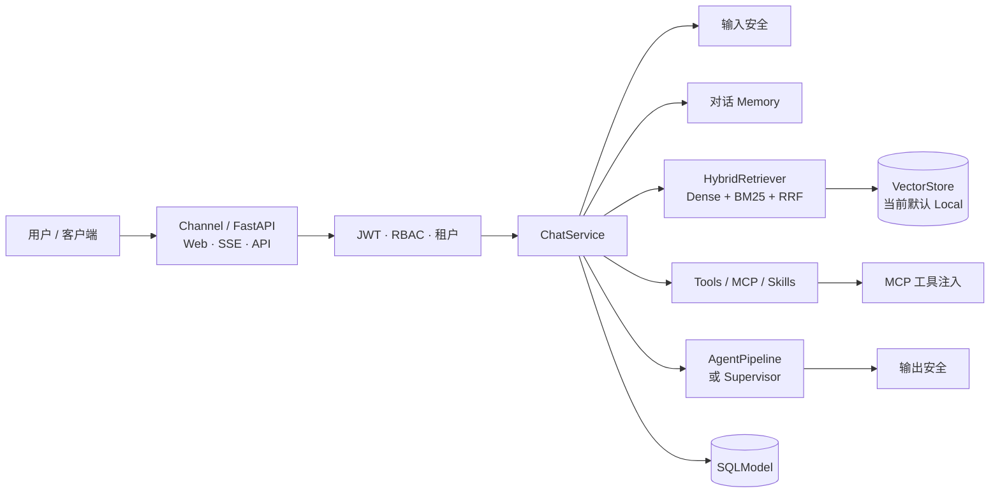
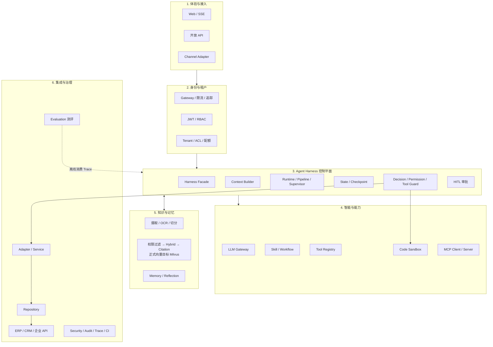
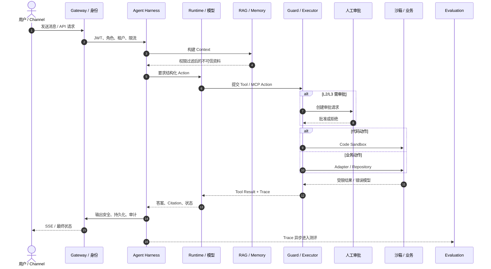

# ai-assistant

[](LICENSE)
[](CONTRIBUTING.md)
[](.github/workflows/ci.yml)
[](https://www.python.org)
[](docker-compose.yml)

> **ai-assistant** 是一个面向企业的开源 AI 助手平台，基于 RAG 与 Agent 编排，通过 MCP 连接私有知识库与受控企业能力。当前主链已可用；rag-v0.1 检索基线已冻结。结构化 Citation 与独立 Harness 仍是目标能力，详见下方架构概览。

## 项目定位

**ai-assistant** 围绕 **RAG 检索增强生成** 与 **Agent 编排** 两大核心能力构建，通过 **MCP 协议** 连接企业内部的文档、业务系统与第三方服务，帮助团队快速搭建可私有部署、回答带来源文本、权限可管控的智能问答系统。当前引用以 source 文本为主，结构化 Citation 为 TARGET。

平台提供以下核心能力：

- **企业知识问答**：上传文档并自动分块处理，通过输入护栏的块生成向量，超限结构保留原文并返回未向量化原因；基于混合检索（向量 + 关键词 + RRF 融合）生成附带来源文本的回答；结构化 Citation 为 TARGET；
- **Agent 智能编排**：内置五阶段推理管线（理解 → 规划 → 行动 → 反思 → 响应），支持工具调用与 Function Calling；
- **系统互联互通**：原生支持 MCP 协议，经受控工具接入企业系统与第三方 API；Agent 不得直连业务数据库；
- **企业级管控**：RBAC 五级角色（系统管理员 / 系统访客 / 租户管理员 / 成员 / 访客）与多租户隔离，保障数据安全；
- **开箱即用**：Docker 一键部署，零额外依赖的本地向量库模式，降低落地门槛。

## 核心特性

- **混合检索 RAG**：向量稠密检索 + BM25 关键词检索 + RRF 融合。当前引用以 source 文本为主；结构化 Citation 为 TARGET。
- **五阶段 Agent 管线**：理解 → 规划 → 行动（含工具调用循环）→ 反思 → 响应，逐步逼近高质量回答。
- **流式与非流式双模式**：支持 SSE 流式增量输出（逐字推送 + 阶段进度广播），也支持一次性返回。
- **原生 MCP 协议**：作为 AI 与企业系统的「万能连接器」，将 MCP 服务器工具动态注入 Agent 工具箱。
- **多 LLM 提供商**：对话和意图分流可以各接一家 OpenAI 兼容接口，主家失败后再试兜底那一家。开发环境没有可用密钥时降为 Mock，对话页会提示填写密钥并重启。
- **灵活向量库**：默认 Local（SQLite + numpy，零额外依赖）。Milvus 为可选适配（Partial，ADR-0002：本阶段正式 Local，Milvus 实验）。升格须另开 ADR 并补摄取/检索/删除闭环证据。
- **企业级安全**：JWT 双令牌（access + refresh）、RBAC 五级角色权限矩阵、多租户数据隔离。

## 架构概览

文档必须同时保留 **As-Is（当前实现）** 与 **TARGET（最终形态）**。目标图不能替代当前事实；当前调用链不能替代产品最终边界。权威文字稿见 [`docs/product/项目产品需求方案.md`](docs/product/项目产品需求方案.md) §3.1，可视化见 [`docs/architecture/target-agent-harness-architecture.html`](docs/architecture/target-agent-harness-architecture.html)。

### 当前实现（As-Is）

当前对话主链以 `ChatService` + 自研五阶段 `AgentPipeline`（可选 LangGraph Supervisor）为中心。默认自研管线已接入独立 Tool Executor 和 State Manager，checkpoint 持久化与同消息续跑为 `Partial`（单实例、SQLite 隔离证据，未完成生产验收）。独立 Agent Harness 仍属目标治理。版本化 Evaluation（rag-v0.1）与 VectorStore ADR-0002 已落地。



默认配置事实：`AGENT_ORCHESTRATION=self`，`RAG_BACKEND=native`，`RAG_VECTOR_STORE=local`，`RAG_ENABLED=true`，`SECURITY_BLOCK_ON_INJECTION=false`。正式向量库目标为 Milvus（ADR-0002，开发 Lite / 生产 2.4+）；第 5 节门槛通过前不改默认。Trace 以内存环形缓冲为主。无真实 Embedding 时 Mock 只能证明链路，不能证明检索质量。

### 最终目标架构（TARGET）

目标依赖方向：`Channel/API → Harness → Runtime → Skill → Tool Executor → Service/Adapter → Repository → 数据与外部系统`。

- 第 3 层 **Agent Harness** 只负责编排：Context、Runtime、State、预算、Guard、HITL。
- **Code Sandbox** 在第 4 层，由 Tool Guard 调用；代码动作不得在宿主进程执行。
- **Evaluation 测评** 是离线横切能力，消费 Trace 与版本化数据集，不阻塞在线请求。

下图是目标形态，不是当前施工顺序。日历推进顺序见 [`docs/plans/plan_delivery_2027-03-25.md`](docs/plans/plan_delivery_2027-03-25.md)：阶段 A（知识库治理）→ B（最小安装点）→ C（MVP）→ D（完整交付）。



### 目标请求时序（TARGET）



### 目标能力与当前状态（防漂移）

| 能力 | 当前状态 | 目标边界 |
|---|---|---|
| Agent 编排 | `Partial`：`ChatService` + `AgentPipeline` 承担部分 Harness | 独立 Harness / Context / State / 预算 / 恢复 |
| RAG | `Partial`：多格式摄取、混合检索、检索注入块剔除与不可信围栏；默认未注入对话 | 资源 ACL Planned；生效日期 ADR-0003 Accepted 但 Flag 默认关；结构化 Citation |
| 代码沙箱 | `Partial`：存在沙箱工具路径 | 代码动作必须经四层隔离，不得宿主执行 |
| MCP / 工具 | `Partial`：工具与 MCP 可注入 | 完整 Tool Contract；经 Executor，不直连数据库 |
| 测评 | `Partial`：rag-v0.1 Gold 与检索基线已有；未测真实 LLM 生成层 | 离线 RAG / Agent / Skill / Safety 评测 |
| 向量库 | 默认 `local`（ADR-0002 Accepted）；Milvus 实验/`Partial` | 升格 Milvus 须另开 ADR，禁止口头升级为已生产 |

状态术语与 `AGENTS.md` 一致：`Implemented` / `Partial` / `Planned` / `Deferred`。禁止把 `Planned` 写成已交付。

## 技术栈

| 层 | 技术 |
|----|------|
| 后端框架 | Python 3.11+ · FastAPI 0.115 · SQLModel 0.0.22 · Pydantic v2 |
| 数据库 | SQLite（开发）/ PostgreSQL 16（生产） |
| 向量库 | Local（SQLite + numpy）或 Milvus 2.4（分布式） |
| LLM | DeepSeek / OpenAI 兼容接口 · Ollama 本地 · Mock 离线 |
| 嵌入模型 | OpenAI 兼容 `/embeddings` 协议（DeepSeek / OpenAI / 智谱 / BGE-M3 等） |
| 协议 | MCP（Model Context Protocol） |
| Web 控制台 | TypeScript · React 18 · Vite 5 · Tailwind CSS 3 · TanStack Query |
| 部署 | Docker Compose；或由 FastAPI 单进程同时提供 API 与控制台 |

## 项目结构

仓库按 **分层目录 + 能力模块** 组织：`core` / `api` / `services` / `models` 是稳定分层，一般不随功能增减；`agents` / `rag` / `mcp` 等是可复用的技术能力，只有独立能力域才在 `app/` 下新开包。业务场景（如面试官）应落在 `services/` + `api/routes/`，不要按产品功能名平铺顶层目录。

```
ai-assistant/
├── app/                         # 应用主代码
│   ├── main.py                  # FastAPI 入口、lifespan（建库、校验、调度器）
│   ├── core/                    # 基础设施：配置、数据库、JWT/RBAC（不依赖 FastAPI）
│   ├── models/                  # 数据模型（SQLModel 表，不含业务逻辑）
│   ├── schemas/                 # 请求/响应契约（Pydantic）
│   ├── api/                     # HTTP 路由（薄层：校验、调 service、返回）
│   │   ├── deps.py              # 依赖注入：get_db / get_current_user / 权限守卫
│   │   └── routes/              # health、auth、chat、rag、mcp、workflow、audit
│   ├── services/                # 业务编排：对话、认证
│   ├── agents/                  # Agent 编排：五阶段管线、Supervisor、工具、Skills、沙箱
│   ├── llm/                     # LLM 抽象 + 工厂（OpenAI 兼容 / Mock）
│   ├── rag/                     # RAG：摄取、嵌入、向量库、混合检索
│   ├── mcp/                     # MCP 客户端：连接企业系统并注入工具
│   ├── workflow/                # 工作流：cron 调度、引擎、桥接到对话
│   ├── memory/                  # 对话窗口裁剪与 LLM 压缩
│   ├── security/                # 内容安全治理（输入/输出过滤、注入检测；非 JWT 鉴权）
│   ├── audit/                   # 审计日志写入与 Admin 查询
│   ├── evolution/               # Reflect 反思与 Distill 夜间蒸馏
│   ├── debug/                   # Agent 执行 Trace
│   └── channels/                # 多入口抽象（当前登记 HTTP）
├── tests/                       # pytest 测试
├── frontend/                    # Web 控制台（Vite + React + TS，见 frontend/README.md）
├── alembic/                     # 数据库迁移
├── docs/                        # 设计文档与 OpenAPI 导出
│   ├── product/项目产品需求方案.md
│   └── architecture/target-agent-harness-architecture.html
├── AGENTS.md                    # AI / 贡献者开发规则（模块边界与扩展约定）
├── pyproject.toml               # 依赖与工具配置
└── docker-compose.yml
```

JWT 鉴权、网关、缓存属于基础设施，分别落在 `core/` 与 `api/`，不单独开顶层包。新增目录的判断标准见 [AGENTS.md](AGENTS.md) 的架构边界。

## API 端点

业务接口统一使用 `/api/v1`，旧 `/api` 路径不提供别名或重定向。`/` 保留控制台或服务信息入口，`/docs` 与 `/redoc` 提供接口文档；这些入口不列入业务 OpenAPI 路径。

| 模块 | 方法 | 路径 | 说明 |
|------|------|------|------|
| 系统 | `GET` | `/api/v1/health` | 健康检查 |
| 认证 | `POST` | `/api/v1/auth/login` | 用户名密码登录，返回双令牌 |
| 认证 | `POST` | `/api/v1/auth/refresh` | 刷新令牌（refresh 轮转） |
| 认证 | `GET` | `/api/v1/auth/me` | 当前用户信息 |
| 认证 | `POST` | `/api/v1/auth/change-password` | 校验当前密码后改密，撤销旧刷新令牌并返回新双令牌 |
| 认证 | `POST` | `/api/v1/auth/register` | 公开注册为 `default` 租户的 member，并返回双令牌 |
| 认证 | `GET` | `/api/v1/auth/setup-status` | 是否还没有系统管理员 |
| 认证 | `POST` | `/api/v1/auth/setup` | 没有系统管理员时创建首个管理员；已有时 404 |
| 认证 | `POST` | `/api/v1/auth/users/{user_id}/revoke-tokens` | 系统管理员撤销该用户的刷新令牌 |
| 认证 | `GET` | `/api/v1/auth/memberships` | 当前用户已加入的租户 |
| 认证 | `POST` | `/api/v1/auth/switch-tenant` | 换成已加入的租户并换发令牌；非成员 403 |
| 邀请 | `POST` | `/api/v1/invitations` | 系统管理员或租户管理员生成邀请码 |
| 邀请 | `GET` | `/api/v1/invitations` | 列出该租户的邀请码 |
| 邀请 | `POST` | `/api/v1/invitations/accept` | 已登录用户凭码加入租户，不切换当前会话 |
| 用户 | `GET` | `/api/v1/admin/users` | 系统管理员分页列出用户，含编号和租户名称 |
| 用户 | `PATCH` | `/api/v1/admin/users/{user_id}` | 修改角色；不能修改自己 |
| 用户 | `POST` | `/api/v1/admin/users/{user_id}/disable` | 停用用户，令牌随后失效；不能停用自己 |
| 租户 | `PATCH` | `/api/v1/admin/tenants/{tenant_id}` | 修改未停用租户的名称 |
| 租户 | `POST` | `/api/v1/admin/tenants/{tenant_id}/deactivate` | 停用租户；当前在该租户中的成员不能继续访问 |
| 系统 | `GET` | `/api/v1/admin/system/status` | 系统管理员查看数据库、向量库、版本和启动时间 |
| 对话 | `POST` | `/api/v1/chat` | 非流式对话。响应含用户 `message_id`、`sources` 与 `code_results`；可用 `resume_message_id` 恢复本人的未完成执行 |
| 对话 | `POST` | `/api/v1/chat/stream` | SSE 流式对话。`conversation` 后的 `message` 事件返回用户消息 ID；支持同消息续跑；`code_result` 事件带代码执行结果 |
| 运行 | `GET` | `/api/v1/runs/{run_id}` | 查询本人运行的状态、绑定消息与最终回复 |
| 运行 | `GET` | `/api/v1/runs/{run_id}/events` | 携带 Last-Event-ID 回放已有运行的增量事件 |
| 运行 | `POST` | `/api/v1/runs/{run_id}/cancel` | 显式取消本人运行，返回确认后的状态 |
| 对话 | `GET` | `/api/v1/chat/conversations` | 会话列表 |
| 对话 | `GET` | `/api/v1/chat/conversations/{conversation_id}` | 会话详情。助手消息含 `code_results`，刷新后仍在 |
| 对话 | `POST` | `/api/v1/chat/conversations/{conversation_id}/messages/{message_id}/regenerate` | 使用最后助手对应的原问题和附件创建新一轮回复，保留原问答 |
| 对话 | `PATCH` | `/api/v1/chat/conversations/{conversation_id}` | 重命名会话（请求体只有 `title`） |
| 对话 | `DELETE` | `/api/v1/chat/conversations/{conversation_id}` | 删除会话 |
| 对话 | `GET` | `/api/v1/chat/tools` | 可用工具列表 |
| 知识库 | `POST` | `/api/v1/rag/documents/ingest` | 文本摄取（自动分块嵌入） |
| 知识库 | `POST` | `/api/v1/rag/documents/upload` | 上传 txt/md/json/xml/csv/doc/xls/ppt/docx/xlsx/pptx/pdf 文件，默认单文件不超过 10MB（扫描版 PDF 可配合 OCR） |
| 知识库 | `GET` | `/api/v1/rag/documents` | 文档列表 |
| 知识库 | `GET` | `/api/v1/rag/documents/{document_id}` | 文档详情 |
| 知识库 | `DELETE` | `/api/v1/rag/documents/{document_id}` | 删除文档 |
| 知识库 | `POST` | `/api/v1/rag/search` | 混合检索 |
| MCP | `GET` | `/api/v1/mcp/servers` | 已配置的 MCP 服务器 |
| MCP | `GET` | `/api/v1/mcp/tools` | 已连接 MCP 工具列表 |
| 工作流 | `GET` / `POST` | `/api/v1/workflows` | 工作流列表 / 创建（需 `WORKFLOW_ENABLED`） |
| 工作流 | `GET` / `PUT` / `DELETE` | `/api/v1/workflows/{workflow_id}` | 工作流详情、更新、删除 |
| 工作流 | `GET` | `/api/v1/workflows/{workflow_id}/executions` | 执行历史 |
| 工作流 | `POST` | `/api/v1/workflows/{workflow_id}/executions/{execution_id}/cancel` | 协作取消本进程执行并等待清理；终态幂等 |
| 工作流 | `POST` | `/api/v1/workflows/{workflow_id}/run` | 手动触发 |
| 工作流 | `POST` | `/api/v1/workflows/{workflow_id}/toggle` | 启停开关 |
| 审计 | `GET` | `/api/v1/admin/audit-logs` | 审计日志查询（系统管理员） |
| 租户 | `GET` | `/api/v1/admin/tenants` | 列出未停用租户；`include_inactive=true` 时含已停用（仅系统管理员） |
| 租户 | `POST` | `/api/v1/admin/tenants` | 创建租户；未停用名称唯一，重名 409（仅系统管理员） |
| 租户 | `POST` | `/api/v1/admin/tenants/{tenant_id}/users` | 在指定未停用租户下创建成员；角色固定为 member（仅系统管理员） |

> 启动后访问 `http://127.0.0.1:8000/docs` 查看交互式 Swagger API 文档。导出文件为 `docs/swagger.json`。

对话页可对最后一条助手消息点击“重新生成”。需要会话写权限；接口不接受客户端替换问题或附件，使用服务端保存的原输入，按当前安全规则和配额追加新一轮问答。原问答保留，新回复以消息 ID 和时间区分，不产生对话分支。失败时原回复仍在，本次新用户消息可能保留；页面刷新实际记录并显示错误。停止等待不保证撤销服务端执行。过期目标或本进程内并发写入返回 409；模型生成失败返回脱敏 502。多进程互斥不在此能力范围。

命名失败使用 `{ "error": { "code", "message", "retry_after", "request_id" } }`。`request_id` 与响应头 `X-Request-ID` 相同，页面不展示。八种编码是：

| code | HTTP | 用户可见结果 |
|------|------|----------------|
| `session_expired` | 401 | 登录已过期，请重新登录 |
| `token_revoked` | 401 | 您的登录凭证已被管理员重置，请重新登录 |
| `user_disabled` | 403 | 用户已被禁用，请联系管理员 |
| `tenant_suspended` | 403 | 全屏提示租户已停用，请联系系统管理员，随后退出 |
| `rate_limited` | 429 | 发送按钮禁用，并显示剩余秒数「N 秒后可重试」 |
| `quota_exceeded` | 429 | 本租户配额已用尽，请联系租户管理员 |
| `model_unavailable` | 502 | 模型服务暂不可用，请联系管理员检查模型配置 |
| `file_too_large` | 413 | 上传文件超过上限，并写出上限字节数 |

访问令牌过期后若刷新成功，原请求继续，不提示错误。错误密码仍是普通登录失败，不返回 `user_disabled`。系统管理员访问已停用租户的管理入口保持原有例外。

## 快速开始

第一次使用按下面五步走。开发模式的控制台在 `http://localhost:5173`。若已构建前端并把 `SERVE_FRONTEND=true` 写入 `.env`，同一套页面在 `http://127.0.0.1:8000`。

### 1. 填写环境

```bash
git clone https://github.com/lwmjava/ai-assistant.git
cd ai-assistant
python -m venv .venv
source .venv/bin/activate        # Windows: .venv\Scripts\activate
pip install -r requirements.txt
python -m app.cli init
```

从项目根目录运行 `init`，它为新 `.env` 生成随机 `JWT_SECRET_KEY`，不会打印密钥或创建数据库。需要其他配置时，从 `.env.example` 取对应键并填写自己的值，保留已经生成的 JWT 密钥。已有 `.env` 时 init 会拒绝覆盖；保留原文件并安全配置密钥。可用 `python -m app.cli init --env-file <新文件路径>` 生成另一份配置，或安装命令入口后使用 `ai-assistant init`。自定义输出文件不会自动改变应用固定读取项目根 `.env` 的行为；部署时应显式将其中的值注入环境。

`pip install -r requirements.txt` 会安装调度依赖 `croniter`。`pip install -e ".[workflow]"` 也会。`WORKFLOW_ENABLED` 默认是 `false`；打开后，进程启动时创建调度任务，支持到点触发执行。调度的生产治理仍为 `Partial`，尚不支持跨进程取消和跨重启恢复。

工作流创建与更新接口支持 `timeout_seconds`：严格整数 1–3600，默认 300 秒；更新省略时保留原值，显式 `null` 无效。总时限包含执行尝试和重试退避，达到时限后发起合作式取消，等待清理并以 `failed` / `WORKFLOW_TIMEOUT` 保存历史。取消接口沿用工作流写权限和租户隔离，成功返回原执行记录（`failed` / `WORKFLOW_CANCELLED`）；已完成记录原样返回，无本进程活动执行返回 409。活动执行尚未清理时删除工作流返回 409。手动执行始终使用创建者身份，创建者缺失时拒绝执行。

超时和取消仅针对当前进程内合作式异步代码，不保证中断同步阻塞、撤销已完成的外部副作用或跨进程强杀；300 秒是发起取消的截止点，清理可能继续等待。成功后的 webhook 有独立时限，不追溯改变成功结果。升级或回滚前应等待当前活动执行排空，执行历史结构保持不变。

Supervisor 不在默认安装里。要启用它，执行 `pip install -e ".[langgraph]"`（`langgraph>=1.0.0,<1.1`），再把 `AGENT_ORCHESTRATION` 设为 `langgraph`。这时只有明确要求多轮调研的问题才进入 Supervisor；不需要工具和知识库的问题只生成一次。没装这个包时，多轮请求回退五阶段管线。默认配置仍是 `self`。

init 已生成 `JWT_SECRET_KEY`；采用已有配置时须确认它不是空白或仓库默认值。要让对话调用真实模型，再填 `LLM_API_KEY`。可选：在空用户库中同时填写 `INITIAL_ADMIN_USERNAME` 和 `INITIAL_ADMIN_PASSWORD`，启动时会创建系统管理员和名为 `default` 的租户。单管理员模式下任一项为空时跳过管理员引导，改由下一步的 `/setup` 创建。示例密码留空，请在本地或秘密管理中设置自主口令，勿提交仓库。

需要同时引导三个内置账号时，将管理员用户名设为 `admin`，并通过部署环境分别注入 `INITIAL_ADMIN_PASSWORD`、`INITIAL_SYSTEM_PASSWORD`、`INITIAL_CULTURE_PASSWORD`。三人口令均至少 8 位；两项新增口令必须一起配置，配置不完整时拒绝写入。空用户库中会在同一事务创建 `admin`（系统管理员）、`system`（default 租户管理员）及 `culture`（member，`is_test_user=true`）；邮箱可以为空。只配置原管理员变量时保留单管理员引导。已有用户库不自动补种或认领同名账号，也不重置密码、角色或测试标记；移除环境变量不删除已经创建的用户。

初始化创建的管理员和内置账号首次登录后进入 `/change-password`，完成前服务端拒绝业务请求，页面也不展示业务内容。CLI、环境变量和 `/setup` 创建的首次管理员遵循相同改密规则。公开注册的普通用户不因本规则被强制改密。数据库只保存 bcrypt 哈希；口令不应放进命令参数、日志或接口样例。实际部署应通过 HTTPS 提供登录、注册和改密页面/API。

也可以用命令迁移数据库并创建系统管理员。在仓库根目录执行 `pip install -e .` 之后：

```bash
ai-assistant migrate --yes
```

没有待执行的迁移时，这条命令成功退出，并说明数据库已是最新。`--yes` 跳过确认。未安装控制台脚本时，用 `python -m app.cli migrate --yes`，效果相同。`python -m app.core.migration migrate` 仍然可用。

创建前，通过部署环境的秘密管理向当前进程注入 `INITIAL_ADMIN_PASSWORD`，使用自己生成且至少 8 位的密码。不要把密码写进命令参数、共享脚本或仓库。以下命令假定该环境变量已安全设置；库里已经有系统管理员时，命令会拒绝：

```bash
# Windows PowerShell
ai-assistant admin create-superuser --username admin

# bash
ai-assistant admin create-superuser --username admin
```

命令的输出和日志只包含用户名。环境变量引导和页面 `/setup` 仍然可用。

失败时看：`.env` 没被读到，多半是进程还停在改文件之前，重新启动后端。任何非 development 环境若 `JWT_SECRET_KEY` 为空白或仍是默认值，应用会在建表和账号引导前拒绝启动；日志给出 `ai-assistant init` 或设置环境变量的解法。进程未启动时不会提供 `/health`。初始化写入失败会报错且清理本次未完成文件，不更改原有配置。

### 2. 启动

在仓库根目录安装 `pip install -e .` 后，可使用 Docker Compose v2 管理指定部署：

```bash
ai-assistant start --project-name assistant-local --env-file /secure/assistant.prod.env
ai-assistant status --project-name assistant-local --env-file /secure/assistant.prod.env
ai-assistant logs --project-name assistant-local --env-file /secure/assistant.prod.env --tail 100
ai-assistant stop --project-name assistant-local --env-file /secure/assistant.prod.env
```

四条命令都必须显式指定项目名与配置文件。默认使用当前目录的 `docker-compose.prod.yml`；
其他位置使用 `--compose-file /path/to/compose.yml`。相对路径按当前目录解析，Compose 的项目目录固定为编排文件所在目录。
配置要求见 [生产编排说明](docs/workflows/production-compose.md)。这组命令管理 Compose 容器，开发时仍可直接运行下面的 Uvicorn。
未安装控制台脚本时使用 `python -m app.cli`，例如 `python -m app.cli status --project-name assistant-local --env-file /secure/assistant.prod.env`。

`start` 等待容器运行或健康，重复执行复用同一项目；`stop` 只停止容器，保留容器和数据卷；
`status` 包括已停止容器，返回的是 Compose 查询结果，并非应用就绪验收；`logs` 默认每容器最近 100 行，不持续跟随。
`--timeout` 是客户端最长等待秒数，默认 300；停止操作给容器 30 秒退出。
超时或中断返回 124/130，容器端操作可能继续，应使用同样的项目与配置执行 `status`，不能假定已回滚。
Docker 缺失、文件不可读和操作失败会给出可读解法。失败时不回显底层输出，防止插值后的凭据泄露。
状态和日志会遮蔽配置/进程环境中的已知敏感值及含凭据标记的整行，但这不能替代应用端日志脱敏，未知且无标记的敏感数据仍需在源头治理。
宿主变量保留 Compose 的常规覆盖优先级；`COMPOSE_*` 隐式选择被清除，避免作用到未指定的编排或 profile。

```bash
uvicorn app.main:app --reload
```

另开一个终端启动控制台：

```bash
cd frontend
npm install
npm run dev
```

单进程托管时，先在 `frontend/` 执行 `npm run build`，再在 `.env` 设置 `SERVE_FRONTEND=true`，只启动上面的 `uvicorn`。差别见 [frontend/README.md](frontend/README.md)。

失败时看：`http://127.0.0.1:8000/api/v1/health` 应返回 `status` 为 `ok`。打不开 `5173` 时，确认命令是在 `frontend/` 里执行的。接口 404 或跨域失败时，确认前端开发服务把 `/api` 代理到 `8000`。

### 3. 建立管理员

三选一。

- 第 1 步已经填了 `INITIAL_ADMIN_USERNAME` 和 `INITIAL_ADMIN_PASSWORD`：不要打开 `/setup`。用这两个值到 `/login` 登录。启动日志里会有已创建初始 `system_admin` 的提示。
- 单管理员模式下任一项为空，而且库里还没有系统管理员：打开 `http://localhost:5173/setup`，填写用户名和至少 8 位密码。成功后先进入 `/change-password`，完成首次改密才能进入 `/chat`，这个初始化向导随即关闭。
- 或者先执行 `ai-assistant migrate --yes`，再按第 1 步里的 `ai-assistant admin create-superuser` 创建系统管理员，然后到 `/login` 登录。

失败时看：`/setup` 一打开就回到 `/login`，说明已经有系统管理员，用已有账号登录。向导提交后提示「初始化向导已关闭」，同样改为登录。页面一直停在「正在检查是否需要初始化」，说明后端没起来，先看第 2 步的健康检查。

### 4. 注册或登录

打开 `/login`。已有账号直接登录。新成员打开 `/register`，注册成功后进入 `/chat`，身份是 `default` 租户的 member。

待首次改密的账号登录后会被引导到 `/change-password`。提交当前口令和不同的新口令（至少 8 位），成功后自动换发双令牌；旧刷新令牌失效。当前口令错误、两次新口令不一致或新口令不符合要求时留在改密页面；可以退出后重新登录。用户摘要返回 `must_change_password` 与 `is_test_user` 两个布尔值，测试身份以字段判断，不按用户名推断。旧版本已有用户默认不强制改密、不自动标记测试用户。

失败时看：页面红字「用户名或密码错误」是登录凭据不对。注册红字「用户名已存在」时换一个用户名。密码少于 8 位会停在表单上，不会发出请求。

### 5. 发送第一条消息

在 `/chat` 的输入框写一句话并发送。能看到助手回复，就说明这条旅程走完了。

失败时看：发送按钮不可用时，先确认输入框里有文字。请求失败时看对话页上的错误提示，并再次打开 `http://127.0.0.1:8000/api/v1/health`。没有模型密钥时，开发环境可能用模拟模型回答，这只说明对话链路通了。

### Docker 一键部署

复制 `.env.example` 为 `.env`，填入独立随机 `POSTGRES_PASSWORD`、随机 `JWT_SECRET_KEY` 和一个 `LLM_API_KEY`，并将 `CORS_ORIGINS` 设置为实际允许的前端来源。这四项缺失或为空时，`docker compose config` 无法展开；编排不回退固定数据库口令或通配来源。开发编排的口令直接进入数据库连接串，应使用 URL 安全字符组成的随机值；特殊字符口令使用生产编排的独立已编码 `DATABASE_URL`。生产来源应为实际 HTTPS 地址，不要把 `.env` 提交进仓库。

```bash
docker compose up -d --build
# 服务默认监听 http://localhost:8000
```

编排包含 PostgreSQL 和开发用 Milvus（单容器）。默认 `RAG_VECTOR_STORE` 仍是 `local`。只有显式改为 `milvus` 时，应用才连接 `http://milvus:19530`。这不表示向量库闭环门槛已经通过。

启动后打开 `http://localhost:8000`，看到的是镜像内已构建的控制台，由同一个 API 进程提供。`/api/v1/health` 仍是健康检查。第一次建管理员、注册和发消息，按上面「快速开始」的第 3 到第 5 步，页面分别是 `/setup`、`/login`、`/register` 和 `/chat`。本机热更新请在 `frontend/` 下执行 `npm run dev`，那个地址不是这条安装路径。

### 关键配置项

`.env.example` 当前覆盖 `Settings` 的全部 **189 个字段**（2026-10-17 快照，验收按源码字段集合动态核对），每项标注“选填”或“条件必填”。选填表示源码提供默认值；条件必填表示生产部署或选择对应能力时需要填写，并不表示启动会自动校验所有条件。示例中的部分值是使用示例，源码默认值以 `app/core/config.py` 为准。解析成功不代表生产安全配置或外部模型、OCR、检索服务可用；首次管理员密码留空，需由部署者自主配置，仓库不提供可直接登录的示例口令。

从仓库根目录用项目解释器执行以下核对。它只读配置源码和示例，在隔离命名空间加载真实 `Settings`，**不导入应用、不读取本地 `.env`**；缺项、额外项、重复键或缺标注会失败。

```powershell
& 'D:\DepTooL\anaconda3\envs\ai-assistant\python.exe' docs/evaluations/env001_example_contract.py --self-test
```

`MILVUS_PORT`、`MILVUS_HEALTH_PORT` 是 Compose 宿主机端口变量，不属于 `Settings`，示例仅保留注释说明。省略时 `docker-compose.yml` 继续采用 19530、9091；需要覆盖时可在启动 Compose 的进程环境中设置它们。

| 环境变量 | 说明 | 默认值 |
|----------|------|--------|
| `ENV` | 运行环境：`development` / `production` | `development` |
| `DATABASE_URL` | 数据库连接串 | `sqlite:///./data/ai_assistant.db` |
| `JWT_SECRET_KEY` | JWT 签名密钥（生产环境必须修改） | 默认占位值 |
| `AUTH_ENABLED` | 是否启用认证 | `true` |
| `INITIAL_SYSTEM_PASSWORD` | 三账号引导时 system 的独立初始口令，与 culture 口令一起配置；只在空用户库生效 | 空 |
| `INITIAL_CULTURE_PASSWORD` | 三账号引导时 culture 的独立初始口令，与 system 口令一起配置；不提供默认口令 | 空 |
| `LLM_PROVIDER` | 大模型提供商：`openai` / `ollama` / `mock` | `openai` |
| `LLM_BASE_URL` | 大模型 API 地址（兼容 OpenAI 协议均可） | `https://api.deepseek.com/v1` |
| `LLM_API_KEY` | 对话模型密钥。主密钥和兜底密钥都为空时，开发环境降为 Mock，对话页提示填写密钥并重启 | — |
| `LLM_DEFAULT_MODEL` | 默认模型名 | `deepseek-chat` |
| `LLM_FALLBACK_API_KEY` | 第二家模型密钥。主配置失败后改用这一家。留空表示没有兜底 | — |
| `LLM_FALLBACK_BASE_URL` | 第二家的接口地址。留空则沿用 `LLM_BASE_URL` | — |
| `LLM_FALLBACK_MODEL` | 第二家的模型名。留空则沿用 `LLM_DEFAULT_MODEL` | — |
| `LLM_INTENT_API_KEY` | 意图分流专用密钥。留空则和对话用同一家 | — |
| `LLM_INTENT_BASE_URL` | 意图分流的接口地址。留空则沿用对话地址 | — |
| `LLM_INTENT_MODEL` | 意图分流的模型名。留空则沿用对话模型 | — |
| `LLM_CHAT_FALLBACK_CHAIN` | 对话按顺序尝试的配置档，未知档名拒绝 | `chat,fallback` |
| `LLM_INTENT_FALLBACK_CHAIN` | 意图识别按顺序尝试的配置档 | `intent,chat,fallback` |
| `LLM_RERANK_PROVIDER` | 独立重排配置档的提供商描述；登记不启用检索重排 | 空 |
| `LLM_RERANK_BASE_URL` | 重排配置档地址；不用于对话或嵌入请求 | 空 |
| `LLM_RERANK_API_KEY` | 重排配置档密钥，只从环境配置，不写日志 | 空 |
| `LLM_RERANK_MODEL` | 重排配置档模型名 | 空 |
| `LLM_CIRCUIT_FAILURE_THRESHOLD` | 同配置连续瞬时故障达到此次数后开路 | `3` |
| `LLM_CIRCUIT_COOLDOWN_SECONDS` | 开路冷却秒数，之后只允许一个半开探测 | `30` |
| `LLM_CAPABILITY_GUARD_ENABLED` | 每次真实调用前核对上下文预算。关闭后回到 RAG-028 之前的行为 | `true` |
| `LLM_CAPABILITY_DECLARED` | 运营者显式声明的窗口与最大输出（`部署!模型=窗口:最大输出`，按部署+模型生效）。未知模型靠它放行 | — |
| `LLM_CAPABILITY_DECLARED_SOURCE` | 上面声明的依据来源。与声明同时填写才生效 | — |
| `LLM_BUDGET_SAFETY_MARGIN` | 预算余量，覆盖消息框架与工具描述的计数误差 | `512` |
| `LLM_OUTPUT_RESERVE_TOKENS` | 未显式给出 `max_tokens` 时的输出预留 | `2048` |
| `RAG_ENABLED` | 是否将检索上下文注入对话。无真实 Embedding 时，开发环境用 Mock，只能证明链路 | `true` |
| `RETRIEVAL_CACHE_ENABLED` | 认证主体的进程内检索缓存，命中前核对授权、数据与索引身份 | `false` |
| `LLM_RESPONSE_CACHE_ENABLED` | 认证对话的进程内响应缓存；还要求显式 temperature=0、实际模型匹配和完整文本响应 | `false` |
| `CACHE_TTL_SECONDS` | 两种缓存的 TTL，必须有限且在 (0,3600] 秒 | `60` |
| `CACHE_MAX_ENTRIES` | 每种缓存的 LRU 条目上限，1–10000 | `256` |
| `CACHE_MAX_BYTES` | 每种缓存的总字节预算，上限 64 MiB | `8388608` |
| `CACHE_MAX_ENTRY_BYTES` | 单条字节上限，不得超过总预算 | `262144` |
| `RAG_DROP_INJECTED_CHUNKS` | 检索后剔除高置信度注入分块 | `true` |
| `RAG_RETRIEVAL_CANDIDATE_MULTIPLIER` | 检索过取倍数，供剔除后补位 | `3` |
| `RAG_KB_SCOPE` | 知识库读范围：`tenant` / `uploader` | `tenant` |
| `RAG_MEMORY_CONTEXT_CHARS` | 注入管线的记忆字符预算 | `2000` |
| `RAG_CONTEXT_CHARS` | 注入管线的 RAG 字符预算 | `6000` |
| `RAG_EFFECTIVE_DATE_FILTER` | ADR-0003 生效日期/预告检索 | `false` |
| `RAG_VECTOR_STORE` | 向量库后端：`local` / `milvus` | `local` |
| `RAG_UPLOAD_MAX_BYTES` | 知识库单文件上限（字节）。等于上限可以上传，超过返回 413 | `10485760`（10MB） |
| `RAG_UPLOAD_ALLOWED_EXTENSIONS` | 允许的扩展名，逗号分隔、不带点 | `txt,md,json,xml,csv,doc,xls,ppt,docx,xlsx,pptx,pdf` |
| `RAG_BACKEND` | 切分/检索策略：`native` / `langchain` / `llamaindex` | `native` |
| `RAG_CHUNK_STRATEGY` | 文档切分策略（见下方「文档切分策略」） | `structured` |
| `RAG_LLM_BOUNDARY_ENABLED` | LLM 辅助切分边界开关。结构保护后让模型只建议句子序号，代码切取原文；失败自动规则降级 | `false` |
| `RAG_LLM_BOUNDARY_MAX_CALLS` | 单篇文档最多几次边界建议 LLM 调用（费用护栏） | `3` |
| `RAG_LLM_BOUNDARY_MAX_CHARS` | 单次发给模型的正文上限（字符），超过则不调用、规则切分 | `1500` |
| `RAG_SECTION_SUMMARY_ENABLED` | 章节摘要开关。为源文档版本绑定的派生数据，不进向量检索、不替代原文；源版本软删/被替换后摘要立即不可读 | `false` |
| `RAG_SECTION_SUMMARY_MAX_CALLS` | 单任务最多几次摘要 LLM 调用（费用护栏） | `8` |
| `RAG_SECTION_SUMMARY_MAX_CHARS_PER_BATCH` | 单批正文上限（字符），超过则切批逐批摘要后合并 | `4000` |
| `RAG_LANGCHAIN_SPLITTER` | LangChain 切分器（当前仅 `recursive`） | `recursive` |
| `RAG_LLAMAINDEX_SPLITTER` | LlamaIndex 切分器：`sentence` / `markdown` | `sentence` |
| `RAG_IMPORT_ENABLED` | 是否启动后台导入调度器 | `true` |
| `RAG_IMPORT_INTERVAL_SECONDS` | 导入调度扫描间隔（秒） | `3.0` |
| `RAG_IMPORT_FETCH_TIMEOUT` | URL 抓取超时（秒） | `30.0` |
| `RAG_IMPORT_BATCH_SIZE` | 每轮最多处理的任务数，范围 1–1000 | `2` |
| `RAG_IMPORT_MAX_CONCURRENCY` | 单进程所有导入执行入口共用的并发上限，范围 1–1000 | `2` |
| `RAG_OCR_ENABLED` | 是否启用扫描版 PDF OCR | `false` |
| `RAG_OCR_PROVIDER` | OCR provider：`tesseract` / `cloud` | `tesseract` |
| `RAG_OCR_LANGUAGES` | OCR 语言包 | `chi_sim+eng` |
| `RAG_OCR_TIMEOUT_SECONDS` | 单次 OCR 超时（秒） | `60.0` |
| `RAG_OCR_BASE_URL` | 云 OCR OpenAI 兼容接口地址（优先于 LLM 配置） | — |
| `RAG_OCR_API_KEY` | 云 OCR API Key（优先于 LLM 配置） | — |
| `RAG_OCR_MODEL` | 云 OCR 模型名（优先于 LLM 配置） | — |
| `EMBEDDING_PROVIDER` | 嵌入模型提供商 | `openai` |
| `EMBEDDING_BATCH_SIZE` | 单次嵌入请求的文本条数（DashScope v3/v4 上限 10） | `10` |
| `EMBEDDING_TIMEOUT_SECONDS` | 单次嵌入 HTTP 超时（秒），会被检索总时限夹住 | `15.0` |
| `RAG_RETRIEVAL_RESILIENCE_ENABLED` | 检索韧性总开关。关闭后不重试（休眠/无网排障用） | `true` |
| `RAG_RETRIEVAL_DEADLINE_SECONDS` | 一次检索（嵌入 + 向量检索）的**总**时限（秒）。`0` 关闭 | `8.0` |
| `RAG_RETRIEVAL_MAX_ATTEMPTS` | 单个子调用最多打几次（**含首次**）。只对连接错误/读超时/429/5xx 重试 | `3` |
| `RAG_RETRIEVAL_BACKOFF_BASE_SECONDS` | 退避基数：第 n 次失败等待 `base * 2**(n-1)` | `0.2` |
| `RAG_RETRIEVAL_BACKOFF_MAX_SECONDS` | 退避上限；剩余预算不够时直接放弃，不睡过总时限 | `1.5` |
| `RAG_EMBED_BATCH_DEADLINE_SECONDS` | 嵌入**单批**的写入侧预算（秒）。未绑定检索 deadline 时每批各拿一个，`0` 不限时 | `20.0` |
| `EMBEDDING_INDEX_VERSION` | 向量索引版本。换模型或改归一化/度量时递增，配合重建脚本切换 | `1` |
| `EMBEDDING_NORMALIZATION` | 索引身份声明的归一化方式。**当前只支持 `l2`**，其它值在构造身份时直接报错 | `l2` |
| `EMBEDDING_METRIC` | 索引身份声明的相似度度量。**当前只支持 `cosine`**，其它值在构造身份时直接报错 | `cosine` |
| `MCP_ENABLED` | 是否启用 MCP 客户端 | `false` |
| `MCP_SERVERS` | MCP 服务器清单（JSON 数组） | — |
| `WORKFLOW_ENABLED` | 是否启用工作流引擎 | `false` |
| `SKILL_ENABLED` | 是否启用 YAML 技能注入 | `true` |
| `MEMORY_ENABLED` | 是否启用对话窗口与压缩 | `true` |
| `AUDIT_ENABLED` | 是否启用审计日志 | `true` |
| `SECURITY_ENABLED` | 是否启用内容安全治理 | `true` |
| `SECURITY_RATE_LIMIT` | 是否按用户和租户限制对话频率。默认关闭，打开后才会计数 | `false` |

对话限流使用本进程内存中的令牌桶。默认每秒补充 60 个、容量 60。补充速率大于 0 且被拒绝时，响应给出等待秒数；速率小于或等于 0 时拒绝，且不计算等待秒数。计数只在本进程有效，重启即清空。完成 `OPS-001` 之前不要水平扩展 API 进程，否则每个进程各计各的。
| `AGENT_ORCHESTRATION` | 编排实现：`self` / `langgraph`。后者要先装 extra，没装时回退五阶段 | `self` |
| `AGENT_STATE_PERSIST_ENABLED` | 默认自研管线持久化运行快照；关闭时拒绝显式续跑，停止新写入和过期清理 | `true` |
| `AGENT_STATE_TTL_SECONDS` | 快照有效期；到期后不可恢复，启动及每分钟分批删除（每批至多 100 行） | `604800` |
| `AGENT_STATE_CHECKPOINT_TOOL_ROUND` | 每个工具行动轮次完成后提交快照；关闭时只有终态快照，无法恢复工具中间进度 | `true` |
| `SERVE_FRONTEND` | 是否由本进程托管 `frontend/dist`（开启后 `GET /` 返回控制台） | `false` |
| `CORS_ORIGINS` | 允许的跨域来源（前后端分离部署时必填） | `*` |

完整配置项见 [`.env.example`](.env.example)。

### 会话附件

输入框支持选择文件、粘贴 PNG/JPEG 图片、逐项移除附件；非法类型、超限和读取失败会显示在对应附件旁，移除或修正后才能发送。每文件最多 1048576 字节，不另设文件个数上限；支持仅发送附件。允许类型为 png/jpg/jpeg、md/doc/docx/xls/xlsx/ppt/pptx/pdf，以及 go/py/css/html/htm/java/js/json/xml/yaml/yml/c/h/cpp/cc/cxx/hpp/vue/ts，不含 txt/tsx/jsx。

`POST /api/v1/chat` 和 `/api/v1/chat/stream` 可附 `attachments: [{name, content_base64}]`。后端先验证整批文件和图片模型能力，再保存用户消息；任一附件失败均不新增该消息或知识库数据。文档和源码正文经过输入安全检查后作为不可信数据进入当前消息，图片以真实多模态内容段进入模型。附件不摄取知识库、不建索引；历史接口只返回名称、字节数和 MIME，二进制内容不返回页面。续跑复用原消息附件，拒绝用新附件替换。

图片使用 `detail=low`。目前仅已核对的 OpenAI 官方部署 `gpt-4o-mini` 登记了视觉计数，每图 2833 tokens，另计完整文本、框架、输出预留和安全余量；其他部署或模型即使有文本窗口声明，也会在发送前拒绝图片。默认模型不变。协议与计数依据为 [官方图片指南](https://developers.openai.com/api/docs/guides/images-vision)；low 适于粗略理解，不能当作精细 OCR 质量保证。旧 doc/ppt 仍依赖现有 LibreOffice 转换，缺失或解析失败明确拒绝。隔离模型测试证明载荷与持久化，不代表真实视觉质量已验收。

### 模型用途与故障兜底

`get_task_profile` 描述 `chat`、`intent`、`embedding`、`rerank` 四种用途。规划、执行和质量门沿用 `chat`；意图识别可独立配置。嵌入描述直接读取现有 `EMBEDDING_*`，实际检索仍使用原嵌入工厂，不因生成模型故障切换嵌入模型或索引。重排配置仅登记，当前不会发起重排请求或启用检索重排。未知用途或兜底档名明确拒绝。

对话与意图链遇到连接失败、超时及允许兜底的 HTTP 状态时依次尝试下一档。连续三次瞬时故障后，同配置在本进程开路 30 秒，冷却结束只允许一个半开探测；成功关闭，失败再次开路。取消和预算拒绝不计瞬时故障，取消会释放探测名额；400 不换家，401/403 可兜底但不累积瞬时故障。流一旦输出内容，故障会结束当前回答，不能拼接另一家的回答。每一跳仍核对自身模型预算与缓存条件。

熔断状态按用途、配置档、端点、模型及凭据摘要隔离，有容量和闲置过期限制，重启清空；不跨进程协调。密钥只参与不可逆摘要，不写入诊断日志。离线桩验证路由行为，不能替代两家真实提供商的对话验收。

### 同一次对话执行续跑

流式连接使用 `run.started`、`node.started/finished`、`intent.classified`、`plan.generated`、`tool.call/result`、`token`、`citations`、`error`、`run.finished` 与 `heartbeat`。所有事件的 JSON 顶层有 `run_id`，帧有 `<run_id>:<序号>` 的递增 `id`；token 内容位于 `delta`，引用位于 `sources`。成功/失败/取消终态分别为 `done/failed/cancelled`。心跳在无输出 15 秒时携带 `ts`。错误提供固定脱敏的 `code/message/retryable`；限流错误为 `rate_limited`，通过 `retry_after_seconds` 倒计时等待，`retryable=false` 不表示可立即重试。

浏览器在提交前生成 UUID `run_id`；同主体重复提交同编号返回 409，不再次执行模型或工具，其他主体统一拒绝。HTTP 断开只结束订阅，运行继续；重连只对 `/runs/{run_id}/events` 发 GET 并带 `Last-Event-ID`，不重发用户消息。浏览器在 30 秒连接/心跳超时后自动续流一次，仍失败可加载最终回复。主动停止须调用 cancel，界面等待服务端确认后才标已停止；取消前已提交的用户消息仍保留绑定。

回放限于单进程：每运行最多 1000 个事件或 8 MiB，最多保留 100 个运行；终态保留 15 分钟。窗口过期明确返回 409，编号过期或无权访问返回 404，可按既有对话权限读取历史消息。缓存满且全为活动运行时拒绝新运行，不取消旧任务。进程重启丢失内存运行与回放；这不代表跨实例或持久化任务队列。查询、回放与取消均复核用户、租户、角色和令牌版本；关闭认证的既有开发演示主体只在开关仍关闭时生效。

`POST /api/v1/chat` 和 `/api/v1/chat/stream` 请求可携带 `resume_message_id`，并提供原 `conversation_id` 与完全相同的 `message`。非流式响应的 `message_id`、流式 `conversation` 后的 `message` 事件，以及会话详情中的用户消息 ID 都可以识别原消息。旧请求无需增加字段。

恢复只支持当前用户本人的自研管线活动执行，复用原用户消息，不新增消息或重复扣配额；系统管理员也不能代恢复他人的执行。归属不符返回 404，文本不符返回 400，无有效活动快照、执行仍在进行或编排/持久化开关不支持时返回 409；缺少会话 ID 返回 422。终态和过期执行不恢复，普通重发文本仍创建新消息。

恢复保留已完成工具的观测和指纹，剩余工具轮次不会重置。默认持久化管线把质量门重入也计入同一次执行的工具预算；未注入 store 的兼容路径仍保持原来的每循环预算。进程内互斥不等同于跨实例租约。工具副作用与快照提交之间的断电窗口不提供 exactly-once 保证；不要用这些单实例证据宣称多实例或 PostgreSQL 生产恢复已通过。当前控制台尚无自动续跑按钮，API 调用方需显式提交恢复请求。

### 单实例知识库导入恢复

后台导入每轮最多处理 `RAG_IMPORT_BATCH_SIZE` 个任务；同一个应用进程的所有导入执行入口共享
`RAG_IMPORT_MAX_CONCURRENCY` 上限。同租户同来源任务串行发布，避免重复文档或重复当前版本。
`run_import_jobs_once(limit=...)` 的参数继续表示每轮任务数，不覆盖并发上限。

调度器启动和执行入口会核对中断的 `running` 任务：有匹配的已提交发布凭据时补齐成功状态；
未发布且尝试额度尚有余量时重新待执行；额度耗尽则失败并保留追踪记录。已失败任务不会无限自动重试，
授权用户可在剩余额度内重试。执行取消会向上传播，并保留可恢复记录；活跃任务不会被恢复扫描抢走。
批次全部任务结束后才显示成功、部分成功或失败。

URL 源文件先登记短事务配额预留及快照，再等待解析和嵌入；恢复复用本次已登记快照，
重解析的旧源文件继续保留。任务、批次、目标文档与源目录的租户绑定不符时拒绝执行。
部署限于一个应用进程；不支持多进程导入竞争，不提供跨库事务或跨系统恰好一次保证。
无需新增数据库迁移。回滚前停止导入调度器，保留任务、文档、源文件和追踪记录，再回退代码与配置；
旧代码没有本次恢复保证，未完成导入须人工核查。

设计及验证范围见 [导入恢复 ADR](docs/adr/0009-single-instance-import-recovery.md) 与
[单卡实施计划](docs/plans/plan_rag_039_single_instance_20261010.md)。

## 升级提示：历史知识库会检索不到（RAG-032 / ADR-0008）

向量现在绑定「索引身份」：`provider / deployment / model / dim / index_version /
normalization / metric` 全部一致才算同一套索引。**同维度不同模型的向量不可比**，
因此升级到含本卡的版本后：

- 升级前已写入、但身份未知的历史分块（`index_id` 为 `NULL`）**默认不参与检索**；
- 没有生效索引却存在历史分块时，检索会报 `unavailable`，而不是返回空结果冒充
  「知识库里没有」；
- 因此**升级后必须先登记或重建，否则老知识库会查不到东西**——这是预期行为，不是故障。

先看现状：

```bash
python scripts/rebuild_embedding_index.py status
curl -s localhost:8000/api/v1/health | python -c "import sys,json;print(json.load(sys.stdin)['checks']['vector_store']['embedding_index'])"
```

`legacy_chunks > 0` 或 `status` 为 `unavailable` / `legacy_quarantined` 时按下面二选一处理。

**A. 能举证历史向量确由当前模型产出 → 登记（不调用嵌入接口，不产生费用）**

```bash
python scripts/rebuild_embedding_index.py adopt \
  --confirm \
  --evidence "声明人=张三; 依据=部署记录 2026-09; 原模型=text-embedding-v3" \
  --declared-model text-embedding-v3
```

维度相同**不能**证明向量空间相同：命令会校验声明的原模型与目标索引一致，并要求全部
历史分块维度抽样匹配，任一条不符就整体拒绝；证据会写入索引的 `notes` 以便追溯。

**B. 无法举证 → 重建（会调用嵌入接口，产生费用）**

```bash
python scripts/rebuild_embedding_index.py rebuild            # 默认只打印计划
python scripts/rebuild_embedding_index.py rebuild --apply     # 真正执行
python scripts/rebuild_embedding_index.py activate --index-id <新索引 id>
```

重建期间旧索引继续服务；失败时旧索引数据完全不变。回退：

```bash
python scripts/rebuild_embedding_index.py rollback --index-id <旧索引 id>
```

回退会校验当前模型配置与目标索引身份完全一致——只改索引名而仍用新模型查旧向量会被拒绝。
详见 [`docs/rag/索引身份与切换.md`](docs/rag/索引身份与切换.md)。

## 模型能力契约与预算护栏（RAG-028）

每次真实调用发出之前，护栏核对一条不等式：

```
实际 payload + 输出预留 + 余量 ≤ 已登记的上下文窗口
```

payload 用**本次真正要发的 messages** 现算，所以工具返回、自纠错（critique）轮次、历史和系统提示都天然被计入，不需要每个调用方各自统计一遍。超过预算时请求**不会发出**，调用方收到固定提示「本次请求内容超出模型已登记的上下文预算，请缩短输入或拆分后重试。」，异常里的计数数字与模型名不会出现在用户看到的句子里。

### 内置已核对模型表

只登记核对过厂商公开依据的条目，登记时同时写下来源 URL 与核对日期（2026-10-07 实取）：

| 部署 | 模型 | 上下文窗口 | 最大输出 | 依据 |
|------|------|-----------|---------|------|
| `api.openai.com` | `gpt-4o-mini` | 128000 | 16384 | <https://platform.openai.com/docs/models/gpt-4o-mini> |
| `api.deepseek.com` | `deepseek-flash` | 1000000 | 384000 | <https://api-docs.deepseek.com/quick_start/pricing> |
| `api.deepseek.com` | `deepseek-v4-pro` | 1000000 | 384000 | <https://api-docs.deepseek.com/quick_start/pricing> |

部署参与身份：同一个模型名在自建网关上跑，不等于厂商官方接口上的同一模型，窗口不能跟着模型名一起被借走。

### 为什么 `deepseek-chat` 需要声明

`deepseek-chat` 是仓库代码里的默认模型名，但它已不在厂商在售模型表内，各来源给出的窗口数字互相矛盾。本仓库**没有**登记它的能力——不去猜一个上限。继续使用它，必须由运营者显式声明：

```dotenv
LLM_CAPABILITY_DECLARED=api.deepseek.com/v1!deepseek-chat=65536:8192
LLM_CAPABILITY_DECLARED_SOURCE=厂商文档 URL 或内部依据
```

**升级后第一步就在这里**：护栏默认开启，未声明时所有真实调用都会被拒绝（对话只剩固定提示）。

声明的格式是 `部署!模型=窗口:最大输出`，**按部署+模型生效**——为 `gateway-a` 声明一次，不会让别家网关上的同名模型也拿到同一个窗口。省略部署时（`deepseek-chat=65536:8192`）只对 `LLM_BASE_URL` 对应的主部署生效。

声明与依据来源**缺一即视为未批准**，护栏照旧拒绝。数值由运营者给，不由代码替他猜；声明条目的计数方法会被标成 `operator-declared`，不冒充已核对条目。「由运营者给」不等于写多少都算：窗口与最大输出必须是正整数、最大输出不超过窗口，且不超过合理上界（窗口 2,000,000、输出 400,000），越界按未批准处理并在日志里给出 `llm_capability_declared_out_of_range`。

建链时如果发现某个 profile（chat / intent / fallback）的模型拿不到已核对或已声明的能力，日志会打一条 `llm_capability_unapproved profile=... model=...`，提示去登记上面两行。字段只带 profile 与模型名，不带接口地址、密钥或请求内容。

### 计数方法与局限

官方计数器优先，不可用时退回经校准的保守估算，用哪种都会写进能力契约：

- 官方计数器：只在 OpenAI 官方域名下认 `tiktoken`。装上 `tiktoken` 后自动优先使用，无需改代码（本仓库不强制安装这个依赖）。装上之后，别家的 token 仍然不用 OpenAI 的 tokenizer 数——那是伪造精度。
- 保守估算：UTF-8 字节数 + 每条消息的框架开销。字节数一般 ≥ token 数（一个汉字 3 字节 ≥ 1 token），因此**偏保守**——宁可拦下刚好够用的请求，也不放行超限请求。**这不是精确 tokenizer 输出。**
- 计不出来就拒绝，不许计 0：多模态 content（如 `image_url`）按 JSON 序列化的字节数计，序列化不了、或正文含不可编码字符，一律按 `payload_uncountable` 拒绝发送。已知残余低估：远程 `image_url`（`http://` 而非 `data:`）只计 URL 本身，图片本体不在文本里，计不到。
- 云 OCR（`RAG_OCR_PROVIDER=cloud`）送 base64 图片，是全系统最大的单次生成 payload，也走同一条不等式；超限或未知模型时抛 `OcrProviderError`（`ocr_budget_exceeded`），一个字节都不外发。

### 关闭护栏

`LLM_CAPABILITY_GUARD_ENABLED=false` 会完全跳过核对，行为与 RAG-028 之前一致。仅在排查护栏本身时临时关闭。

## 检索调用时限与重试（RAG-038）

一次检索由「嵌入 + 向量检索」两个外部调用串成。改之前只有**逐次** HTTP 超时：嵌入与向量检索各拿一个 60s 预算，一次检索最坏能拖 120s，429/5xx 也不重试，慢查询没有上界。现在两者装进**同一个总时限**：

- **总 deadline，不是逐次 timeout。** 子调用按剩余预算夹自己的单次超时（`Deadline.subcall_timeout`），任何一环拖沓都会压缩后面所有环节；预算用完就直接拒绝发起下一个子调用（`ensure_budget`）。逐次 timeout 的 N 个子调用最坏是 `N × timeout`，总 deadline 最坏就是 `deadline`。
- **有限退避，只对可重试故障。** 连接错误 / 读超时 / `429` / `5xx` 才重试；`4xx`（除 429）与业务错误只打一次——重试一个错误的请求只会再错一次。退避是 `base * 2**(n-1)` 夹到 `max` 再叠 ±20% 抖动，次数上界来自 `RAG_RETRIEVAL_MAX_ATTEMPTS`（**含首次**）。
- **耗时有界的关键在退避前检查预算。** 剩余时间不够等下一次就**直接放弃**，不睡过 deadline；否则「有界」名存实亡。
- **取消不改写。** `asyncio.CancelledError` 一律原样上抛，不写成「检索不可用」，也不记成一次调用失败。
- **失败不伪造空知识。** 重试耗尽 / 超时一律向上抛，由 RAG-037 的检索状态契约收敛为 `unavailable` 并强制披露；绝不返回空列表让上层以为「查过了、没有」。

每次失败 attempt 记一条 `rag_call_failed`（attempt / elapsed_ms / error_type / backend / tenant / outcome），每次成功记一条 `rag_call_succeeded`（含 `attempt=1` 的首次成功——只记失败会让依赖方抖动期不可观测，分不清「一直很稳」和「抖完自己好了」），预算耗尽记 `rag_deadline_exhausted`。日志里**不写** Authorization、api key、请求正文或命中正文。

### 三条必须说清的边界

**1. 「总时限」的粒度是「一次检索」，不是「一次用户请求」。**
deadline 用 `ContextVar` 传播：`asyncio` 每次 `create_task` 会复制当前 context，因此后端 `retrieve` 内的绑定只影响**该次调用**派生的子协程；`asyncio.gather` 并发的多个子调用共享父任务的 deadline，这正是「一次检索一个总预算」的预期语义。但调用方不绑定时，每调一次 `retrieve` 就新起一个预算——**一次用户请求触发 N 次检索，总耗时按 `N × deadline` 累加**。当前三条线上路径（fast_path / pipeline / supervisor）每请求只调一次检索，因此现网不受影响；将来若出现「一请求多检索」，需要由调用方显式 `bind_deadline` 包一层。

**2. 写入路径不复用检索预算。**
`embed()` 一次调用可能含几十批。检索路径（已绑定）各批共享总预算；**写入 / 导入 / 重建索引 / 语义切分路径没有绑定，每批各拿一个 `RAG_EMBED_BATCH_DEADLINE_SECONDS`（默认 20s）**。若让整通调用共用一个 8s 的检索预算，一篇 200 分块的文档会在第 16 批被 `DeadlineExceededError` 打断——哪怕每一批都在自己的超时内成功返回。写入侧单次超时同样用 `EMBEDDING_TIMEOUT_SECONDS`。

**3. 总时限必须大于第一次退避，否则重试实际不会发生。**
判据是 `RAG_RETRIEVAL_DEADLINE_SECONDS > min(BASE, MAX) × 1.2`（1.2 = 抖动上界）。不满足时第一次失败后剩余预算就不够等退避，直接走「放弃」，一次都不重试——配置看起来启用着重试，实际等价于 `MAX_ATTEMPTS=1`。启动时会打一条 `rag_retry_effectively_disabled` 告警说明「重试实际已禁用」。默认 8.0 / 0.2 / 1.5 满足该约束。`BASE<=0` 是**零退避**：失败后立即重试（不等），判据自动满足，不算「重试实际已禁用」。

### pymilvus 同步调用的取消边界

pymilvus 是同步客户端，查询放进线程池执行。总时限到期或调用被取消时，`asyncio.wait_for` 只能让**协程放弃等待**，**无法真正中断**线程里的底层调用——线程会跑到底才释放工作线程。因此：

- 「有界」的含义是**调用方不再等**，不是服务端调用被取消；
- 被放弃的调用不会污染结果（返回值被丢弃），也不会被写成空结果；
- 依赖方持续无响应时，线程池 worker 会被占住，运维上仍需靠 Milvus 侧的连接/查询超时兜底。

### 关闭韧性

`RAG_RETRIEVAL_RESILIENCE_ENABLED=false`：不重试（attempt 固定为 1）、不记退避等待，行为退回 RAG-038 之前，便于在休眠/无网环境排障。`RAG_RETRIEVAL_DEADLINE_SECONDS=0` 则连总时限一起关闭。

## 技能在对话路径中的生效范围

每次对话最多选择一条有权使用的技能。私有技能只对创建者生效，全局技能必须启用；成员技能正文保留不可信内容围栏。

| 对话路径 | Prompt 模式 | 工具模式 |
|---|---|---|
| 默认完整管线（含结构化计划） | 注入授权技能内容 | 使用绑定与原工具名单的交集 |
| 默认简单问题短路 | 注入授权技能内容 | 仍受原短路工具白名单限制 |
| 工具短路径 | 注入授权技能内容 | 使用绑定与当前路径名单的交集 |
| 知识库与计算器组合 | 检查当前授权技能绑定 | calculator 与绑定名单取交集，资料不能授予权限 |
| 普通问答、知识库短路径 | 注入授权技能内容 | 明确提示当前路径不支持执行绑定工具 |
| Supervisor | 仅调研与撰写节点使用技能，调度节点不注入 | 已装配委派时，调研节点执行绑定与有效低风险契约的交集；调度和撰写不执行。未装配时明确说明未调用 |

绑定不会授予工具权限，也不会自动执行所有绑定工具。未注册、空绑定或路径不支持时会明确说明；权限、参数、预算、超时和有限重试仍由受控执行链处理。日志区分匹配、注入、绑定可用和工具实际终态，并记录本轮有效版本；技能名称本身不表示工具已执行。

显式打开 Supervisor 且本请求装配了工具委派时，调研节点复用既有执行器，只执行技能绑定与已注册有效低风险契约的交集。回答前会写入实际执行状态；模型自称完成不能代替执行记录。调度节点和撰写节点不能启动工具。直接构造、没有委派能力的 Supervisor 仍不执行工具，并在回答中说明未调用。普通问答和知识库短路径仍不执行绑定工具。高风险工具、未注册工具和并行执行不在这条路径上开放。

每次注入技能和启动新工具前复核技能是否仍有效。停用或变版后不继续消费旧内容；已经完成的工具副作用保留。续跑只恢复原来授权的精确技能版本，不重新语义选型。旧 checkpoint 缺技能绑定、绑定畸形、技能变版/撤销或编排不支持恢复时会拒绝续跑，保留原进度，要求显式重新发起请求。回滚旧版本前应关闭恢复入口，避免忽略新版本约束。

## 可选进程缓存

缓存默认关闭。检索缓存通过已认证主体、有效读范围、数据库、文档/分块内容与生效状态、实际索引身份和检索参数绑定结果；每次命中仍读取最新授权。发布、删除、重解析、改权和索引切换会使旧键失效。已提交态缓存不能用于未提交写事务；flush、显式 SQL 和嵌套事务中的写入均绕过缓存。不透明自定义后端或实际依赖与 Service 名义依赖不一致也绕过缓存；未知 Embedding 的可变状态可能导致保守不命中。为保证失效完整性，当前实现每次读取本租户文档/分块指纹，仍有 SQL 和哈希开销；减少向量库调用不等于整体延迟已达标。

LLM 响应缓存仅作用于 ChatService 绑定的认证请求和实际 OpenAI 兼容模型单跳。temperature=0 之外，还要求实际消息/上下文、模型、端点、凭据摘要、配置和 Prompt/代码版本相同；响应必须确认实际模型匹配、完整文本 stop 结束。流式响应还须正常读取到 DONE。错误、截断、取消、工具调用响应、无已持久化身份的开发请求与非确定性请求不缓存。兜底链仍逐跳尝试，不把兜底答案记为主模型答案；预算与输出安全检查仍执行。

每种缓存各受 TTL、LRU、总字节和单条预算限制，只在本进程内保留，返回副本；不持久化、不跨实例协调，也不合并并发请求。关闭两个开关即可恢复原调用路径，重启清空缓存；不能将此功能视为 Redis、多实例一致性或生产性能验收。隔离 HTTP/合成 Embedding 测试证明重复调用被省去，未使用真实收费服务验证账单或生成/检索质量。

## 备份与恢复

默认数据库是仓库里的 SQLite 文件 `data/ai_assistant.db`。备份前先停掉正在使用这个文件的进程。

不要只复制主文件。用 Python 标准库的 `sqlite3.Connection.backup`，把已提交内容写进另一个文件。源文件旁边若有 `-wal` 或 `-shm`，由这次 `backup` 收进目标文件，不要单独拷走未合并的日志。

备份文件和数据库一样敏感，可能含有口令哈希和对话。不要提交到仓库，不要写进日志。

源文件在 `data/knowledge`，不在这个 SQLite 里，上面的步骤不包含它们。`RAG_VECTOR_STORE` 保持 `local` 时，向量在同一个 SQLite 里。改成 Milvus 之后，向量不在这个文件里，只恢复 SQLite 不会带回 Milvus 中的数据。

在仓库根目录、服务已停止时：

```python
import sqlite3
from pathlib import Path

source = sqlite3.connect("data/ai_assistant.db")
target = sqlite3.connect("备份放在仓库外的路径.db")
with source, target:
    source.backup(target)
```

恢复时把目标文件设为该进程的 `DATABASE_URL` 再启动，并请求 `GET /api/v1/health`。确认 `status` 为 `ok`，且目标文件的 `alembic_version` 与源文件相同。自动备份脚本、PostgreSQL、Milvus 和上传目录的备份这里不提供。

## 文档切分策略

文档摄取时按 `RAG_CHUNK_STRATEGY` 选择切分方式，也可在调用 `ingest_text` 时用 `strategy` 参数按请求覆盖。支持六种模式：

| 策略 | 说明 |
|------|------|
| `structured` | 默认。按 Markdown 标题分节，无标题时回退到句子切分 |
| `paragraph` | 按空行/段落边界切分，超长段落内部按字符硬切 |
| `sliding_window` | 固定窗口 + 步长，适合需要重叠上下文的场景 |
| `token_aware` | 按 token 上限切分（tiktoken 优先，缺失时按字符估算） |
| `semantic` | 复用 embedding 计算相邻句子相似度，低于阈值处断开 |
| `parent_child` | 父子文档：父块为子块倍数粗块，检索命中子块时自动返回父块上下文 |

设 `RAG_CHUNK_STRATEGY=auto` 时，系统按文档特征自动路由（含标题走 `structured`、英文占比高走 `token_aware`，其余走 `paragraph`）。

`RAG_LLM_BOUNDARY_ENABLED=true` 为可选增强：在代码围栏/盒图/表格等结构原子单元被规则保护之后，让 LLM 对这些单元之间的**正文间隙**只建议句子序号，代码按序号切取原文。模型不输出、不改写原文；坏 JSON、注入式输出、超时或调用次数用尽时自动回退规则切分，不阻塞摄取。默认关闭；真实质量与成本需在获得调用授权后另行评测。

## OCR（扫描版 PDF）

当 `RAG_OCR_ENABLED=true` 且 PDF 没有可提取的文本层时，系统会尝试使用 OCR 提取文本。

当前支持：

- provider：`tesseract`、`cloud`
- 本地 OCR 语言：`chi_sim+eng`

配置优先级：

1. `RAG_OCR_BASE_URL` / `RAG_OCR_API_KEY` / `RAG_OCR_MODEL`
2. 若未配置，则回退到 `LLM_BASE_URL` / `LLM_API_KEY` / `LLM_DEFAULT_MODEL`

本地 Tesseract 示例：

```env
RAG_OCR_ENABLED=true
RAG_OCR_PROVIDER=tesseract
RAG_OCR_LANGUAGES=chi_sim+eng
RAG_OCR_TIMEOUT_SECONDS=60
```

云 OCR（OpenAI 兼容视觉）示例：

```env
RAG_OCR_ENABLED=true
RAG_OCR_PROVIDER=cloud
RAG_OCR_BASE_URL=https://your-openai-compatible-endpoint/v1
RAG_OCR_API_KEY=your-api-key
RAG_OCR_MODEL=gpt-4.1-mini
RAG_OCR_TIMEOUT_SECONDS=60
```

部署要求：

- Python 依赖中已包含 PDF 渲染库 `PyMuPDF`
- 使用 `tesseract` 时，服务器需额外安装 `tesseract`
- 使用 `tesseract` 时，服务器需安装 `chi_sim` 与 `eng` 语言包
- 使用 `cloud` 时，需提供可访问的 OpenAI 兼容视觉接口与有效鉴权

说明：

- 带文本层的 PDF 不会走 OCR
- 扫描版 PDF 仅在显式开启 OCR 时尝试识别
- `pdf.py` 会先尝试文本层提取，只有无文本层时才走 OCR
- 云 OCR 当前采用“PDF 按页渲染图片，再逐页调用视觉模型”的方式提取文本
- OCR 未启用、环境缺失、配置缺失或云接口调用失败时，导入任务会失败并记录明确错误原因

## 老 Office 格式（doc / xls / ppt）

系统支持上传并摄取老 Office 二进制格式：

- `.xls`：使用纯 Python 的 `xlrd` 直接提取，无需额外系统依赖；
- `.doc` / `.ppt`：使用 headless LibreOffice（`soffice`）先转换为 `docx` / `pptx`，再复用现代解析器提取文本。

部署要求：

- `.doc` / `.ppt` 需要服务器安装 LibreOffice（Docker 镜像已内置 `libreoffice-writer` 与 `libreoffice-impress`）；
- 若未安装 LibreOffice，`.doc` / `.ppt` 导入任务会失败并记录原因：`老 Office 格式依赖缺失：未检测到 LibreOffice（soffice）`。

说明：

- 老格式转换仅用于提取可读文本，不保证复杂版式、表格结构与嵌入对象被完整还原。

## 开发

```bash
# 安装开发依赖（不含 croniter；调度依赖见快速开始，或 pip install -e ".[workflow]"）
pip install -e ".[dev]"

# 运行测试
pytest

# 代码检查
ruff check .
mypy app/
```

## 文档入口

| 文档 | 用途 |
|---|---|
| [`AGENTS.md`](AGENTS.md) | 当前代码事实、分层边界、AI 协作规则 |
| [`tasks.yaml`](tasks.yaml) | 当前任务契约、状态和允许/禁止路径 |
| [`docs/product/as-is-capability-matrix.md`](docs/product/as-is-capability-matrix.md) | 当前能力状态、证据和文档漂移 |
| [`docs/product/项目产品需求方案.md`](docs/product/项目产品需求方案.md) | 产品目标、TARGET 架构/时序/能力清单 |
| [`docs/architecture/target-agent-harness-architecture.html`](docs/architecture/target-agent-harness-architecture.html) | 最终架构图与时序图可视化 |
| [`docs/governance/agent-harness-engineering.md`](docs/governance/agent-harness-engineering.md) | Harness 治理与渐进提取顺序 |
| [`docs/AI辅助开发迭代指导.md`](docs/AI辅助开发迭代指导.md) | 当前推进顺序与 Evaluation 要求 |
| [`docs/ai-prompts/README.md`](docs/ai-prompts/README.md) | 可复制的项目任务提示词 |
| [`docs/checklists/anti-drift-checklist.md`](docs/checklists/anti-drift-checklist.md) | 防漂移审查 |

当 README、PRD 与代码不一致时，以代码和测试证据为当前事实，以 PRD §3.1 为目标边界，并记录漂移，不得静默选一方。

### 知识库检索结果关系

当前消息明确同时要求知识库与计算时，进入有界组合：本轮检索和实际选块 → 一次模型提取 → 代码核验出处、数字、单位与表达式 → 现有计算器实际执行 → 固定模板返回金额和来源。首轮仅支持 calculator；缺依据、冲突或不支持的单位须补充说明，不执行工具；实际工具失败不输出成功金额。提取局部绕过响应缓存，每次请求重新核验与执行。附件不能替代企业依据，新组合不支持 checkpoint 恢复。能力仍为 `Partial`：保守支持明确的金额/人数/天数结构，未验证真实模型质量，不是通用报销政策裁决。

对话中的 Embedding、VectorStore 和检索后端只在实际进入检索时创建。默认管线的 preflight 短路、LangGraph 普通问答和工具短路径不会因这些未使用依赖的构造故障而失败；默认完整管线、知识库短路径和 Supervisor 的检索策略保持原样。实际检索依赖初始化失败时，回答明确提示检索不可用且没有资料来源，不冒充“查过了、没有命中”。每轮请求独立持有检索状态，取消原样传播；此行为不改变知识库权限、索引身份、上下文预算或摄取/管理接口的依赖创建方式。

`POST /api/v1/rag/search` 保留原有响应字段，并提供 `chunk_id`、`parent_id`、`chunk_kind`（`parent` / `child` / `unknown`）、`retrieval_origin`（`hit` / `parent_expansion`）和 `expanded_from_chunk_id`。未知块类型不推断为父块；直接命中的父块标为 `hit`。

知识库页面显示命中子块、命中父块或扩展父块及其 ID 关系。`top_k` 是检索命中上限，父块展开后可能增加；扩展父块继承触发子块的融合分数，不是独立重新评分。结果仍按块 ID 去重，文本相同的不同块可能同时出现。

`score_inherited_from_chunk_id` 记录评分继承来源：仅展开的父块继承触发子块的分数；父块本身命中时始终保留自身的融合分数和 similarity，不显示继承来源。结果保留原始命中顺序并穿插展开父块，不表示追加后重新独立排序。

搜索复核命中与父块的租户、所属文档、软删除、当前版本或生效日期，并剔除注入内容。不存在或关联不一致的记录不会返回；安全父块不可用时仍可返回安全子块。该读取路径修复无需重建索引。

### 分块完整性与向量化状态

含 Markdown 围栏代码、保守识别的 ASCII/Unicode 盒图或表格的文档，共享规则保护完整结构，`chunk_size` 为软目标。代码/盒图可以超过软目标；表格按完整行分组并保留派生表头。结构路径明确降级为规则切分，不保证仍执行原语义/滑动窗口算法；普通无结构路径保留原策略。已有文档不会自动重建。

文档摄取、上传、列表与详情响应新增 `vectorization_status`、`vectorized_chunk_count`、`not_vectorized_chunk_count`、`unknown_chunk_count` 和 `embedding_skip_reason_counts`。这些计数包含父块与子块，`chunk_count` 表示已保存块数量，不能当成已向量化数量。

| 文档状态 | 含义 |
|---|---|
| `vectorized` | 全部已保存块有向量 |
| `partial` | 全部状态可判定，部分块有向量、部分明确未向量化 |
| `not_vectorized` | 全部状态可判定，所有块均明确未向量化 |
| `unknown` | 存在未知旧块、没有块或存储块数量不一致；已知计数仍返回 |

`GET /api/v1/rag/documents/{document_id}/chunks` 新增 `embedding_status`、`embedding_skip_reason`、`oversized`。原因包括 `input_limit_exceeded`（超过已批准的输入预算）、`input_limit_unverified`（模型/端点限制未核对）、`input_count_unverified`（缺少计数方法），无法识别的历史原因统一为 `unknown_reason`，不回传任意异常正文。旧块有向量时判为已向量化，没有向量又没有明确处理记录时判为未知。状态只说明存储记录，不能证明向量维度、模型或外部索引兼容。字段不改变现有认证、租户或文档权限。

超限且无法安全拆分的结构保留原文、标记 `oversized`，不发出该块的 Embedding 请求、不伪造向量。未向量化不等于未保存，也不保证完全无法被稀疏检索或父块关联取回。异步导入/重解析的任务完成后，查询文档详情和分块核对结果；提交任务不表示已经向量化完成。管理页面尚未新增这些状态的专用展示，当前通过 API/Swagger 查看。

已核对的 DashScope `text-embedding-v3` 每输入上限 8192 tokens、每批 10 条。当前输入护栏使用负责人批准的 UTF-8 字节数加 32 预留作为保守估算，六类合成样本已用实际 API usage 校准；这不是精确 tokenizer 或所有输入的数学保证。未知模型/端点缺少已验证政策时拒绝外发，通用模型能力配置仍待后续治理。此护栏不更换模型或维度。结构评测只证明合成样本中的完整性，不代表真实检索质量提升。详见 [实现说明](docs/plans/implementation_rag_021_structure_integrity_20261006.md) 和 [结构评测](evals/chunk_structure_integrity/README.md)。

## 国内联网搜索与共享资料读取

`web_search` 使用独立国内适配器，不改变主对话 LLM。配置 `SEARCH_PROVIDER` 为 `dashscope`、`zhipu`、`bocha` 或 `baidu`，并通过环境变量提供对应 `SEARCH_*_API_KEY`。默认通义 `qwen-plus`；智谱使用 `web-search-pro`；百度使用 `ernie-4.5-turbo-32k`；博查为搜索 API。服务固定国内端点，失败不回退国外服务。`disabled` 关闭搜索；缺密钥或不支持的模型不注册工具。

搜索仅发送调用者明确输入的查询，不附带会话历史或租户知识库内容。配置的密钥可能产生搜索/模型费用，由运维授权启用。结果附来源 URL，作为不可信资料交给 Agent；不能把来源当作权限或执行指令。`SEARCH_TIMEOUT_SECONDS`、`SEARCH_MAX_RESULTS`、`SEARCH_MAX_RESPONSE_BYTES` 限制超时、结果数及远端响应体积。没有真实付费调用证据时，不声称真实搜索质量或生产可用性。

`file_ops` 默认关闭。运维仅可将明确允许所有对话用户阅读的公开共享文本资料配置到 `FILE_OPS_ALLOWED_ROOTS`，格式为 JSON 别名到绝对目录的映射，例如 `{"public":"E:/shared-public"}`，然后启用 `FILE_OPS_ENABLED`。不得配置租户上传目录、数据库、密钥、生产配置或用户私有目录。工具接收 `root` 别名、相对 `path` 和可选 `max_bytes`，只读有限 UTF-8 文本；没有写入、删除或列目录接口。`FILE_OPS_MAX_BYTES` 默认 65536。

`GET /api/v1/health` 的 `checks.tools.web_search` 和 `checks.tools.file_ops` 展示脱敏配置状态，不展示密钥或主机根路径，也不发起收费探测。可选工具不可用不改变既有数据库/向量库连通性判定。运行中关闭搜索或文件开关后，新的对话工具清单回到旧四工具；部署回滚应恢复上一源码发行和匹配的 Prompt 登记。配置默认值见 `.env.example`，本卡验收证据见 `docs/plans/implementation_pagt_001.md`。

## 贡献

欢迎参与建设！提交 Issue、完善文档或贡献代码前，请先阅读 **[CONTRIBUTING.md](CONTRIBUTING.md)** 了解行为规范、分支策略与提交信息约定。

## 许可证

本项目基于 [Apache License 2.0](LICENSE) 开源。
