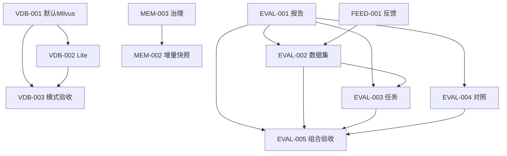

# 核心借鉴一期：12包任务拆分计划

日期：2026-10-21（Asia/Shanghai）  
状态：任务登记与范围落盘；全部业务任务为backlog，未开始业务实现。  
任务真源：[tasks.yaml](../../tasks.yaml)。上游：[借鉴评估方案](proposal_cross_project_reuse_20261021.md)第15–18节。

## 1. 授权、目标与非目标

用户明确要求“开始实施吧，先开始拆任务”。本轮登记最小12包，新增9卡、扩展MEM-002/MEM-003并沿用FEED-001；不登记剩余24包，不修改其状态，不提前MEM-004。方向授权持续有效，不重复询问是否采用Milvus。具体新依赖/Schema/保留期/ADR/SLO与真实调用预算在对应卡计划中锁定，不能把任务登记当成全部技术细节已批准。

一期目标：开发者能用默认Milvus与开发Lite模式摄取/检索；有权维护者能查看报告和运行历史、管理评测集、执行/取消预算内评测、对照检索；会话所有者能反馈，长对话能复用受治理的增量快照。数字人0卡。

非目标：存量迁移/清库、生产部署、Git提交推送、付费模型调用、数据外发、重排/查询改写实验、长期记忆/画像、MCP新功能、替换Agent Runtime、分布式双写。所有数据库当前为测试数据，不要求存量迁移；这不等于自动执行删除命令。

## 2. 基线与当前事实

- 基线HEAD：`ac494b386bccd00e5e0f66f1ec214664cdb3216d`；分支 `codex/flow-003-scheduled-execution`。
- 登记前192卡：141 done / 50 backlog / 1 cancelled；登记后201卡：141 done / 59 backlog / 1 cancelled。
- 登记前工作区仅本轮系列评估/验证文档未跟踪；不把这些文件称为已提交。
- 原任务逐卡对象摘要、MEM/FEED原契约及599个受保护源码/测试/配置/CI文件指纹见 `../reviews/core_reuse_task_registration_baseline_20261021.json`。
- 本轮未执行应用基线、pytest、mypy、前端检查或真实模型/Milvus/Lite运行；只做YAML、依赖、范围、引用和规则一致性验证。业务检查留待单卡开发前，不能用文档通过冒充业务通过。
- 当前向量默认仍local，Milvus仍Partial；本轮没有改配置。报告中新的质量/样本/费用建议仍待对应计划批准。

## 3. 正式映射与工作量

| 评估包 | 正式卡 | 交付 | 阶段 | 人日粗估 |
|---|---|---|---|---:|
| S01 | [VDB-001](#vdb-001) | Milvus 成为默认向量后端并打通空库摄取 | D1 | 4–7 |
| S02 | [VDB-002](#vdb-002) | 开发环境 Milvus Lite 启动兜底与实例归属 | D1 | 5–9 |
| S03 | [VDB-003](#vdb-003) | 默认 Milvus 与 Lite 模式组合验收 | D1 | 2–4 |
| R01 | [EVAL-001](#eval-001) | 受权评测报告查询与结果页面 | D2 | 4–7 |
| R02 | [EVAL-002](#eval-002) | 评测数据集版本审核与反馈候选管理 | D3 | 5–8 |
| R03 | [EVAL-003](#eval-003) | 受预算在线评测任务执行与取消 | D3 | 6–11 |
| R04 | [EVAL-004](#eval-004) | 受控检索策略对照与候选分析页面 | D3 | 3–6 |
| R08 | [EVAL-005](#eval-005) | 最小评测平台组合与业务验收 | D3 | 2–4 |
| O01 | [TRACE-001](#trace-001) | 受权持久运行历史与脱敏 Trace 详情 | D2 | 5–9 |
| M01 | [MEM-002](#mem-002) | 同会话增量快照持久化 | D2 | 3–5 |
| M02 | [MEM-003](#mem-003) | 会话记忆治理与规则接线 | D2 | 3–5 |
| F01 | [FEED-001](#feed-001) | 原反馈CRUD与对话交互 | D2 | 2–4 |
| **合计** | **12卡：9新、3原卡** | **未实施/未验收** | D1–D3 | **44–79** |

数字来自评估逐卡剩余成本；不是承诺工期。D1为11–20、D2为17–30、D3为16–29人日。599个源文件指纹不等于逐行审核或测试通过。

## 4. 依赖与实施顺序

首张推进VDB-001，先形成具体实施计划/ADR补记与开发前基线，再写失败测试和最小实现。默认环境尚未验证时不直接修改默认值声称成功。

新增精化依赖 **MEM-003 → MEM-002**：先落实会话/摘要/快照读写授权、失效和删除规则，再落持久化快照。它不改变MEM-004暂缓，也不把两卡合并。本边相对于评估初图是实施拆分精化，已登记到tasks.yaml。

原卡及已完成前置保留：VDB-001依赖RAG-015/032/036、V1C-001；EVAL-001依赖RAG-017/035、PAGT-007；TRACE-001依赖SSE-001/PAGT-006。所有这些当前done仍须按当前输入复核，不能沿用旧版本全绿。具体同一时刻只推进一张业务卡，分支任务不因图上独立而自动并行授权。

VDB-003/TRACE-001对EVAL-005为软建议；EVAL-005只验收R01–R04及既有runner。**整批一期验收另按本计划核对12卡全部业务出口**，不能只用EVAL-005 done就声称存储/记忆/Trace已完成，也不再新增第13张重复验收卡。

## 5. 共享归属与准入

- EVAL-001拥有报告协议/只读适配；EVAL-002拥有数据集版本/审核/反馈候选；EVAL-003拥有任务状态/预算/取消。
- TRACE-001拥有运行历史与展示；既有SSE/状态/Executor沿用，不另造Runtime。
- MEM-003拥有策略；MEM-002拥有同会话快照存储；FEED-001只做原反馈CRUD，入集归EVAL-002。
- 具体ADR待编写/确认：默认切换修订ADR-0002；Lite预留0019；评测任务使用0023（原预留0020已被原生结构化工具提议占用）；运行历史预留0021；会话快照/治理预留0022。此处只是候选文件路径，不是已Accepted决定；不覆盖已有ADR。
- 每卡启动前：核对真实代码、规则、允许路径；锁定接口/表/状态/错误/读取主体/版本/回滚与验证命令；记录当前基线；按适用要求完成具体设计审查。方向已获授权不重复裁决，但新增费用/供应商/依赖或风险边界不得推定获批。
- 所有卡nightly eligible=false，production_access=false，auto_merge=false，auto_deploy=false。不将本计划设为后台自动工作或自动发布授权。

### 5.1 EVAL-003～005、TRACE-001、MEM-003/002 批次设计决定（2026-10-23）

用户批准按 `EVAL-003 → EVAL-004 → EVAL-005 → TRACE-001 → MEM-003 → MEM-002` 顺序实施。外部硬前置 EVAL-001、EVAL-002、SSE-001、PAGT-006 均为 done；批次内部保持 EVAL-003/004 先于 EVAL-005、MEM-003 先于 MEM-002。

- **评测任务**：ADR 使用 `0023-evaluation-job-lifecycle.md`。任务由 Service 维护受权状态机、有限并发、幂等、取消和重启终态，runner 通过固定适配接口调用，不拼接任意 shell。任务绑定租户、提交人、数据集版本、runner/模型用途、预算与报告。未经另行批准，真实外部模型预算为零，执行请求明确拒绝；确定性测试 runner 只验证生命周期，不能作为真实质量证据。
- **检索对照**：只暴露当前 RagService/backend 实际支持并可白名单校验的参数；同一主体、租户、知识库、索引身份和问题形成配对输入。响应返回候选、排序、来源/版本和分阶段耗时，不新增重排、Query Rewrite、向量库或稀疏架构，不修改线上默认值。
- **组合验收**：仅在 EVAL-003/004 完成后覆盖数据集→任务→报告→对照→失败门禁。真实调用未授权时明确记为未验收，不用 Mock 替代；最终状态受同一候选输入的后端、前端、适用 Linux 与 CI 证据约束。
- **运行历史**：ADR 使用 `0021-run-history-storage-visibility.md`。会话所有者可读自己的记录；同租户管理员沿用既有角色/权限入口读取；越权统一表现为不存在。持久化内容限于脱敏、截断后的阶段、工具状态、错误类别、真实 usage（缺失为 unknown）和耗时，不保存原始 Prompt、凭据、工具参数或结果。默认保留 30 天，过期立即不可读，本批不自动物理删除；会话删除或主体撤权后立即不可读。
- **会话记忆治理与快照**：ADR 使用 `0022-memory-snapshot-governance.md`。读取沿用当前 ChatService 会话所有权及同租户系统管理员规则；租户不匹配、用户停用/撤权、会话删除、消息编辑/删除、压缩器或快照版本变化均使快照失效。默认保留 30 天，过期后不可复用，本批不自动物理删除。MEM-003提供唯一策略接口，MEM-002通过 Service 持久化同会话快照并只压缩消息游标后的新增历史；不实现跨会话记忆。
- **错误与回滚**：权限和身份错误默认拒绝且不泄露资源存在性；预算不足不启动 runner；取消、进程重启、外部失败和快照冲突均进入确定终态或安全重算，不隐式扩大调用。回滚关闭新增入口和写入，保留已落记录，不自动删表或清理数据。
- **验证**：每卡先补失败用例，再做最小实现和直接调用方专项；新增状态、权限、Trace、Memory 与 RAG 行为均补 Evaluation Case。最终全量、静态、前端和平台证据按 AGENTS.md 第10节绑定候选版本，证据不足保持 in_review。

## 6. 逐卡实施契约

本节提供目标、现状、方案、非目标与验收，满足拆分落盘要求；**不是在具体Schema/接口/保留期尚未锁定时直接改业务的许可**。代码前应在本卡实施计划补齐上节设计和基线，若本节补全后能独立执行可沿用，无需为形式再写重复计划。allowed_paths以tasks.yaml为真源，其中新文件是候选落点，不表示已存在；目录级路径不授权顺手重构无关模块。

### VDB-001：Milvus 成为默认向量后端并打通空库摄取

**目标/交付**：运行默认Milvus，空库首次上传即可登记索引、写入与检索；开发部署/依赖/健康状态与实际后端一致；local仅供显式离线评测/隔离测试，不自动兜底。

**现状/问题**：app/core/config.py默认local；已有MilvusVectorStore、索引身份登记和Compose片段，Milvus仍Partial。 当前默认local走数据库+NumPy；已有Milvus适配但不能把默认字符串修改等同可运行交付。

**方案**：沿用VectorStore，先修订默认切换ADR与启动契约；接通默认配置、依赖、干净部署、空库索引登记和摄取；无隐式local回退。

**依赖**：RAG-015、RAG-032、RAG-036、V1C-001。**范围**：见tasks.yaml中本卡allowed_paths；主要落点：app/rag/vectorstore/、app/rag/index_registry.py、app/rag/index_identity.py、app/rag/ingestion.py、app/rag/service.py。

**非目标**：

- 不迁移或清空现有测试库
- 不引入Chroma、重排、查询改写或新稀疏召回架构
- 不在本卡实现Lite兜底；不删除冻结local评测

**验收**：

- 默认配置实际选择Milvus；未知配置/连接故障不静默退回local
- 真实Standalone下空库摄取、检索、删除、重解析、租户与索引身份校验通过
- 普通非检索请求不因无关Milvus故障失败；检索故障明确unavailable，不冒充no_hit
- 当前混合候选窗口限制和回滚有记录，必要最终版本检查通过

**设计前置**：先修订ADR-0002并锁定具体默认/依赖/初始化方案；方向已授权无需重选向量库；现有SDK变更、新依赖或破坏性数据动作如确需发生须单独明确。**风险**：L1。**回滚**：回退本卡默认与接线配置；保留数据和local离线实现，不宣称两库数据可自动互相接管。

**验证/实现说明**：适用第7节完整门禁；实现后另写 `docs/plans/implementation_vdb_001.md`，绑定最终输入与实际结果，不预填通过。

### VDB-002：开发环境 Milvus Lite 启动兜底与实例归属

**目标/交付**：可验证的Lite兼容矩阵和开发启动兜底；持久化实例归属、索引/缓存隔离、实际模式及兜底原因可见。

**现状/问题**：当前pymilvus固定2.5.11并使用ORM接口；Lite/Windows兼容未实测，两实例不共享数据。 本机Standalone未启动时需要开发可用路径，自动逐请求换库会产生数据归属混乱。

**方案**：先做兼容时间盒探针；仅开发环境、启动时对本机地址有限探测后选择Lite；持久保存实例归属和索引身份，进程内固定模式。

**依赖**：VDB-001。**范围**：见tasks.yaml中本卡allowed_paths；主要落点：app/rag/vectorstore/、app/rag/index_registry.py、app/rag/index_identity.py、app/rag/cache.py、app/models/rag.py。

**非目标**：

- 不逐请求换库，不运行中故障自动降级，不生产兜底
- 不双写/同步/自动重建、不静默切回Standalone、不清空旧实例
- 不未经批准升级SDK或把WSL可用冒充原生Windows通过

**验收**：

- 真实Lite摄取/检索/删除/重解析及重启持久化；服务可用时优先Standalone
- 仅连接不可达/未就绪可启动兜底；配置/身份/Schema/凭据错误明确拒绝
- 进程内模式固定，跨重启不因Docker恢复静默换库；归属不一致拒绝而非空命中
- 生产与显式远程服务地址禁止本机Lite兜底；真实平台与Linux证据齐全

**设计前置**：Proposed ADR-0019只预留路径，实施前锁定实例选择、持久化字段和兼容范围；建议1人日兼容探针属于本卡预算；失败停止并提出环境/依赖替代，不降低门禁。**风险**：L1。**回滚**：关闭开发启动兜底、回退模式选择；保留Lite文件及索引登记；禁止自动删除或合并两库。

**验证/实现说明**：适用第7节完整门禁；实现后另写 `docs/plans/implementation_vdb_002.md`，绑定最终输入与实际结果，不预填通过。

### VDB-003：默认 Milvus 与 Lite 模式组合验收

**目标/交付**：真实Standalone/Lite组合矩阵与最终版本证据；启动/停止/故障/回滚手册及可复现实验报告。

**现状/问题**：已有历史Milvus五门证据，但不覆盖本批默认/Lite最终输入。 单卡测试不能替代默认部署/两模式/故障路径的最终组合证据。

**方案**：复用真实服务测试，锁定最终输入与环境，验证干净部署和模式切换拒绝，输出业务验收与运行手册。

**依赖**：VDB-001、VDB-002。**范围**：见tasks.yaml中本卡allowed_paths；主要落点：tests/与验收手册。

**非目标**：

- 不代替前两卡独立单测、不顺带修未授权业务
- 不发付费模型请求，不清现有库，不自动合并部署

**验收**：

- 默认/空库/双模式/归属/不可用/非检索隔离组合全部按锁定契约通过
- 同最终提交Ubuntu必要CI与适用Linux测试通过；缺证据保持in_review或blocked
- 明确Mock仅证明链路，记录SDK、服务版本、机器、命令、退出码和指纹

**设计前置**：前两卡交付及最终输入冻结后实施；外部CI推送权限按对应明确授权处理。**风险**：L0。**回滚**：本卡只回退验收脚本和文档；不得更改已保存业务数据。

**验证/实现说明**：适用第7节完整门禁；实现后另写 `docs/plans/implementation_vdb_003.md`，绑定最终输入与实际结果，不预填通过。

### EVAL-001：受权评测报告查询与结果页面

**目标/交付**：只读报告API、稳定数据协议与有权列表/详情/趋势/失败切片；旧协议/缺测/失败状态和模型/数据/源码版本按真实口径显示。

**现状/问题**：已有RAG检索/生成及Agent runner与版本化报告；现前端无统一评测页面。 评测以文件/CI为主，缺受权报告列表、趋势和失败切片页面。

**方案**：定义只读报告协议、服务端白名单适配与身份范围；沿用前端路由/权限体系展示三类报告，来源前端结构只做适配。

**依赖**：RAG-017、RAG-035、PAGT-007。**范围**：见tasks.yaml中本卡allowed_paths；主要落点：app/api/routes/evaluation.py、app/api/router.py、app/services/evaluation_reports.py、app/schemas/evaluation.py、app/core/security.py。

**非目标**：

- 不重写评测器，不启动模型调用
- 不暴露任意文件路径下载，不把全局报告默认授予所有租户
- 不替代被测RAG/Agent质量发布结论

**验收**：

- 三类报告的数值/缺测/版本/失败切片与原始输入一致；不支持协议明确拒绝
- 报告归属未知时默认拒绝；未授权/跨租户访问不泄露正文或报告存在性
- 前后端契约与四项前端门禁通过，未将缺测显示为0或失败显示为通过

**设计前置**：实施计划先锁定报告读取主体、全局基线与租户运行结果分域、协议适配及脱敏；角色值不由前端决定。**风险**：L1。**回滚**：回退新路由和页面，保留原始报告/runner/CI。

**验证/实现说明**：适用第7节完整门禁；实现后另写 `docs/plans/implementation_eval_001.md`，绑定最终输入与实际结果，不预填通过。

### EVAL-002：评测数据集版本审核与反馈候选管理

**目标/交付**：数据集创建/导入/导出/版本/等级/审核闭环；已授权反馈转待审回归候选，保留来源与审核记录。

**现状/问题**：已有evals版本化数据与Schema，反馈CRUD由FEED-001负责，尚无受控入集页面。 缺受控数据集管理与反馈进入回归候选的统一入口，直接改Gold会破坏证据。

**方案**：复用已有Schema/等级和报告协议，新增租户受权数据集版本、导入导出/审核及反馈候选关联；冻结集和holdout只按原规则读用。

**依赖**：EVAL-001、FEED-001。**范围**：见tasks.yaml中本卡allowed_paths；主要落点：app/models/evaluation.py、app/models/__init__.py、app/core/database.py、app/api/routes/evaluation.py、app/services/evaluation_datasets.py。

**非目标**：

- 不覆盖冻结数据、阈值、holdout或官方基线
- 不自动升Gold，不实现试题模型生成
- 不重复FEED-001反馈CRUD，不扩展成训练语料运营平台

**验收**：

- 有效数据导入导出语义及哈希规则一致，非法Schema/版本/权限拒绝
- 冻结/holdout不可通过页面变成调参数据；AI生成默认非Gold
- 反馈候选能追溯原证据和审核，删除/撤权/租户隔离按批准契约生效

**设计前置**：先锁定数据集版本/不可变范围/审核主体及反馈快照授权和保留契约；不处理真实客户数据。**风险**：L1。**回滚**：关闭新增管理入口并回退代码；保留原数据版本，数据删除另获授权。

**验证/实现说明**：适用第7节完整门禁；实现后另写 `docs/plans/implementation_eval_002.md`，绑定最终输入与实际结果，不预填通过。

### EVAL-003：受预算在线评测任务执行与取消

**目标/交付**：后台任务受权启动/状态/取消/有限并发/幂等/重启终态；复用runner与计数预算，任务/报告/输入版本可追溯。

**现状/问题**：三个现有runner可复用；无已批准统一后台评测任务存储/调用接口。 缺从页面启动的受权评测生命周期；直接同步长调用会阻塞并失去取消与预算。

**方案**：先完成任务生命周期ADR与runner接口方案，服务端固定数据/输入身份、预算和幂等，提供启动/状态/取消/报告关联；不新增Agent Runtime。

**依赖**：EVAL-001、EVAL-002。**范围**：见tasks.yaml中本卡allowed_paths；主要落点：app/models/evaluation.py、app/models/__init__.py、app/core/database.py、app/api/routes/evaluation.py、app/services/evaluation_jobs.py。

**非目标**：

- 不任意shell拼接运行脚本，不新建第二Agent运行时
- 不默认付费、生产外发或通知，不调整质量门槛

**验收**：

- 重复提交、超限、取消、重启和外部失败有确定终态；未批准预算新增调用0
- 任务数据/报告/主体/模型用途绑定，失败保留失败，不隐式重试扩大调用
- 后台会话生命周期与权限复核正确，原官方门禁和前后端回归不退化

**设计前置**：先锁定Proposed ADR-0023与任务/runner接口；建议1人日生命周期探针属于本卡预算；真实模型、数据外发和费用信封须批准；本次登记不含调用授权。**风险**：L2。**回滚**：停止接收新任务、受控收尾后回退服务；保留任务和报告证据，不清理运行数据。

**验证/实现说明**：适用第7节完整门禁；实现后另写 `docs/plans/implementation_eval_003.md`，绑定最终输入与实际结果，不预填通过。

### EVAL-004：受控检索策略对照与候选分析页面

**目标/交付**：候选/排序/来源/耗时/输入身份配对对照API和页面；实验参数不污染线上默认配置，报告实际支持的策略。

**现状/问题**：已有知识库单次检索与混合后端，来源项目有对比交互可借鉴。 单次检索难比较候选/排序/来源/耗时，易把不同版本实验当改进。

**方案**：参数白名单和身份范围在服务端校验，同问题/数据/索引/模型下走现有受控backend并展示配对结果。

**依赖**：EVAL-001。**范围**：见tasks.yaml中本卡allowed_paths；主要落点：app/api/routes/evaluation.py、app/services/evaluation_comparison.py、app/schemas/evaluation.py、app/rag/backend/base.py、app/rag/backend/native.py。

**非目标**：

- 不在本卡新增重排/查询改写/向量库/稀疏架构
- 不修改RRF融合常数默认值，不用holdout调参
- 不为对比接口另建绕过RagService的授权通道

**验收**：

- 同输入与固定后端/数据身份可复现，跨身份混比拒绝
- 候选被正确映射到来源和版本；耗时口径明确，实验不改变后续线上请求默认
- 只暴露实际支持的策略；未授权读取、任意参数和预算外调用拒绝

**设计前置**：先锁定可比较参数矩阵；如当前后端不支持某策略须提出方案，不伪造空对比或悄改算法。**风险**：L1。**回滚**：关闭比较入口并回退适配，现有单次检索和默认排序保持。

**验证/实现说明**：适用第7节完整门禁；实现后另写 `docs/plans/implementation_eval_004.md`，绑定最终输入与实际结果，不预填通过。

### EVAL-005：最小评测平台组合与业务验收

**目标/交付**：核心平台端到端、权限、失败/预算与最终版本验收报告；D3用户操作说明及明确未实现能力。

**现状/问题**：核心清单尚未实现；算法增强不属于本批验收条件。 页面/API/runner各自通过不代表整条链路与门禁一致。

**方案**：锁定核心R01–R04及已有runner清单，按角色复验数据集→任务→报告→对比→失败门禁；汇总当前最终版本证据。

**依赖**：EVAL-001、EVAL-002、EVAL-003、EVAL-004。**范围**：见tasks.yaml中本卡allowed_paths；主要落点：frontend/src/。

**非目标**：

- 不等待未批准重排、生成题目或长期记忆
- 不以平台交付宣称既有生成质量达标
- 不重开done卡，不在验收卡偷偷修业务

**验收**：

- 核心清单端到端矩阵通过；report与runner门禁判定一致，红色报告保持失败
- 所有必要最终后端/前端/适用Linux/同SHA CI检查完整，缺证据不得done
- 真实调用若未获授权/未运行须保留待验收，不用Mock替代质量结论

**设计前置**：锁定验收数据/角色/真实调用授权与最终指纹；后续新增功能各自承担集成回归。**风险**：L0。**回滚**：回退验收脚本/说明，不删除已生成报告或业务数据。

**验证/实现说明**：适用第7节完整门禁；实现后另写 `docs/plans/implementation_eval_005.md`，绑定最终输入与实际结果，不预填通过。

### TRACE-001：受权持久运行历史与脱敏 Trace 详情

**目标/交付**：受权持久化运行历史、脱敏事件与节点详情查询；历史/Token/耗时页面，复用现有SSE/检查点和共享指标口径。

**现状/问题**：TraceCollector以内存为主；已有SSE回放、状态检查点和前端阶段展示。 内存Trace重启丢失，现有流式阶段/Plan无法替代受权历史查询。

**方案**：先确定Trace存储/主体/字段/保留ADR；业务服务持久化脱敏事件，提供run关联历史及Token/耗时详情；缺用量标未知。

**依赖**：SSE-001、PAGT-006。**范围**：见tasks.yaml中本卡allowed_paths；主要落点：app/debug/trace.py、app/services/run_history.py、app/services/chat_service.py、app/services/supervisor_tools.py、app/services/agent_state_service.py。

**非目标**：

- 不通过历史回放重新执行工具或模型
- 不保存原始敏感Prompt/凭据，不承诺多实例活跃任务恢复
- 不重复SSE-001，不把尚未实现OPS-007标成已具备

**验收**：

- 重启后可按身份/租户/会话查询保留范围内记录；越权拒绝且不泄露存在性
- 脱敏、截断、过期/删除契约生效；缺用量显示未知而非0
- 历史查看不产生模型/工具调用；阶段计时口径和真实usage来源可追溯
- 同最终输入的公共链全量后端、前端、适用Linux/CI检查通过

**设计前置**：先锁定Proposed ADR-0021，批准读取角色/字段/保留期/删除语义；不使用未批准数值默认。**风险**：L2。**回滚**：关闭新历史写读入口，回退接线；保留现有消息/状态和已落记录，物理删除另授权。

**验证/实现说明**：适用第7节完整门禁；实现后另写 `docs/plans/implementation_trace_001.md`，绑定最终输入与实际结果，不预填通过。

### MEM-003：治理先于同会话快照持久化

**目标/现状**：原卡已要求读权限、期限、删除、租户隔离规则落在路径上；本次把范围落实到当前会话历史/压缩摘要和即将建立的同会话快照，不实现跨会话检索。

**方案**：在Service定义并复用会话主体/租户/版本/有效期/删除判定；当前记忆入口先执行可适用规则，快照校验接口供MEM-002消费。Proposed ADR-0022定义适用字段、保留值和失败行为；未经确认不任意设置保留天数。Agent不持有数据库会话。

**扩卡差额**：增加必要Service、models/初始化、alembic、chat入口、配置和文档/Evaluation路径；保持原读/存/删/隔离验收，priority从P2改P1用于本期核心治理。允许路径只是候选上界，实际变更需最小化。与MEM-002共用Schema/ADR，不重复新增第二套快照表。

**非目标**：不提前MEM-004、不画像/抽取/检索、不替代MEM-002快照持久化、不实际清库。

**验收**：主体/租户/会话归属、撤权、过期/删除都有可重复判定和反例；在当前真实调用入口生效，不只文档或未接线工具类。长期能力尚未接入的规则明确为预留契约，不能宣称长期记忆已实现。必要公共链全量回归与类型检查通过。

**依赖/回滚**：无新增硬前置；失效/删除规则回退须保护现有摘要和数据，不以禁用鉴权回滚。实现说明另写 `implementation_mem_003.md`（不得覆盖已有同名记录，存在时用带日期新文件并更新链接）。

### MEM-002：同会话持久增量快照

**目标/现状**：现有compressor接收existing_snapshot，ChatService尚未保存和传递；复用而非换算法。

**方案**：先消费MEM-003策略。Service按已授权的会话读取有效快照，绑定处理消息边界/版本，只压新增历史并保留最近消息；保存冲突、编辑/删除/模型或版本变化及压缩失败有确定处理，不能把snapshot误当跨会话记忆。

**扩卡差额**：增加models/alembic/Service/初始化/chat必要路径和重启验收；新增depends_on=MEM-003。具体Schema、消息游标、配置和迁移失败行为先锁定，禁止代码先落后补ADR。

**非目标**：不改压缩算法、不跨会话检索、不画像，不实际迁移/清空现有数据库。

**验收**：首次压缩、再次追加和重启后有效快照复用；旧消息不重复压缩；keep_recent正确；编辑/撤权/过期/删除后不能复用失效快照；摘要故障不泄露或导致非授权读取，必要公共链全量回归通过。

**回滚/说明**：回退接线，保留快照数据；必要时暂停新增写入，不自动删表。另写 `implementation_mem_002.md` 或不覆盖的日期文件。

### FEED-001：沿用原反馈契约

**目标/现状**：缺反馈表/API和对话交互。保留原scope、acceptance、risk、depends_on；只补本批映射、计划和准入记录。

**方案**：沿用 `plan_chat_feedback.md` 与其引用评审，实施前复核2026-10-01的历史事实与当前SSE/取消协议漂移；所有者可提交失败反馈、有用/无用并查询/删除，入库前脱敏。EVAL-002消费其受权记录生成候选，FEED-001不做语料运营扩张。

**非目标/验收**：不直接改Skill/Prompt/模型、不跨租户排行、不自动Gold。表结构/OpenAPI可复现、原所有者操作通过、非所有者拒绝、评论脱敏；前后端和公共链适用门禁通过。如旧详细方案与当前契约存在影响方向的冲突，给证据后停止，不自行选择历史实现。

**回滚/说明**：回退入口和迁移脚本，不自动删除反馈表数据。原计划保留，另写实际实现说明，不预置验收结论。

## 7. 验证、任务关闭与证据

本次任务登记属于纯文档/规则治理，不改业务、测试、依赖、配置或CI执行行为，只运行任务/YAML/引用/依赖/范围一致性验证；不声称已有业务CI通过。

业务实施时：解释器固定 `D:/DepTooL/anaconda3/envs/ai-assistant/python.exe`，测试数据库为隔离的测试库，禁止使用开发主库。记录非敏感配置、extras/依赖版本、数据/模型/维度和平台；新Prompt/Tool/State/RAG/Memory/Guardrail更新Evaluation。

- 后端变更：`-m ruff check .`、`-m mypy app/`与专项；公共链/全局配置执行无筛选`-m pytest`，不能用-k替代。
- 前端源码或契约：在frontend执行typecheck、Vitest、lint、build，分别保留退出码；按实际需要npm ci。
- 平台/文件系统/进程/部署：Linux相关测试与最终提交Ubuntu CI；没有环境只登记缺证据，不能done。
- 真实模型费用、评测数据外发和外部CI推送按对应明确授权，不在本次登记时推定。
- 必要失败/未跑/过期保持in_review或blocked。仅修改说明且不影响检查输入可按规则沿用证据并说明；业务修改必须重跑对应检查。
- 单卡实现、独立审查与业务验收后更新文档和任务状态；不得自行提交为已完成交付。发布/合并还要核验最终SHA必要检查。

注册验证命令：`D:/DepTooL/anaconda3/envs/ai-assistant/python.exe docs/reviews/validate_core_reuse_registration_20261021.py`。结果与基线差异、报告/任务指纹见 `../reviews/core_reuse_task_registration_validation_20261021.json`。旧评估validation绑定旧tasks输入，本次登记后不再当作当前任务队列验证证据。

## 8. 阶段出口与下一步

- D1：VDB-001/002/003通过真实默认/双模式/故障验收，不自动同步两库。
- D2：MEM-003先于MEM-002；FEED-001/EVAL-001/TRACE-001各按权限显示反馈/报告/历史，缺测不冒充0；不承诺长期记忆。
- D3：EVAL-002/003/004/005完成受控数据集→任务→对照→报告闭环，失败质量报告保持失败。
- 整批完成须12卡各自必要门禁、业务出口和最终版本证据齐全；本次登记只完成任务契约准备，不关闭这12张业务卡。
- 下一项是VDB-001的具体实施准备。任务拆分已授权，无需再次确认是否拆卡；尚未决定的依赖/兼容/字段等在该卡内带证据落实。

