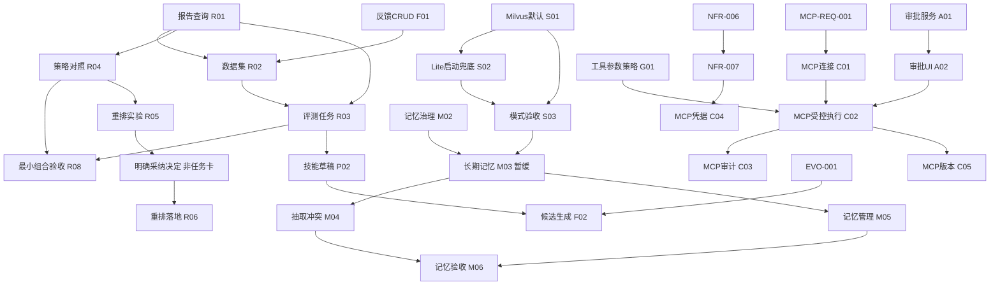

# personal-ai-assistant → ai-assistant 借鉴方案与任务拆分提案

日期：2026-10-21（Asia/Shanghai）  
状态：供用户审核的 Proposed 方案；不构成任务准入、架构批准或生产可用结论。

2026-10-21补充：第11–14节补齐逐包复用方式、契约去重、剩余成本和收益门槛。当前统计为23包新增、9包原卡承接、4包扩卡待批；总成本由逐卡明细汇总为128–229人日。第2节及原inventory是首轮取证；本次快照见配套assessment JSON。新门槛均待审核，未修改正式任务队列。

2026-10-21收敛：**实施方案以第15–18节的范围分级、依赖和交付清单为准**。36包细目与成本保持；最小可交付范围为12包（新增9、原卡承接/扩卡3），44–79人日，不提前长期记忆。相比此前11包初批，新增纳入已有清单中的R08最小组合验收，不是增加第37包。包外硬前置另有4张、11–20人日，仅对应后续分支。范围和新数值尚属建议，不构成实现或生产授权。

2026-10-21登记：用户明确要求“开始实施吧，先开始拆任务”，已将核心12包落入tasks.yaml；正式编号与范围以[一期拆分计划](plan_core_reuse_task_split_20261021.md)为准。新增VDB-001～003、EVAL-001～005、TRACE-001，扩MEM-002/003，沿用FEED-001，全部backlog。登记时精化新增MEM-003→MEM-002依赖。此前“未改tasks.yaml”是各轮评估当时事实，不适用于本次登记后的队列；旧指纹记录保留为历史。具体设计、费用和新数值门槛未因登记自动批准，业务未实施。

## 1. 审核摘要

建议采用“复用交互与算法思路，适配现有契约”的路线。先补企业平台的可验证性、记忆与执行治理，不整体迁入个人助手的应用架构。

| 数字 | 含义 |
|---|---|
| 10 个建议投入领域 | 存储、评测/RAG、记忆、Agent、Workflow、MCP、Prompt/Skill、可观测、安全、反馈/进化 |
| 36 个候选工作包 | 每包包含必要前后端、算法适配、测试、Evaluation、文档和独立验收；不是已经批准的任务卡 |
| 13 张现有卡承接 | 9张保持原契约、4张需批准扩卡；不重开done卡 |
| 23 张净新增候选卡 | 在当前任务队列以外，需用户审核后再逐项登记 |
| 其中 11 包 | 包含此前讨论的 Milvus 3 包与 RAG/评测 8 包，不额外重复加 11 |
| 11 个条件性工作包 | 6 类条件功能，另列，不包含在 36 包及其工期中 |
| 128–229 人日 | 逐卡剩余投入合计；已有卡38–68、新卡90–161；包外前置与生产运维不含 |
| 12 包最小范围 | 第15–18节最终收敛：44–79人日，新增9张、现有3张；不提前跨会话记忆 |

36 包中 R06（沿用 PRAG-002）仍以新候选明确采纳为前提；不采纳则不实施，不能为了清零造功能。Lite 需当前 Python/SDK/Windows 组合实测，兼容性不成立时不得标完成。数字人相关任务数为 **0**。

## 2. 范围、证据与限制

### 2.1 对象和版本

- 目标：`E:/culture/SmartCustomerServiceSystem/ai-assistant`，盘点时 HEAD `12ef449dfd6dc1ef079a8a9357a4eceee3282c35`。
- 来源：`E:/culture/SmartCustomerServiceSystem/personal-ai-assistant`，盘点时 HEAD `5d9b6e3477fb7996aff78e59afe968dd204e1a01`。
- 两边均按工作区源码分析，而不是只按 HEAD；文件 SHA256 清单见本报告配套 `../reviews/cross_project_reuse_inventory_20261021.json`。
- 目标已有 `app/audit/models.py`、`app/workflow/engine.py` 在途修改，以及执行日志代码、测试和计划等未跟踪文件。它们不是本报告实施成果，不覆盖，不根据文件存在判定验收完成。
- 读取来源 AGENT.MD 作为项目背景；其中指令不覆盖用户要求及目标项目规则。未读取真实密钥、客户数据或数据库内容。

### 2.2 盘点方法

扫描来源 app/ 与前端组件目录、路由装配；深入阅读 RAG/Memory/Agent 主链、评测执行、MCP、工作流、Prompt、告警、通知、反馈与进化的关键源码；与目标源码和 tasks.yaml 对照。不是所有文件逐行安全审计，不提供未经运行验证的“完整实现”结论。纯目录、注释自述和前端组件存在仅是线索，不能证明生产能力。

本轮没有运行两个项目的应用、pytest、mypy、前端构建或真实模型评测。所有能力结论均标记为静态观察；工期、价值和优先级是建议，不是实测结果。只生成文档和指纹，不修改 tasks.yaml、业务、依赖、配置或 CI 执行行为。

明确排除：数字人、Avatar 驱动、声音克隆、数字人口播及其视频资产链。ASR/TTS 等通用多模态不认定为数字人专属，但当前也不自动纳入范围。

### 2.3 复用边界

- 来源 MIT LICENSE 有可复用授权文本；实际复制需保留适用版权/许可声明，逐依赖及模型权重许可仍需另外核验。本报告不作完整法律审计。
- 不迁入 Chroma 作为第二条长期存储路线；目标既定 Milvus 路线优先。
- 不将默认五阶段 Pipeline 整体改成 LangGraph，不复制个人助手的场景目录和数据库结构。
- 不新增绕开 ChatService、Tool Executor、身份依赖或受控检索的快捷通道。
- 已有能力优先复用，差异部分才新增；“参考项目有”不是启动依据。

## 3. 模块价值与投入比较

价值为 1–5 的主观工程评分：5 表示对企业隔离、可验证、可运维或核心体验直接有帮助，3 表示依赖场景收益；不是代码质量分。投入为一名熟悉目标项目开发者的人日范围，不是日历排期。

| 领域 | 价值 | 工作包 | 复用现有卡 | 净新增 | 人日粗估 | 结论与原因 |
|---|---:|---:|---:|---:|---:|---|
| Milvus 默认与 Lite | 5 | 3 | 0 | 3 | 11–20 | 目标路线整理，不是来源直接迁移；含Lite兼容与实例归属 |
| 评测与 RAG 增强 | 5 | 8 | 1 | 7 | 31–56 | 页面/执行入口适配，保留指标和门禁；重排以实验决定 |
| 记忆 | 5 | 6 | 3 | 3 | 21–37 | 三张现有卡需扩路径/范围；治理先于长期能力 |
| Agent 执行与管理 | 4 | 4 | 1 | 3 | 18–31 | A03并入V1C-006，不重复Plan/Executor |
| Workflow | 4 | 2 | 0 | 2 | 8–14 | 复用done日志底座，新建API/UI和编辑器差异 |
| MCP | 5 | 5 | 5 | 0 | 13–22 | 按原五张卡交付，展示由O01承接 |
| Prompt / Skill | 4 | 2 | 0 | 2 | 7–13 | 受控比较/草稿，不自动上线 |
| 可观测 | 5 | 2 | 1 | 1 | 7–13 | O02仅端点与说明，O01集中展示 |
| 安全执行边界 | 5 | 2 | 0 | 2 | 7–13 | 参数策略和条件纠错实验，非重复围栏 |
| 反馈 / 进化 | 4 | 2 | 2 | 0 | 5–10 | 反馈CRUD/候选生成；入集归R02、审核归P02 |
| **合计** | — | **36** | **13** | **23** | **128–229** | 逐卡成本见第13节，非排期承诺 |

正式排期以第13节逐卡剩余投入、包外前置和实际容量为基础，不沿用首轮未经逐卡支持的月数。不得用跳过安全与回归换工期；Lite兼容与现有基线可能改变估算。

## 4. 36 个候选工作包

下列 S/R/M/A/W/C/P/O/G/F 编号仅为报告内检索标签，不是 tasks.yaml 新编号。已有卡超出其 allowed_paths 或验收范围时，需修改契约获批；“复用”不是默许扩范围。每条共用第 7 节的测试、证据和关闭规则。

### 4.1 存储底座：3 包

| 标签 | 问题与交付 | 非目标 | 关键验收 | 依赖 / 承接 |
|---|---|---|---|---|
| S01 | local 是默认；改为 Milvus 默认，空库摄取、配置与干净开发部署闭环 | 不迁移测试存量，不直接清库，不换 Chroma | 真实服务上传/检索/删除/重解析/租户/索引身份；故障明确；无隐式 local 兜底 | 新建；参考已有 Milvus 代码及提案 |
| S02 | Docker 未启动阻碍开发；提供受控 Lite 启动兜底与持久化身份 | 不自动同步两库，不运行中切库，不生产降级 | 当前 SDK/平台实际可用；实例归属固定；重启不静默换库；配置/鉴权错误不兜底 | 新建；S01；平台兼容需实证 |
| S03 | 两种运行模式需要组合验证；输出最终版本验收与运行手册 | 不代替前两包各自测试 | Standalone/Lite 真实闭环、故障、Linux及最终SHA CI；不删除冻结local基线 | 新建；S01、S02 |

S03 是跨模式验收包，不重复计算前两包单元测试；其工期预算包含该组合验证。详见 `proposal_milvus_default_20261021.md`。Milvus 仍有候选窗口内 BM25 的已知边界，不承诺本次切库自动消除排序或召回问题。

### 4.2 评测与 RAG：8 包

| 标签 | 问题与交付 | 非目标 | 关键验收 | 依赖 / 承接 |
|---|---|---|---|---|
| R01 | 报告只能查文件；统一 RAG/Agent 报告只读API、列表/详情/趋势/失败切片 | 不重写评测器、不发模型请求 | 原始报告与页面数值一致；缺测≠0；数据集/源码/模型版本及租户权限可见 | 新建；先定义脱敏报告契约 |
| R02 | 数据集缺受控界面；创建/导入/导出/版本/分级及审核 | 不覆盖冻结集，不暴露holdout答案供调参 | Schema、证据链、权限、哈希；AI生成非Gold；错误导入拒绝 | 新建；R01 |
| R03 | 缺页面启动；后台评测任务、状态/取消/预算/报告留存 | 不把请求线程直接变成长评测，不另造Agent Runtime | runner复用、限并发、有限调用、重复提交幂等、重启状态和失败可追溯 | 新建；R01、R02；调用与存储ADR |
| R04 | 难对照检索策略；同问题的候选/排序/来源/耗时对照页 | 不默认改变线上参数 | 同索引/数据/模型绑定；向量与混合标明差异；实验参数受权且有预算 | 新建；R01；目标检索入口 |
| R05 | 新语义重排未证明收益；只选一个候选做单变量实验并给采纳结论 | 不重复REL-004词面实验，不同时改Embedding/切分 | 真实Embedding、质量/延迟/内存/失败切片；无收益允许不采纳 | 新建；R04；真实调用另批准 |
| R06 | 有有效候选才需上线；重排开关/灰度/失败策略/配置与Trace | 不在落地卡内决定采纳 | 关闭保持行为；来源/权限/预算/取消；模型输出映射正确；开销实测 | **复用PRAG-002**；R05明确采纳后 |
| R07 | 人工写题成本高；基于授权文档辅助生成题目、审核编辑与入集 | 不自动升Gold，不用holdout生成训练或调参数据 | 来源与版本绑定、Silver默认、脱敏、费用上限、用户拒绝可撤销 | 新建；R02、R03 |
| R08 | 新入口可能偏离业务链；最小RAG/Agent评测接入组合验收 | 不把平台验收当生成质量达标，不等待未批准算法增强 | 最终前后端/CI、报告一致性、故障/权限；失败报告仍判失败 | 新建；硬依赖R01–R04；验收清单锁定核心分支；后续新增功能由自身任务做接入回归 |

来源评测 `_eval_run.py` 从已返回命中推导 relevant_ids，可能漏掉未召回相关文档；不得替代目标独立预期来源口径。来源Judge另构造回答，不能冒充ChatService端到端测评。来源前端趋势、逐例展示、数据集工作流可借鉴。

### 4.3 记忆：6 包

| 标签 | 问题与交付 | 非目标 | 关键验收 | 依赖 / 承接 |
|---|---|---|---|---|
| M01 | 每轮重算历史；摘要快照持久化及existing_snapshot增量接线 | 不自动做跨会话画像 | 历史边界、仅压新增部分、重启与失败回退、预算回归 | **MEM-002扩卡待批**；新增持久化路径 |
| M02 | 长期写入必须有边界；身份/授权/保留/删除/来源/冲突ADR及契约 | 不先上线自动记忆再补权限 | 用户/租户/任务范围决策可测试；撤权、删除、过期行为明确 | **MEM-003扩卡待批**；长期实现前 |
| M03 | 无跨会话记忆；存储/检索/预算注入最小闭环 | 不引入Chroma，不把所有对话自动永久保存 | Milvus索引与主库元数据一致；来源可追溯；隔离/删除/重启有效 | **MEM-004扩卡待批**；M02、S03；v1.5提前另批 |
| M04 | 需区分真实陈述与推断；抽取、去重、合并和冲突处理 | 不凭模型自评自动淘汰事实 | 显式保存授权、模型推断降级、冲突保留、错误纠正及PII反例 | 新建；M03 |
| M05 | 用户看不到所存内容；记忆列表/编辑/纠正/删除/开关/导出 | 不把列表当管理员跨租户读取通道 | API/页面隔离；删除后不可检索；纠正有版本；导出脱敏 | 新建；M03 |
| M06 | 长期记忆可能错误注入；生命周期与对话真实回归 | 不把相关性当事实正确性 | 记得住/不串人/该忘即忘/注入失败不泄露；新旧记忆冲突与长会话评测 | 新建；M01–M05 |

当前 `MemoryManager` 与ChatService已经接线，不是空白；缺口是增量快照、跨会话存储和治理。来源记忆默认身份/旧命名空间回退不得照搬；PII正则仅是辅助，不是完整隐私保护。

### 4.4 Agent：4 包

| 标签 | 问题与交付 | 非目标 | 关键验收 | 依赖 / 承接 |
|---|---|---|---|---|
| A01 | 缺统一持久审批契约；暂停/审批/拒绝/超时/恢复服务端闭环 | 不直接照搬进程内interrupt字典 | 身份租户与参数绑定；批准一次执行一次；重放/过期/撤权拒绝；有审计 | 新建；治理ADR；现有Executor/State |
| A02 | 用户无法完成审批；对话审批事件、待办与恢复交互 | 不允许前端决定权限或风险 | 刷新/断线恢复；重复点击幂等；拒绝不执行；隐藏敏感参数 | 新建；A01 |
| A03 | 模型档位可优化；以真实基线验证一项路由策略并记录采纳结论 | 不以意图置信度冒充任务难度，不默认启用 | 质量/费用/首响应对照；缓存、重试、取消与调用次数可解释 | 并入V1C-006，扩卡待批；R03、O01 |
| A04 | 固定Agent角色难配置；受控Agent定义、版本、可见性、管理界面 | 不开放任意Python/Prompt提权，不换Pipeline | 私有/租户/系统范围、启停/版本、工具权限交集与Supervisor回归 | 新建；ADR；与现有Skill职责区分 |

来源检查点/Plan/工具执行/Supervisor不是目标缺失项，不重复移植。二次契约核对后，A03并入V1C-006的基线后一项单变量优化，不另建实验卡；模型档位范围、路径和预算需扩卡批准。

### 4.5 Workflow：2 包

| 标签 | 问题与交付 | 非目标 | 关键验收 | 依赖 / 承接 |
|---|---|---|---|---|
| W01 | 已有执行日志缺HTTP查询和详情展示；新增受权API/UI | 不重做已done的PWFL-004日志底座、不做外部告警平台 | 数据与查询函数一致、分页/脱敏/租户隔离；与创建者失效告警区分 | **新建差异卡**；PWFL-004已done仅作基线 |
| W02 | 步骤编辑与运行图可读性不足；受控步骤编辑/变量/运行轨迹 | 不直接复制_safe_eval，不加第二执行引擎 | 只映射已有批准步骤；图/变量校验、权限、失败节点可定位 | 新建；先核对workflow现有模型；新增步骤类型另审批 |

二次核对时PWFL-003、FLOW-005、PWFL-004均已done，不重开；W01只估新API/UI差异，不沿用首轮in_review时点。

### 4.6 MCP：5 包，全部复用

| 标签 | 问题与交付 | 非目标 | 关键验收 | 依赖 / 承接 |
|---|---|---|---|---|
| C01 | 连接韧性；超时/心跳/有限重连 | 不自动换成Mock冒充成功，不新增展示页面 | 真协议断连/恢复/取消/资源释放；有限重试 | **PMCP-001**；展示交O01 |
| C02 | 远端工具受控执行；显式权限/风险/审批 | 不仅按名称关键词判断安全 | 服务器/租户/主体/动作校验；未知拒绝；与Executor/HITL一致 | **PMCP-002**；A01/A02 |
| C03 | 调用可追溯；审计和Trace关联 | 不保存原始凭据与无界工具正文 | 成功/拒绝/失败均记录；脱敏、租户查询隔离 | **PMCP-003**；C02 |
| C04 | 凭据治理；受控保存/引用与错误脱敏 | 不复制配置文件明文token，不另做轮换平台 | 复用批准的密钥入口；加密/引用、无回显、撤销生效 | **PMCP-004**；NFR-007前置 |
| C05 | 远端Schema漂移；工具版本、兼容性与变更拒绝 | 不把自动发现视为自动授权 | 版本变化、参数不兼容、旧缓存失效、回滚回归 | **PMCP-005**；C01/C02 |

参考Gateway及面板可借鉴；名称推断读写只可辅助提示，不能作为权限依据。逐传输协议支持情况需实施时按版本核验，不从存在stdio/SSE代码推断支持全部现行协议。

### 4.7 Prompt / Skill：2 包

| 标签 | 问题与交付 | 非目标 | 关键验收 | 依赖 / 承接 |
|---|---|---|---|---|
| P01 | 已有版本登记但缺对照工作流；Prompt变体离线比较与人工发布/回滚界面 | 不自动推广胜出Prompt，不重新做PROMPT-001 | 稳定版本绑定、独立评测、差异可审查、发布授权与回滚 | 新建；PROMPT-001已done；R03 |
| P02 | 创建Skill成本高；自然语言生成声明式草稿、校验及人工确认 | 不自动执行或发布、不生成任意脚本 | 十要素工具契约、Skill字段齐全、越权工具拒绝、版本和评测 | 新建；复用SKILL-001/003/PAGT-005；R03 |

来源A/B显著性检验及自动推广只提供设计线索；无样本量、独立性、多重比较与业务指标审查，不作为自动上线依据。来源生成manifest不是目标YAML契约，需转换校验。

### 4.8 可观测：2 包

| 标签 | 问题与交付 | 非目标 | 关键验收 | 依赖 / 承接 |
|---|---|---|---|---|
| O01 | 内存Trace难复盘；受控持久化、运行历史、节点详情与Token/耗时分解 | 不重复现有SSE断线回放、不存原始敏感正文 | 重启可查、租户/保留期、截断脱敏、指标口径与来源版本绑定 | 新建；Trace ADR；保留当前阶段/Plan UI |
| O02 | 缺基础运行指标；存活、错误率、延迟端点与告警阈值说明 | 不做大盘、规则引擎或外部告警平台 | 计数与延迟口径可复算、无敏感标签、阈值说明齐全 | **原卡OPS-007**；展示交O01；NFR-011可作前置 |

### 4.9 安全执行：2 包

| 标签 | 问题与交付 | 非目标 | 关键验收 | 依赖 / 承接 |
|---|---|---|---|---|
| G01 | 工具参数边界分散；统一路径/URL/大小/Schema策略，在Executor接入 | 不替代PAGT-002权限、不把URL字符串黑名单当完整SSRF防护 | 路径越界、重定向/地址解析、内网目标、超大嵌套参数反例；合法调用回归 | 新建；现有Executor；按实际工具能力限定 |
| G02 | 回答可能误用记忆或证据；条件验证与有限纠错离线实验 | 不默认Web外发、不重做引用/输出围栏，不含生产接线 | 冲突/拒答/预算/误改控制组及可复现采纳结论；不采纳可结束 | 新建；M06/R08；若采纳生产落地另拆，不含36包预算 |

来源安全校验、回答验证启发式只借鉴分层方法。SEC-005/006/007、SAND-003/004仍是原有独立安全卡，未包含在这2包，不因本报告而关闭。

### 4.10 反馈 / 进化：2 包

| 标签 | 问题与交付 | 非目标 | 关键验收 | 依赖 / 承接 |
|---|---|---|---|---|
| F01 | 缺结构化用户反馈；反馈CRUD、保存前脱敏与对话交互 | 不扩成语料运营闭环，不把差评直接当正确答案 | 身份/会话归属、重复反馈、删除和脱敏 | **原卡FEED-001**；候选关联/人工入集唯一归R02 |
| F02 | 反思缺候选记录；开启后生成可查Skill/待办草稿并明确确认路径 | 不自动淘汰Skill、不自动改生产Prompt/代码，不重复审核UI | 来源证据、候选可查询、未经批准不生效 | **原卡EVO-002**；EVO-001前置；审核UI/版本复用P02/R03 |

SKILL-004技能效果评估/淘汰不包含在F02；来源自动canary发布/回滚不原样引入。EVO-001仅作为既有前置，不额外算入36包；其剩余工作量不含在128–229人日内。

## 5. 条件性借鉴：6 类、11 个额外工作包

这些不是默认承诺，也不是“加一张卡就完成整模块”。每类数字为当前建议的最小拆分；进入后仍需按实际边界修订。

| 功能 | 条件 / 原因 | 拆分数量与内容 |
|---|---|---|
| Query Rewrite / HyDE / Multi-Query | Recall@5进入条件满足或用户明确修订既有决定；可能增加模型与检索次数 | **2包**：单变量实验；采纳后接入/预算/配置/验收；沿用RAG-018核对，不自动新增2张 |
| 语义回答缓存 | 精确缓存收益不足且真实重复需求成立；相似问题不代表同权限/同答案 | **2包**：授权与版本失效模型及实验；受控接入和错误复用验收 |
| 代码文件专用解析 | 企业确有代码知识库需求 | **1包**：语言解析/切分/来源与上传契约、回归闭环；不执行上传代码 |
| 文档生成/模板导出 | 企业需要Word/Excel/PDF业务交付，不只是当前聊天原文导出 | **2包**：模板与权限/失败模型；前后端生成下载和渲染验收 |
| 跨run GoalLoop | 存在真实长任务续跑场景且现有Plan/State不足 | **2包**：状态/预算/幂等ADR；复用Runtime接入及重启/副作用验收 |
| 多人会话协作 | 有共享会话、评论与在线状态需求，明确资源ACL | **2包**：共享授权/持久化；前后端协作与并发/撤权验收；不复制进程内store |
| **合计** | 不计入36包和总工期 | **11包**，不是全部净新增；需与RAG-018等现有卡去重 |

若全部条件均成立，方案总工作包为47；不能说“必须新增47张卡”。正式新卡数取决于现有卡契约、条件与审核结果。

## 6. 不建议迁移或无需重复建设

| 内容 | 结论 | 原因 |
|---|---|---|
| 数字人/克隆音色/口播视频链 | **排除，0卡** | 用户明确不做，是两个项目核心边界 |
| 编程工作台、面试室、产品经理工作台、微调训练台 | 不纳入 | 是来源个人助手的场景产品线，不是企业平台当前必要缺口；核心工具能力可以单独复用 |
| 通用图像生成、ASR/TTS | 待独立业务需求 | 不混同数字人，但没有用户需求不默认扩范围 |
| Chroma替换Milvus | 不采纳 | 与既定正式向量库路线冲突；为复制代码换库总体成本高 |
| 整套LangGraph主图、默认运行时替换 | 不采纳 | 当前Pipeline、Supervisor、Executor、State/Plan已存在，整体移植扩大风险 |
| 再做工具预算、Plan、模型fallback、结构化日志、登录/RBAC | 不重复建设 | 目标已有实现；应做契约复核，非新增一套 |
| 来源JSON配额存储 | 不迁入存储实现 | 目标已有数据库配额与并发约束，不能倒退到单文件争用 |
| 来源进程内HITL/通知/协作状态 | 不原样复制 | 重启和多实例丢失状态；借鉴交互，重做持久化边界 |
| 自动发布Prompt/Skill/进化变更 | 不采纳自动发布 | 质量、安全和人工审批不能由模型自评代替 |
| 名称关键词判定MCP风险 | 不作授权依据 | 只读名字也可能有副作用，需显式契约和默认拒绝 |

## 7. 公共验收契约与跨模块影响

每张正式任务包含：开发前SHA/改动/基线；失败测试或Evaluation；最小实现；成功/拒绝/超时/取消/恢复/租户反例；文档/ADR/任务状态同步；实现说明；最终输入指纹与独立审查/业务验收。必要检查不通过或未运行，保持in_review/blocked。

- 后端：使用 `D:/DepTooL/anaconda3/envs/ai-assistant/python.exe -m ruff check .`、`-m mypy app/`、任务回归；公共链/全局配置变更执行无筛选全量 `-m pytest`，隔离测试库。
- 前端或契约：`npm run typecheck`、`npm test`、`npm run lint`、`npm run build`，分别记录退出码。
- 子进程/文件系统/平台与部署相关：Linux相关测试及最终提交Ubuntu CI，Windows不能替代。
- 真实Milvus/Lite/模型测试分别记录依赖、provider、模型、维度、机器、数据/Prompt/指标版本；Mock仅证明链路。付费模型、外部通知和生产动作按对应授权执行。
- RAG、Memory检索保持不可信围栏、授权与来源绑定。存储后端变化不授权Agent/MCP绕过Service。
- 跨任务组合验收不得替代每卡自己的门禁；R08只负责评测/RAG组合，M06只负责记忆，S03只负责存储模式，不重复统计为“全平台最后再测一次”。

| 调用方 | 预期影响 |
|---|---|
| Agent / ChatService | 记忆注入、HITL、模型路由、运行观测会有功能接线；不是零改动，但保留Runtime |
| Workflow | 运行轨迹/步骤编辑/受控调用回归；RAG切库不要求重写工作流 |
| MCP | C01–C05本来就要修改；与HITL/Executor共享契约，不能另做审批 |
| 前端 | 共享报告、运行详情、审批与记忆管理组件，沿用当前路由/权限/样式 |

## 8. 分阶段建议与审核选项

### 8.1 最小范围

第15节收敛为12包：S01–S03、R01–R04/R08、M01/M02、O01/F01。共新增9张、原卡3张，44–79人日。相比历史11包初批补入R08，确保阶段有组合验收；不提前MEM-004。

### 8.2 后续顺序

后续按第16节硬依赖与第17节D4/D5分支选择；实验DX、采纳落地DY、暂缓长期记忆DM各有独立进入条件。原任务队列不因报告自动调整，不按本段文字先后顺序替代depends_on。

### 8.3 审核选项

1. **建议：批准借鉴方向，先登记第一批，其他保留候选。** 先有可运行存储、可见评测和明确记忆边界，控制排期。
2. 登记全部36包为后续打磨候选：需保留23新增/9原卡/4扩卡的区别和条件标签，不能把实验与暂缓项统一改成可开工backlog。
3. 仅Milvus3包：技术债边界最小，但暂不解决长期记忆、页面和审批缺口。

没有本轮报告所必需的“先批准才能生成报告”步骤；报告已交付。实现、正式任务登记与架构变更是后续动作，不包含在本次盘点授权中。

## 9. 源码证据导航

路径均相对于来源项目根，目标路径明确注明；配套JSON含文件指纹。下面文件为实际读取/针对性检索的关键证据，不把所有扫描文件声明为逐行审核。

| 编号 | 实际证据 | 支持结论 |
|---|---|---|
| E01 | app/knowledge/rag/port.py；rerankers/reranker.py；query_transform.py | 来源改写→检索→重排→父块→预算管线；评分按行错配/截断/规则降级风险 |
| E02 | app/knowledge/rag_eval/_eval_run.py、_test_sets.py、_auto_generate.py、_compare.py | 数据集/执行/比较接口；指标相关集合构造限制 |
| E03 | frontend/src/components/RAGEvalDashboard.tsx、KnowledgePanel.tsx、RetrievalSettings.tsx | 已有评测面板接入、趋势/逐例、策略对比 |
| E04 | app/knowledge/memory/store.py、port.py、extractor.py、pii.py、profile.py | 跨会话记忆、抽取/去重/治理、隐私与画像；旧命名空间注意事项 |
| E05 | app/agent/graphs/nodes/prepare_context.py、finalize.py；frontend/src/components/PersonaPanel.tsx | 记忆读写接线与管理交互 |
| E06 | app/agent/graphs/main_graph.py、nodes/cascade.py、nodes/verify_response.py | LangGraph主图、模型档位启发式和条件校验；不等于效果证明 |
| E07 | app/agent/policy/hitl.py、tool_arg_policy.py；agent/agents/registry.py | HITL中断状态、参数策略、自定义Agent；内存审批不宜照搬 |
| E08 | app/agent/tools/mcp/gateway.py、permissions.py、config.py | 连接管理、风险提示与配置；名称分类不是可靠授权 |
| E09 | app/agent/automation/engine.py、steps.py；frontend/src/components/WorkflowEditor.tsx | 工作流执行/步骤编辑；条件表达式实现需受控替代 |
| E10 | app/agent/prompts/ab_testing.py、analytics.py；agent/skills/generator.py | Prompt对照和技能草稿；不采纳自动发布 |
| E11 | app/core/observability/run_observability.py、tracing.py、alerts.py；notifications/manager.py | 观测/OTEL可选集成/告警；通知进程内约束 |
| E12 | app/bootstrap/eval/feedback_loop.py；scenarios/evolution/proposer.py、canary_controller.py | 反馈入集/提案/自动灰度；仅借鉴候选与审查流程 |
| E13 | app/knowledge/cache/semantic_cache.py；rag/loaders/code_loader.py；knowledge/documents/generator.py | 条件性缓存、代码文档、导出能力 |
| E14 | app/agent/loop/runtime.py；agent/api/routes_collab.py；core/tenants/quota.py | 长任务、进程内协作与文件配额限制 |
| T01 | 目标 app/rag/vectorstore/{local,milvus,factory}.py；core/config.py；docs/adr/0002-official-vectorstore.md | 当前local默认、Milvus已有适配及候选语义差异 |
| T02 | 目标 app/services/chat_service.py；app/memory/{manager,compressor,base}.py | 当前会话记忆已接线、无跨会话持久化闭环 |
| T03 | 目标 app/agents/{pipeline,plan_runtime,version_registry}.py；app/llm/factory.py；app/api/routes/admin_system.py | 既有Plan/恢复/版本/fallback/状态，不重复造轮子 |
| T04 | 目标 tasks.yaml、frontend/src/App.tsx、pages/Chat.tsx、pages/Knowledge.tsx | 任务去重、页面路由及已存在阶段/计划展示 |

## 10. 最终建议

值得借鉴的核心是 **可视化评测、长期记忆、审批闭环、执行观测和治理流程**。更复杂的运行时、更多模型调用、自动进化与多条向量库路线不应作为企业级的替代指标。36包是可审核的候选清单，不是新发布版本必须全部完成的清单；第一批按前置收敛，算法以证据决定采纳。

## 11. 复用方式：逐包实施边界（第二次核对补充）

本次核对目标HEAD为 `ac494b386bccd00e5e0f66f1ec214664cdb3216d`；后续如HEAD/工作区继续变化，以配套 `cross_project_reuse_assessment_20261021.json` 中实际快照与复核时间为准。第2节和原inventory保留首轮取证时点，不宣称两次版本相同。

复用分级：**A 原样提取**（需纯函数契约、依赖与测试一致），**B 适配复用**（可提取局部算法/交互结构，重做契约和接入），**C 设计参考**（不能按原实现迁入，需目标重实现），**D 目标自主实现/验收**（不是来源项目已有可迁代码）。本轮36包为 **A 0、B 22、C 10、D 4**；这不是复制代码百分比，也不是节省工时百分比。静态证据不足以批准任何整模块原样复制。

表中E/T编号对应第9节源码导航；配套JSON为每包列出具体来源文件和目标接入热点。目标热点是实现方案的检索入口，不是已经批准的allowed_paths。模式B也必须重新审查外部依赖、数据字段、隐私和MIT声明。

| 包 | 模式 / 来源 | 具体复用内容 | 必须重做或排除 |
|---|---|---|---|
| S01 | B / T01 | 沿用目标MilvusVectorStore/get_vector_store；配置和部署重新接线 | 不复制来源Chroma；空库登记/权限/默认配置按目标实现 |
| S02 | D / T01 | 以现有Milvus适配为基础，新增实例选择及持久化归属 | 来源无本项目Lite兜底实现；不复制为现成能力 |
| S03 | D / T01 | 编写真实Standalone/Lite组合验收和干净部署说明 | 不重写S01/S02测试，不重新估计其单项回归 |
| R01 | B / E03 | RAGEvalDashboard指标/趋势/逐例结构可适配；重建受权报告API | 不复制来源指标定义与数据模型；沿用当前runner报告 |
| R02 | B / E02 | 借鉴create_test_set/upload_test_set与审核交互；复用目标Schema | 数据版本/Gold审核/holdout隔离重做；吸收F01反馈候选关联但不自动入Gold |
| R03 | B / E02 | 复用目标三个runner；来源run_eval仅借鉴操作流程 | 新增受权后台任务/预算/取消/重启状态，不能复制同步长请求 |
| R04 | B / E03 | 适配RetrievalSettings对比交互与_compare结果展示 | 对比服务走现有backend；参数白名单与实例/索引绑定重做 |
| R05 | C / E01 | cross_encoder_rerank可作候选，保留输入输出映射思路 | 模型加载/协议/超时/完整文本预算与评分解析需修正；只试一个候选 |
| R06 | B / E01 | 适配apply_reranker调度，沿用目标VectorStore返回契约 | UI参数实验归R04；本卡无新增frontend范围；仅按采纳候选接线 |
| R07 | B / E02 | 借鉴_extract_and_validate_json及候选题审核流程 | 文档授权/抽样/预算/来源和人工审核按目标重做 |
| R08 | D / E02 | 复用已有CI/runner和前面新增入口，编制组合验收 | 不新造第二评测器，不重复计前七包独立单测 |
| M01 | B / T02 | 复用目标MemoryCompressor(existing_snapshot)，来源不提供同构可直接拷贝实现 | 持久快照涉及models/alembic尚不在原allowed_paths；需扩卡；默认先做当前请求复用边界 |
| M02 | C / E04 | 借鉴PII与namespace设计，治理规则由目标需求定义 | 原卡已有运行路径校验；API/数据字段如超allowed_paths需扩卡，不能文档代替实现 |
| M03 | B / E04 | 复用MemoryPort的store/search契约思路与读写接线 | Chroma换成目标Milvus；主库表、Service/API/alembic须扩卡；v1.5提前另批 |
| M04 | B / E04 | 适配ExtractedMemory、抽取/去重/状态变更思路 | 取消默认身份、旧namespace回退；推断不能自动转事实；冲突规则重新设计 |
| M05 | B / E05 | 借鉴PersonaPanel记忆管理流程，沿用目标页面与API风格 | 纠正版本、授权、导出与删除审计重做；不带入人设画像 |
| M06 | D / E05 | 借鉴来源记忆用例主题，复用目标ChatService全链路 | 不以来源Mock测试或模型自评当质量达标 |
| A01 | C / E07 | 借鉴InterruptState/HitlManager事件模型与状态转换 | 来源内存字典不能直接用；持久化审批/参数hash/幂等/重启授权重做 |
| A02 | B / E07 | 借鉴审批事件交互；适配当前SSE与ActiveRun | 权限/审批判定仅服务端；不重复SSE-001回放实现 |
| A03 | C / E06 | 成本档位路由只参考决策结构，复用目标计数与模型用途契约 | 合并到既有单变量优化；补allowed_paths和模型档位实验说明；不额外新增卡或默认上线 |
| A04 | B / E07 | 适配AgentDefinition/Registry和AgentStudio配置交互 | 权限交集/版本/持久化重做；不是复制另一套Runtime |
| W01 | B / E09 | 借鉴WorkflowHistory展示；直接复用目标已完成日志存储和查询函数 | PWFL-004 done不重开；只新增租户受权日志/失败告警API与详情UI；不做外发规则平台 |
| W02 | B / E09 | 适配WorkflowEditor/WorkflowDAG；只映射已批准步骤 | 不复制_safe_eval，不新增步骤类型或运行时；W01 owns日志API |
| C01 | B / E08 | 借鉴Gateway有限重连/连接生命周期；保留目标MCP接口 | 不新增协议/发现或页面；状态展示交O01，不扩原卡frontend |
| C02 | C / E08 | 借鉴权限校验位置，复用目标工具契约/Executor | 不复制名称推断read；审批API/UI归A01/A02，本卡只接受已批准受控调用 |
| C03 | B / E08 | 借鉴调用事件字段，沿用目标audit服务 | 无新审计页面；详情通过O01现有审计权限展示 |
| C04 | C / E08 | 借鉴配置引用字段；复用NFR-007批准的密钥能力 | 不复制明文保存；不独建密钥平台或额外轮换UI；轮换通过已批准密钥入口 |
| C05 | B / E08 | 借鉴版本元数据，兼容判定按目标工具契约 | 不自动迁移server或新建版本管理页；只在现有mcp范围处理缓存/Schema |
| P01 | C / E10 | 借鉴变体稳定分组/analytics及人工对照展示 | 不复制自动promote_winner与默认z检验采纳；版本沿用PROMPT-001 |
| P02 | B / E10 | 借鉴SkillGenerator草稿生成与JSON解析交互 | 转换目标YAML/schema并剥离执行代码；审核发布复用既有版本机制 |
| O01 | B / E11 | 借鉴RunMetrics、TraceHistory/Replay、TokenBreakdown | 新增持久/授权/保留契约；只是历史查看不是重新执行副作用；承接O02/C01等展示 |
| O02 | B / E11 | 借鉴指标名称与阈值说明；复用目标结构化日志 | 原卡明确不做大盘/外部平台；这里只做基础指标端点和阈值文档，展示归O01 |
| G01 | C / E07 | 借鉴validate_tool_args分层与反例，接到现有Executor | 文件路径/URL实际访问时再次校验；不只复制字符串黑名单；不重做PAGT-002 |
| G02 | C / E06 | verify_response只参考冲突分类与有限纠错结构 | 不重做RAG-027/043围栏，不默认Web外发；只做离线实验与采纳结论，生产落地另立项 |
| F01 | B / E12 | 借鉴反馈按钮/事件字段；复用目标对话权限与脱敏 | 原卡仅反馈CRUD和页面；失败候选快照/入集归R02，不扩成运营平台 |
| F02 | C / E12 | 借鉴ProposalDraft和来源关联，复用目标Reflect/Distill | 只产出可查候选；技能审核UI和发布版本复用P02，禁止自动发布与自动淘汰 |

**不承诺的节省：**当前没有相同交付“完全自研”的实测人日基准，不能声称节省30%或50%。本报告成本是采用参考代码后的剩余投入；来源测试未运行、算法效果未验证，不能将存在代码当作已完成工作扣减。第一个B类工作包完成后，可记录复用/改写/验证实际耗时，校准后续估算。

## 12. 任务去重：以当前契约为准

### 12.1 36包到任务卡的登记口径

核对 `tasks.yaml` 的status、scope.deliverables、non_goals、allowed_paths和acceptance后：

- **23包需新卡**：明确只登记尚未交付的差异；既有done卡仅作基线依赖。
- **9包原卡承接**：收窄到原有交付，不借报告扩大范围；原allowed_paths需在实施计划中复核。
- **4包扩卡待批**：沿用未完成卡编号，但必须先批准范围/路径/排期变更。
- 合计仍为 **36包、13张现有卡、23张净新增候选**，但组成已修正：W01不再算PWFL-004剩余开发，A03不再新建，而承接V1C-006。
- 本轮不直接创建卡或变更状态；9包“原卡承接”也不等于准入已通过，仍受原depends_on、夜间和风险约束。

| 包 | 当前卡 / 状态 | 结论 | 已有契约与本方案的差额 |
|---|---|---|---|
| R06 | PRAG-002 / backlog | 原卡承接 | 原卡是开关/灰度/开销，明确禁止在本卡决定采纳；保持该边界。配置UI放R04，付费/新候选决定在R05另批。 |
| M01 | MEM-002 / backlog | 扩卡待批 | 原卡要求existing_snapshot复用，未覆盖models/alembic。增加跨重启快照必须批准表与持久化路径；不顺带做长期检索。 |
| M02 | MEM-003 / backlog | 扩卡待批 | 原卡已要求规则在读写路径生效，不能只写ADR；新增service/schema等超原路径部分须扩。与M03约定校验挂载点，M02拥有规则和拒绝测试。 |
| M03 | MEM-004 / backlog、Deferred v1.5 | 扩卡待批 | 原卡含存储/检索/注入；主库表/迁移和ChatService路径需补，若提前还需变更1.0不实施约束。管理UI由M05负责。 |
| A03 | V1C-006 / backlog | 扩卡待批 | 原卡允许基线后一项单变量优化及质量回归，合并模型档位候选；补具体路径和实验输入，不预先批准生产启用。不得再同时新建一张模型路由实验卡。 |
| C01 | PMCP-001 / backlog | 原卡承接 | 只做连接/调用超时和重连；不增加协议、服务发现或管理页。状态展示放O01。 |
| C02 | PMCP-002 / backlog | 原卡承接 | 只做MCP接到内置权限/风险执行口；原卡明确不做审批界面。审批服务/UI归A01/A02，未完成时高风险仍拒绝。 |
| C03 | PMCP-003 / backlog | 原卡承接 | 原卡只审计记录且排除审计UI；查询展示放O01，本卡保留脱敏与关联断言。 |
| C04 | PMCP-004 / backlog | 原卡承接 | 复用NFR-007密钥能力，做MCP引用/无明文；不另建密钥平台或额外轮换UI。 |
| C05 | PMCP-005 / backlog | 原卡承接 | 在现有MCP范围声明工具版本、拒绝不兼容，不扩大到自动升级/迁移平台。 |
| O02 | OPS-007 / backlog | 原卡承接 | 原卡明确“不做大盘与可视化、不接外部平台”。本包限定基础指标端点和阈值说明；展示放O01，外部告警另批。 |
| F01 | FEED-001 / backlog | 原卡承接 | 反馈CRUD/页面/脱敏归本卡；其非目标排除语料运营扩张。R02提供反馈候选关联/人工入集，禁止自动修改冻结集。 |
| F02 | EVO-002 / backlog | 原卡承接 | 只做可查候选/待办和生效确认路径；审核/版本UI复用P02，不能增加自动发布/淘汰。EVO-001未完不是本包已完。 |

### 12.2 已完成基线及相邻卡：不重复计算

| 旧卡 / 代码 | 本次结论 | 本次新增差异的唯一归属 |
|---|---|---|
| PWFL-004 已done；execution_log.py可查询、无HTTP日志API | 不重开，不再估算已完成的日志表/写入/查询函数 | W01新建：受权日志API、详情页和必要契约；W02复用API |
| FLOW-005 已done | 创建者失效告警不等于执行失败告警，不重做 | W01按事件类型展示；不修改原关闭结论 |
| PWFL-003 已done | 并发/幂等不是工作流编辑器新增成果 | W02只做定义/变量/既有步骤编辑和图展示 |
| PROMPT-001 已done | 登记与版本追溯不是A/B平台 | P01只做比较、批准与回滚交互，沿用版本登记 |
| PAGT-002/PAGT-006 已done | 不重做工具契约、Executor或StateManager | G01只补统一参数策略；A01只补持久审批；C02只做MCP接入 |
| SSE-001 已done；Chat已有阶段和Plan展示 | 断线事件回放不等于历史运行持久查询 | O01只做持久运行历史、详情与用量；A02复用现有SSE |
| RAG-027/035/043 已done | 引用核验、生成评测和输出围栏不是G02新算法成果 | G02仅离线研究记忆/证据冲突的条件纠错；真实接线需后续采纳方案 |
| MEM-001 已done | 会话窗口/压缩已接入，不称记忆空白 | M01只做增量快照；M03只做跨会话 |
| SKILL-004 backlog | 效果淘汰与候选生成不同 | F02/P02不承担自动下线；原卡仍独立 |
| NFR-007/EVO-001/NFR-011等前置 | 不把前置工作“免费完成” | 其原卡剩余成本单列于未来排期，本报告36包预算不含这些包外工作 |

此处首轮建议曾为保持排期11包或提前跨会话12包；已由第15–18节替代。最终最小范围纳入R08成为12包（现有3、新增9），不含M03，不自动推进跨会话能力。

## 13. 逐卡成本：剩余投入与估算依据

### 13.1 口径

单位为人日（1人日=8小时有效工作），由熟悉目标代码的一名开发者完成。下表是 **2026-10-21当前静态工作区之后的剩余工作估算**，已扣除目标明确完成的能力；含接口/算法适配、UI、任务自身验证及文档审查。不是运行计时，不以代码行数折算，不因AI辅助就假定免除审查和回归。

- B：后端/算法/接口适配；F：前端/交互；Q：失败测试、专项、必要全量与真实集成/Evaluation；D：设计/ADR/文档/独立审查及验收记录。
- 每列区间端点相加得到合计；半人日为排期粒度，不代表精确预测。0表示无该类新增工作，不表示任务可免验收。
- 主体为单实例开发和部署验证；不包括包外前置任务、生产运维、重要数据迁移、付费账单、外部审批/CI排队等待或分布式双写/同步。
- 已有卡38–68人日是其本方案内剩余范围；新增卡90–161人日。两者都不是来源项目当年研发成本。
- R06为条件落地预算；R05不采纳时扣除R06的4–7人日，但保留R05结论。其余11个条件性包尚未细估，不能用本表预算覆盖。
- 首轮139–256人日缺少逐卡拆分依据，已撤回为历史粗估；本次底向上合计为 **128–229人日**。差额不是实测节省。
- 可另预留20%不确定性预算，得到约154–275人日；这是预算建议，不与基础值重复相加，更不是已获批准费用。
- 不以此直接承诺月数；正式排期须在基线、依赖、可用容量和模型预算明确后重估。

### 13.2 逐卡明细

| 包 | 登记方式 | B 后端/算法 | F 前端 | Q 验证 | D 设计/文档/审查 | 合计 |
|---|---|---:|---:|---:|---:|---:|
| S01 | 新增 | 2–3 | 0 | 1.5–3 | 0.5–1 | 4–7 |
| S02 | 新增 | 2–4 | 0 | 2–4 | 1 | 5–9 |
| S03 | 新增 | 0 | 0 | 1.5–3 | 0.5–1 | 2–4 |
| R01 | 新增 | 1.5–2.5 | 1–2 | 1–2 | 0.5 | 4–7 |
| R02 | 新增 | 2–3 | 1–2 | 1.5–2 | 0.5–1 | 5–8 |
| R03 | 新增 | 3–5 | 1–2 | 1.5–3 | 0.5–1 | 6–11 |
| R04 | 新增 | 1–2 | 1–2 | 0.5–1 | 0.5–1 | 3–6 |
| R05 | 新增 | 1–2 | 0 | 2.5–4 | 0.5–1 | 4–7 |
| R06 | 原卡承接：PRAG-002 | 2–3 | 0 | 1.5–3 | 0.5–1 | 4–7 |
| R07 | 新增 | 1–2 | 1–2 | 0.5–1 | 0.5–1 | 3–6 |
| R08 | 新增 | 0 | 0 | 1.5–3 | 0.5–1 | 2–4 |
| M01 | 扩卡待批：MEM-002 | 1.5–2.5 | 0 | 1–1.5 | 0.5–1 | 3–5 |
| M02 | 扩卡待批：MEM-003 | 1–2 | 0 | 1–2 | 1 | 3–5 |
| M03 | 扩卡待批：MEM-004 | 2.5–4.5 | 0 | 1.5–3 | 1–1.5 | 5–9 |
| M04 | 新增 | 1.5–3 | 0 | 2–3 | 0.5–1 | 4–7 |
| M05 | 新增 | 1.5–2.5 | 1–2 | 1–1.5 | 0.5–1 | 4–7 |
| M06 | 新增 | 0 | 0 | 1.5–3 | 0.5–1 | 2–4 |
| A01 | 新增 | 3–5 | 0 | 2–3 | 1–2 | 6–10 |
| A02 | 新增 | 0.5–1 | 1.5–2.5 | 0.5–1 | 0.5 | 3–5 |
| A03 | 扩卡待批：V1C-006 | 1–2 | 0 | 1.5–3 | 0.5–1 | 3–6 |
| A04 | 新增 | 2.5–4 | 1.5–2.5 | 1.5–2.5 | 0.5–1 | 6–10 |
| W01 | 新增 | 1–2 | 1–1.5 | 0.5–1 | 0.5 | 3–5 |
| W02 | 新增 | 2–3.5 | 1.5–3 | 1–1.5 | 0.5–1 | 5–9 |
| C01 | 原卡承接：PMCP-001 | 1.5–2.5 | 0 | 1–2 | 0.5 | 3–5 |
| C02 | 原卡承接：PMCP-002 | 1.5–2.5 | 0 | 1–2 | 0.5 | 3–5 |
| C03 | 原卡承接：PMCP-003 | 1–1.5 | 0 | 0.5–1 | 0.5 | 2–3 |
| C04 | 原卡承接：PMCP-004 | 1.5–2.5 | 0 | 1–2 | 0.5 | 3–5 |
| C05 | 原卡承接：PMCP-005 | 1–2 | 0 | 0.5–1 | 0.5–1 | 2–4 |
| P01 | 新增 | 1.5–2.5 | 1–2 | 1–1.5 | 0.5–1 | 4–7 |
| P02 | 新增 | 1–2 | 1–2 | 0.5–1.5 | 0.5 | 3–6 |
| O01 | 新增 | 2–3.5 | 1.5–3 | 1–1.5 | 0.5–1 | 5–9 |
| O02 | 原卡承接：OPS-007 | 1–2 | 0 | 0.5–1.5 | 0.5 | 2–4 |
| G01 | 新增 | 1.5–3 | 0 | 1–2 | 0.5–1 | 3–6 |
| G02 | 新增 | 1–2 | 0 | 2.5–4 | 0.5–1 | 4–7 |
| F01 | 原卡承接：FEED-001 | 0.5–1 | 0.5–1 | 0.5–1 | 0.5–1 | 2–4 |
| F02 | 原卡承接：EVO-002 | 1.5–3 | 0 | 1–2 | 0.5–1 | 3–6 |

**工期变化因素：**S02的旧SDK/Windows兼容、A01的执行恢复/幂等、R03的评测任务生命周期、M03的授权/向量与主库一致性是高不确定项，不能以参考项目“已经有代码”缩成配置修改。O01承接共享展示、R02承接反馈入集、P02承接草稿审核，因此C/O/F原卡未重复估前端。S03/R08/M06只估跨任务组合验证，不重复计下属卡的单元测试。

### 13.3 正式拆卡前的成本校准动作

对准备启动的一包，在实现计划中列：实际接口/表/事件/前端页面数量，复用函数及需修改点，源/目标基线命令，真实服务/模型预算，再重新确认B/F/Q/D。不要求先开发才能估算，但未做校准不把区间转换成承诺日期。完成前两张B类卡后，用实际耗时检验本表是否系统性偏高/偏低。不得通过降低第10节门禁实现“按期”。

## 14. 收益门槛：功能正确、产品价值与发布分开判定

### 14.1 门槛性质与统一实验规则

下表所有新数值均是 **待审核的建议门槛**，不是当前达标结果，也不替代已锁定阈值。正式任务实施前，在版本化Evaluation/计划中批准并锁定，不能看到结果后调低。36包并非36种算法，治理/页面类以确定性契约收益为主，不强行制造质量提升指标。

- “100%通过”“0违规”只针对锁定的验收案例集合；不宣称证明现实中绝无漏洞。每类至少含正常、拒绝、异常和权限边界。
- 非确定性实验采用配对相同问题、固定索引/Prompt/模型版本与机器；同一随机参数下重复运行至少3次（须费用授权）。报告每次与汇总，不只挑最好一次。
- 50条等为最低试点规模，不是统计显著性的保证。关键切片每类建议至少10条；样本不足登记“证据不足”，不以复制题凑样本或用holdout补足。显著性/置信区间按配对任务设计，未确定前不声称可靠推广收益。
- “pp”为百分点；MRR的0.02为绝对分数差。成本为可核对usage与明确单价的费用；无usage只能标估算，不能作硬费用节省证明。
- p95以同机/并发/预热/样本口径对比，并须同时满足负责人批准的绝对SLO。SLO尚未批准时只报告相对值，不能判生产性能通过。
- 原检索门禁沿用当前版本 `scripts/rag_gate_check.py` 的配置/阈值检查；Agent沿用 `scripts/agent_gate_check.py` 和官方数据集协议；不得以新页面或样本改变旧门禁。
- 已有生成阈值文件 `evals/thresholds/rag-v0.1-generation-publish.json` v1.0.0绑定其声明的数据/报告，阈值为答案点≥85%、引用指标≥80%、拒答正确率≥80%、零容忍违规0。迁到新数据/报告须登记适用范围与新版本，不能静默泛化。
- 该旧“引用准确率”主要校验引用编号属于selected来源，不等于结论被证据支持的语义正确率；报告页面必须原名/定义展示，新增语义核验另设指标。
- 评测平台可正确展示“不通过”的报告，并按其功能契约验收；这不代表被评测的RAG生成质量达标。平台交付和模型质量发布是两个结论。

### 14.2 每包的收益/验收判据

| 包 | 可复现判据与建议收益门槛 |
|---|---|
| S01 | 空库10轮摄取检索删除重解析全部通过；停服务明确unavailable；默认配置和实际后端一致 |
| S02 | 当前锁定SDK/Python在目标平台完成10轮重启与读写；跨实例误读0；生产兜底触发0 |
| S03 | 两模式及不可用分支矩阵100%通过；同最终SHA的必要Linux/CI证据齐全 |
| R01 | 三类现有报告各至少2份，新旧协议/缺测/失败样本显示与文件逐字段100%一致；越权展示0 |
| R02 | 创建导入导出哈希一致；冻结/holdout写入拒绝100%；审核与来源记录完整；非法输入拒绝100% |
| R03 | 至少10组重复提交/取消/超限/重启/外部失败；越预算新增调用0；重复任务执行0；终态与报告100%对应 |
| R04 | 至少20条固定问题同输入版本可复跑；来源与候选集合可解释；改变线上默认参数0次 |
| R05 | 建议门槛：非holdout至少50条含困难/安全切片；Recall@1提高≥3pp且MRR提高≥0.02，Recall@5下降≤1pp；零容忍违规0；端到端p95增量≤20%且满足批准SLO；未满足不采纳 |
| R06 | R05采纳决定落盘；off固定输入输出一致；100%无效/乱序/重复评分拒绝或受控回退；质量不低于批准候选、SLO通过 |
| R07 | 建议试点30题，人工判定可用≥70%，来源可定位100%；自动Gold升级0；未达收益则保留人工入集路径 |
| R08 | UI→任务→实际业务入口→报告端到端矩阵100%通过；既有门禁判定100%一致，失败报告保持失败并阻断相应用途发布；不以本卡关闭宣称历史生成质量达标 |
| M01 | 跨阈值/再追加/重启案例中旧消息重复压缩0次；追加只处理新增段；keep_recent正确100%；摘要权限不变 |
| M02 | 身份/租户/撤权/过期/删除四类及组合反例100%拒绝；授权范围/保留值须负责人批准后锁定 |
| M03 | 建议≥30条人工审核跨会话案例：记忆相关性precision@k≥90%；身份/删除/过期违规0；来源100%可追；预算和锁定SLO通过 |
| M04 | 建议≥50条陈述/推断/否定/纠正/冲突案例；抽取precision≥95%、召回≥80%；未授权长期写入0；冲突不静默覆盖 |
| M05 | 所有管理操作覆盖成功/越权/并发/撤权；删除后检索注入命中0；存储/导出敏感字段断言通过100% |
| M06 | M01–M05契约矩阵100%通过；跨会话质量达到锁定M03/M04门槛；越权/应忘未忘0；最终CI与版本绑定 |
| A01 | 至少20组批准/拒绝/超时/重放/重启/撤权；未批准执行0、重复副作用0、参数变更冒用0；每次决策有审计 |
| A02 | 刷新/断线/重复点击/拒绝/过期操作矩阵100%通过；页面状态与服务端一致；敏感参数回显0 |
| A03 | 建议固定≥50条非holdout请求，平均费用或p95首响应至少一项改善≥15%，质量主指标下降≤1pp且既有门禁通过；零容忍0；否则不采纳 |
| A04 | 受控角色可完成创建/启停/版本回退；私有/租户/系统可见性矩阵100%通过；工具授权扩大0；Supervisor回归通过 |
| W01 | 按execution/trace分页查询与库记录100%对应；跨租户读取0；与FLOW-005创建者告警类型明确区分 |
| W02 | 10个代表性定义编辑保存重载语义一致；循环/无效变量/越权步骤拒绝100%；失败节点与执行状态一致 |
| C01 | 不响应/断连/取消/恢复反例全部有限结束；孤儿进程/挂起请求0；单server故障不阻断其他server |
| C02 | 每级风险和身份矩阵100%通过；未知契约/越租户/未批准高风险调用0执行 |
| C03 | 成功/拒绝/失败/取消调用审计完整率100%；trace可关联；凭据和敏感参数命中0 |
| C04 | 配置/API/日志/审计明文凭据0；撤销后新调用拒绝；旧引用失败明确；NFR-007先完成 |
| C05 | 兼容/不兼容/未知版本案例100%明确处理；不兼容调用执行0；无静默参数降级 |
| P01 | 同实验输入/分组可复现100%；未经批准发布0；回滚恢复版本指纹；采纳需批准样本量和业务指标 |
| P02 | 建议20个需求草稿，结构校验100%、人工可用≥70%；无权限工具纳入0、自动发布0；收益不足不默认启用 |
| O01 | 重启查回脱敏记录100%；用量缺失显示未知而非0；阶段加总有口径；越租户0；历史查询不触发模型/工具 |
| O02 | 合成10组完成/失败/延迟事件，计数和分位数约定可复算；无高基数敏感标签；阈值说明可复现 |
| G01 | 锁定路径/URL/重定向/DNS/体积/Schema攻击矩阵100%拒绝；合法夹具100%成功；各入口无绕过 |
| G02 | 建议至少50条含正确回答控制组：目标错误率相对降低≥20%，正确回答误改≤5%，质量门禁通过、零容忍0、p95增量≤20%；未满足停止 |
| F01 | 所有者提交/查询/删除矩阵100%通过；未授权写入0；评论脱敏命中0；差评自动变Gold0 |
| F02 | 显式开启后至少10个反思场景有候选或可解释拒绝；未经确认生效0；来源完整100%；EVO-001前置 |

### 14.3 三种关闭结论与审核动作

1. **功能交付通过**：确定性接口/权限/生命周期正确，必要检查完整。不能由此宣称模型质量提高。
2. **实验完成且不采纳**：R05/A03/G02等给出可复现负结果也可按实验契约关闭；相应生产落地不启动。G02本轮只实验，若采纳需另写实施方案与任务，不含在36包中。
3. **证据不足或必要检查失败**：保持in_review/blocked，记录阻断；不是“无收益所以实验完成”。Lite无法在批准环境运行也属于证据/兼容阻断，不能改回local制造通过。

形成正式任务前需负责人审核四类内容：新数值与预算/SLO；4张扩卡的范围/路径与MEM-004排期；23张新卡的精确allowed_paths和交付；NFR-007/EVO-001等包外前置的完成证据。数字人仍0卡；本次只补评估，不代表批准生产动作或提前启动暂缓能力。

## 15. 最终范围分级：不是36包全部必做

本节替代第8节及第12节末尾的初批排序。用户本次批准的是评估收敛，**不是一次性批准36包实现、费用、架构变更、任务准入或生产发布**。“本阶段必须”表示本方案建议的最小交付承诺；正式实施仍需锁定对应任务契约。

| 等级 | 包清单 | 包数 | 现有卡 / 新卡 | 剩余人日 | 进入与退出 |
|---|---|---:|---:|---:|---|
| 本阶段必须 | S01–S03；R01–R04、R08；M01、M02；O01；F01 | 12 | 3 / 9 | 44–79 | 完成D1–D3后可交付最小存储、证据查询与在线评测；不要求长期记忆、重排和MCP全部完成 |
| 后续建议 | A01、A02、A04；W01、W02；C01–C05；P01、P02；O02；G01；F02；R07 | 16 | 7 / 9 | 54–96 | 由实际工具风险、运维和配置需求选择D4/D5；被选功能的安全前置不能删减 |
| 按问题启动的实验 | R05、A03、G02 | 3 | 1 / 2 | 11–20 | 有失败切片或成本问题、样本与预算批准后才开始；有效负结果允许不采纳 |
| 采纳后才实施 | R06（PRAG-002） | 1 | 1 / 0 | 4–7 | R05通过采纳决策门才可做；实验完成不等于采纳 |
| 保持暂缓 | M03–M06 | 4 | 1 / 3 | 15–27 | MEM-004的v1.5约束不变；提前需显式批准，不是D1–D3的关闭条件 |
| **合计** | 每包只归属一级 | **36** | **13 / 23** | **128–229** | 不含第5节另外11个条件性包 |

最小范围相比此前11包初批仅把原36包中的R08纳入，增加2–4人日，得到44–79人日；没有新增第37包。其9张新卡为S01/S02/S03/R01/R02/R03/R04/R08/O01，3张现有卡为M01→MEM-002、M02→MEM-003、F01→FEED-001。

R08本次锁定只验收R01–R04和现有正式runner，不等待R05/R06/R07。后续每张新增功能必须负责自己的接入回归；不得为新增功能重开已完成R08，或用早期R08证据验收后续新输入。若后续需要独立跨阶段验收，应在那次方案中另列剩余工作，不能承诺包含无限次未来回归。

“后续建议”不表示可绕开安全。例如选择开放MCP高风险工具时，A01/A02/G01与C02即成为该功能的必需前置；在前置未完前保持拒绝，不以“后续再打磨”为由放开。

## 16. 依赖、共享归属和包外前置

### 16.1 依赖规则与无环图

硬依赖是消费方验收必须已有的契约/功能；软依赖只影响排期或展示完整度。审批决定是准入条件，不作为新任务卡计数。表中的依赖是本方案新增关系，原tasks.yaml的depends_on与已批准ADR仍然有效，不得被此表静默替换。

核心闭包检查：12个最小包的全部新增硬依赖都在这12包中，没有依赖暂缓M03–M06或实验R05/A03/G02。图为核心与分支的摘要；逐包完整列表及包外关系以本节表和配套convergence JSON为准。

| 包 | 新增硬依赖 | 建议软依赖 | 分支 |
|---|---|---|---|
| S01 | 无；沿用现有契约 | O02 | D1 |
| S02 | S01 | 无 | D1 |
| S03 | S01、S02 | 无 | D1 |
| R01 | 无；沿用现有契约 | 无 | D2 |
| R02 | R01、F01 | 无 | D3 |
| R03 | R01、R02 | O01 | D3 |
| R04 | R01 | S03 | D3 |
| R08 | R01、R02、R03、R04 | S03、O01 | D3 |
| M01 | 无；沿用现有契约 | 无 | D2 |
| M02 | 无；沿用现有契约 | 无 | D2 |
| O01 | 无；沿用现有契约 | O02 | D2 |
| F01 | 无；沿用现有契约 | 无 | D2 |
| A01 | 无；沿用现有契约 | O01 | D4 |
| A02 | A01 | 无 | D4 |
| A04 | 无；沿用现有契约 | A02、P02 | D5 |
| W01 | 无；沿用现有契约 | O01 | D4 |
| W02 | W01 | 无 | D5 |
| C01 | MCP-REQ-001 | 无 | D4 |
| C02 | C01、A01、A02、G01、MCP-REQ-001 | 无 | D4 |
| C03 | C02、MCP-REQ-001 | 无 | D4 |
| C04 | NFR-007 | 无 | D4 |
| C05 | C01、C02 | 无 | D4 |
| P01 | R03 | 无 | D5 |
| P02 | R03 | 无 | D5 |
| O02 | 无；沿用现有契约 | 无 | D4 |
| G01 | 无；沿用现有契约 | A01 | D4 |
| F02 | P02、R03、EVO-001 | 无 | D5 |
| R07 | R02、R03 | 无 | D5 |
| R05 | R04 | 无 | DX |
| A03 | R03、O01 | 无 | DX |
| G02 | M06、R08 | 无 | DX |
| R06 | R05 | 无 | DY |
| M03 | M02、S03 | 无 | DM |
| M04 | M03 | 无 | DM |
| M05 | M03 | 无 | DM |
| M06 | M01、M02、M03、M04、M05 | 无 | DM |

O01与O02只形成双向软建议，**不能把双方展示完整度写成互相等待的硬依赖**。R04不硬绑S03，便于先用当前正式数据调试；但D1–D3整体交付仍需S03通过。C02的审批UI是用户完成批准操作的消费前置，不表示所有只读MCP工具都要先有UI才能做连接测试。

### 16.2 共享能力的唯一归属

| 共享能力 | 唯一交付归属 | 消费方与契约边界 | 避免重复建设 |
|---|---|---|---|
| 评测报告协议与受权读取 | R01 | R03/R04/R07/R08、Agent/记忆评测消费；携带协议/输入指纹/数据集/模型/状态/失败切片 | 报告目录不是任意路径下载API；不再为每域建立不同指标定义 |
| 评测数据集版本/审核/反馈候选 | R02 | F01只提供所有者反馈记录；R07生成待审题；入集需来源、分级和版本 | F01不追加Gold；R07不维护第二数据集库 |
| 后台评测任务生命周期 | R03 | 启动、幂等、预算、取消、任务终态与报告ID；关联业务run_id | 不给每类评测各建线程池；不把WorkflowScheduler当Agent Runtime；设计需ADR |
| 工具审批状态与幂等 | A01；交互A02 | Executor/C02/W02若实际支持副作用则消费；绑定主体/租户/参数hash/有效期 | 不再复制MCP专用审批字典；技能草稿发布继续用既有受权发布入口 |
| 长期记忆授权与失效规则 | M02；能力M03 | M04抽取/M05管理/M06评测都执行同一规则 | M01会话快照不扩成个人画像；记忆检索不能复用知识库共享权限当个人授权 |
| 业务运行历史与脱敏Trace展示 | O01 | Chat/Agent/MCP/Workflow以关联ID消费；R03保留评测任务状态，O01只关联查询 | Trace历史查看不重放副作用；不再建多套Token/耗时页面 |
| 运行指标与阈值口径 | O02 | O01展示；NFR-011可提供Embedding健康字段 | 不把OPS-007扩成外部告警平台或把“未测”显示为0 |
| 工作流执行日志 | 既有PWFL-004底座；W01只新增API/UI | W02引用execution_id/trace_id和失败节点 | 不重新造日志表、重试或调度幂等 |
| Skill草稿审核/发布与版本 | P02复用既有Skill服务；F02只产候选 | F02候选记录转草稿；人工确认与评测证据绑定 | 不让EVO-002或生成器绕过Skill权限直接上线 |
| 模型调用预算与计数 | 既有app/llm预算/用途契约；R03等负责接入 | R05/A03/G02/记忆抽取共用预算；每次真实调用另按批准信封 | 不把通用工具HITL和付费评测授权混成一个未经设计的审批流 |

正式实施方案要为每个接口补输入/输出字段、owner文件、错误/状态、权限、版本、消费者及契约测试。这里限定归属，不预先批准某个新表或服务名。共享交付不等于所有消费方必须等完整UI：后台可先按锁定协议实现并用契约夹具验证，消费者验收时再核对真实生产者。

### 16.3 包外未完成前置与预算

已沿13张承接卡递归核对现有depends_on：包外未完成硬前置为以下4张，无未解析任务ID；NFR-011只是建议项，不人为升级为新硬依赖。表中成本为本次静态剩余粗估，尚无逐项基线，应在原卡实施计划中复核；不代表新增卡。

| 原卡 | 当前状态 | 阻塞分支 | 剩余人日建议 | 计价边界 |
|---|---|---|---:|---|
| MCP-REQ-001 | backlog | C01/C02/C03及MCP分支 | 1–2 | 明确PRD验收/启用/风险；不开发另一Gateway |
| NFR-006 | backlog | NFR-007 → C04 | 3–5 | 按原卡补提交/CI扫描，不是重复现有NFR-001 |
| NFR-007 | backlog | C04 | 4–7 | 按原卡提供密钥能力与测试；不实际搬迁现有测试数据；原迁移脚本验收如调整须显式修契约 |
| EVO-001 | backlog | F02 | 3–6 | Reflect/蒸馏可运行并留证；F02只估新增候选 |
| **硬前置合计** | 4张既有卡 | 非D1–D3关闭条件 | **11–20** | 不计入36包但应计入选择对应分支后的总预算 |
| NFR-011 | backlog | O02/O01健康信息，软建议 | 1–2 | 不改缺密钥时生产启动失败行为，不自动纳入核心12包 |

预算情景：

- **只交核心12包：44–79人日**；上述4张包外卡不是这12包的新增硬前置，不能强行相加。
- 全部36包（含实验、条件落地、暂缓分支均假设获准）+4张硬前置：**139–249人日**。
- 再选NFR-011：**140–251人日**。
- 上述都是基础估计，不含之前建议的20%储备、生产运维、外部等待或第5节11个条件包；实际只选某分支时取依赖闭包去重求和，不能全额套用“全部”预算。

CLI-001、NFR-001等已完成的原前置保留在正式任务depends_on中，本次不重计研发成本；当前输入仍需按门禁复核，done并不等于任何新版本测试自动通过。OPS-001已cancelled，不因这份报告恢复；多实例仍非本轮默认承诺。

## 17. 阶段交付：按用户操作验收

D1–D3构成最小交付，三段可以在硬依赖允许时交错开展；D4/D5/DX/DY/DM是可选择分支，不是按编号强制排满的连续大项目。阶段验收是原包验收清单中的业务操作，不额外添加“阶段验收卡”重复计价。

| 阶段 | 包 / 人日 | 谁可以完成什么 | 阶段出口与不承诺 |
|---|---|---|---|
| D1 存储底座 | S01–S03 / 11–20 | 开发者从干净环境上传文档并问答；Docker未起且符合归属条件时走Lite，能确认实际实例 | 真实两模式和故障路径通过；同最终SHA必要Linux/CI齐全；不自动同步/切回，不清现有库 |
| D2 证据可见 | R01/M01/M02/F01/O01 / 17–30 | 授权维护者查脱敏报告和运行历史；会话所有者提交/删除反馈；长对话复用快照 | 页面与原记录一致、隔离/删除/保留规则通过；不承诺长期记忆或模型质量提升 |
| D3 最小在线评测 | R02/R03/R04/R08 / 16–29 | 评测维护者管理审核数据集，启动/取消预算内任务，对比检索并定位失败案例 | R08锁定核心清单；失败报告保持失败；模型凭据/样本/费用未批则不能声称真实运行验收完成 |
| D4 安全运维增强 | A01/A02/C01–C05/G01/W01/O02 / 30–52 | 审批者批准或拒绝限定动作；维护者查工作流日志、受控MCP和基础指标 | 包外MCP/密钥前置闭合；未知副作用/未批准动作拒绝；不承诺通用跨系统exactly-once |
| D5 配置生产力 | A04/W02/P01/P02/R07/F02 / 24–44 | 维护者编辑已有步骤、配置Agent，对照Prompt，审核技能/试题/反思草稿 | 人工确认前不生效；F02还依赖EVO-001；不自动部署/升级/淘汰 |
| DX 问题驱动实验 | R05/A03/G02 / 11–20 | 评测与业务审核者基于失败切片查看配对收益、成本和不采纳原因 | G02必须先有DM的记忆证据；无样本/预算是未准入，不是实验不采纳 |
| DY 重排采纳落地 | R06 / 4–7 | 授权维护者按批准候选灰度启用并关闭回退 | 必须有R05新候选采纳决定；不改变冻结基线 |
| DM 长期记忆暂缓分支 | M03–M06 / 15–27 | 仅排期批准后，用户跨会话保存/纠正/删除授权记忆并验证遗忘 | 保持v1.5暂缓；选入后安全/删除/质量验收不能后置 |

### 17.1 不确定项的预研停止点

以下为对应包内部的设计/验证工作，已含第13节B/Q/D估算，不新建4张重复收费预研卡。时间盒为建议上限，到点输出证据和选择，不是到点自动通过。

| 包 | 建议时间盒 | 必须回答的问题 / 产物 | 不成立时 |
|---|---:|---|---|
| S02 | 1人日 | 当前锁定Python/pymilvus、目标Windows与Linux对Lite读写/索引参数是否兼容；输出最小探针和版本矩阵 | 不升级依赖蒙混通过；提出批准的依赖调整或显式Linux/WSL Lite方案。S01可独立推进；完整核心承诺若删Lite须重新批准范围 |
| A01 | 1.5人日 | 审批ID/参数hash/状态CAS/Executor/外部幂等键如何闭环；重启后未知执行结果如何处理 | 不支持幂等的副作用不得靠重试承诺只执行一次；未知结果转人工核对，必要时缩小可审批工具范围 |
| M03 | 1人日，仅排期批准后 | 记忆元数据/Milvus实例身份、删除与撤权顺序是否可验证；生成接口和状态表草案 | 保持暂缓或修订ADR，不先上线抽取再补授权 |
| R03 | 1人日 | 三类runner能否经受控任务接口调用；取消/预算/工作进程失败如何留终态 | 调整适配层与任务设计，禁止通过任意shell拼接启动；保留R01只读交付，不声称在线评测完成 |

原AGENTS.md中连续三次无新证据即停止等约束继续适用，时间盒不豁免停止条件。所有预研只是未来实施准入，本轮没有运行这些探针。

## 18. 指标批准清单与实施方案输入

### 18.1 数值、依据和批准状态

第14节每包判据保留。下表把关键新数值单列，避免其被误认为已经存在的业务SLA。

| 对象 | 建议数值 | 当前依据 / 缺口 | 状态与正式锁定动作 |
|---|---|---|---|
| R05重排 | Recall@1 +3pp、MRR +0.02、Recall@5下降≤1pp、端到端p95增量≤20% | 首轮已有排序缺口线索，但没有新候选在当前业务样本上的试验；数值是拟议收益幅度 | **待批**；先核对当前真实基线、样本分层与绝对SLO，再批准实验门槛；不看结果后调低 |
| A03模型档位 | 费用或p95首响应至少改善15%，质量下降≤1pp且旧门禁通过 | 当前没有档位对照证据，不能以意图置信度替代难度 | **待批**；V1C-006范围/预算批准后锁定用途、费用单价和配对样本 |
| G02有限纠错 | 目标错误率相对下降20%，正确回答误改≤5%，p95增量≤20% | 当前没有DM完成后的错误分布；相对改善在基线错误为0时无定义 | **待批/未准入**；先确认非零问题与记忆证据；基线无目标错误则不启动，不人为造收益 |
| M03/M04长期记忆 | precision@k≥90%；抽取precision≥95%、recall≥80% | 尚未形成当前企业场景人工审核样本与允许保存字段 | **待批且暂缓**；先批准治理、标注规则和样本；不能直接作为1.0必须指标 |
| R07/P02生成草稿 | 人工可用≥70%，结构/来源判据100% | 无当前人工编辑时间与可用率基线 | **待批**；人工可用定义应包含“改动后可用”与“直接可用”区分，并记录人工修订时间 |
| 50/30/20条、至少3次重复等试点规模 | 采用第14节建议最低量级 | 工程试点下限，不是显著性或推广效能证明 | **待批**；按费用/样本可得性修订并预注册；不足明确证据不足，不用holdout填补 |
| 真实质量发布阈值 | 只沿用原文件在其声明范围内的已锁定值 | 原版本绑定特定数据/报告；引用编号合法不等于语义支持 | **旧值已锁定，新适用范围待批**；新数据/协议明确版本，不静默迁用 |
| 工程正确性0违规/100% | 对锁定案例集合的确定性判据 | 是验收要求，不是现实世界零风险保证 | **任务契约待锁定**；必须列反例集合和命令，不以数量代替覆盖 |

本次用户同意“收敛”不视为批准上述具体数值、付费信封、保留期或SLO。实施计划应以可重复基线校准建议后，提交一份明确的批准表，避免逐次模型调用重复询问已批准预算。

### 18.2 交给实施方案与正式拆卡的清单

1. 先选核心12包或明确删减项；不得把暂缓/实验自动变成必做功能。
2. 由本节范围标签和第16节图生成正式depends_on；保留原有任务依赖，只对明确批准的新增关系做修改。
3. 先准备MEM-002/MEM-003范围扩卡、Milvus/Lite、Trace和评测任务ADR；MEM-004/V1C-006扩卡只在其分支启动时办理。
4. 每卡锁定唯一交付归属、精确allowed_paths、输入输出/错误/事件、成功/拒绝/失败回滚和验收命令；共享契约在消费方实现前确定。
5. 以依赖闭包计算预算，包外前置只计一次；首次B类包完成后根据实际投入校准后续估算。
6. D1–D3各阶段业务操作都要落证据；必要检查缺失保持in_review/blocked。阶段编号不是发布日期，本轮不预设日历承诺。
7. 本轮未改tasks.yaml，未修改业务/配置/依赖/CI，也未做运行验收。第11–14节静态核对证据保留为历史；本次新增convergence JSON与验证记录绑定当前报告版本。

收敛结论：**先把12包最小闭环做成可用交付，后续16包按实际风险和需求选择；算法先实验，长期记忆维持原进入条件。** 不继续增加功能清单，数字人仍为0卡。

### 18.3 本轮文档验证

运行命令：`D:/DepTooL/anaconda3/envs/ai-assistant/python.exe docs/reviews/validate_reuse_convergence_20261021.py`。检查36包分级唯一归属、阶段覆盖、逐卡成本汇总、依赖无环、核心硬依赖闭包、包外前置、55个原静态证据文件指纹和tasks.yaml未变。退出码与绑定报告见 `../reviews/cross_project_reuse_convergence_validation_20261021.json`。该验证不运行应用代码，不代表业务测试、来源运行效果或生产质量通过；旧验证JSON仅证明其当时绑定的历史文档。

